# Catering guide

This guide is for whoever runs catering: the AGM, the Catering Manager, the GM and up. It follows a lead from the first call to the money, then shows the setup behind it.

## Start here

Catering in CO-OPS is one board and a few lists. You take a lead, price it with a quote, and move it along until the food goes out. The app also keeps your customers, your company accounts and your numbers.

You can read this guide in the app too. Tap **Training** in the **Explore** menu.

### App words

These are the words you will see in this guide and on the screen.

| Word | What it means |
|---|---|
| Shop | One of our two stores: P Street or Capitol Hill. |
| Dashboard | The home page you land on after you log in. |
| Explore | The row of buttons on the dashboard that opens each part of the app. |
| Roles | Your job in the app. It decides what you can see and change. |
| PIN | Your 4-digit code for logging in. Every role has one. |
| Catering hub | The **Catering** page. It has one card for each part of catering. |
| Lead | One catering job you are working on: who, when, how many people. |
| Pipeline | The board that holds every lead, in columns. |
| Stage | The column a lead is in, like **Inquiry** or **Confirmed**. |
| Headcount | How many people the food is for. |
| Quote | The price you put together for a lead, line by line. |
| Draft | A saved quote that has not been sent yet. |
| Package | A set order with its own price, like a platter or a lunch. |
| À la carte | A single menu item you add on its own, like cookies or drinks. |
| Deposit | The part of the total the client pays up front. A quote shows it as **Deposit due**. |
| Toast | The shop's register. |
| ezCater order | A catering order placed on the ezCater website. It shows up on its own. |
| Customer | A person who orders catering from us. |
| Company account | A business we cater for, with its people grouped under it. |
| Gone quiet | A customer or account that has not ordered in a while. |
| Opted in | The person said yes to marketing email. Only these people go on the marketing list. |
| Prep demand | The food the kitchen will need for confirmed catering jobs. |
| Mid-Shift Pulse | A live page that shows what is going on in the shop today. |
| Handoff note | A note you leave for the next shift on the Mid-Shift Pulse. |
| Password check | Some changes ask for your password, not your PIN. |
| Saved | The app kept your work. In catering there is often no "saved" message. The new card or page is your sign that it worked. |

### Who can do what

Your role decides what you can change.

- **Shift Lead:** can open Catering and read the board, quotes, customers, companies and insights. Can't change them.
- **AGM and Catering Manager:** add, fix and move leads, build and send quotes, and edit customers and companies. In setup: packages, the FAQ, prep demand and LTOs.
- **GM:** all of that, plus the catering menu, capacity, delivery zones, the customer pages and sales.
- **Manager of Operations and up:** pricing, tax and catering rates.
- **Catering Manager, or Manager of Operations and up:** move an order to the other shop, and review ezCater items.
- **Owner and Chief Growth Strategist:** see a person's email and phone on the **Customers** page in Admin, and download the marketing list.

### Log in

You do this each time you pick up the tablet.

1. On "Where are you?", tap your shop.

2. On "What's your role?", tap your role: **AGM**, **CTR** (Catering Manager) or **GM**.

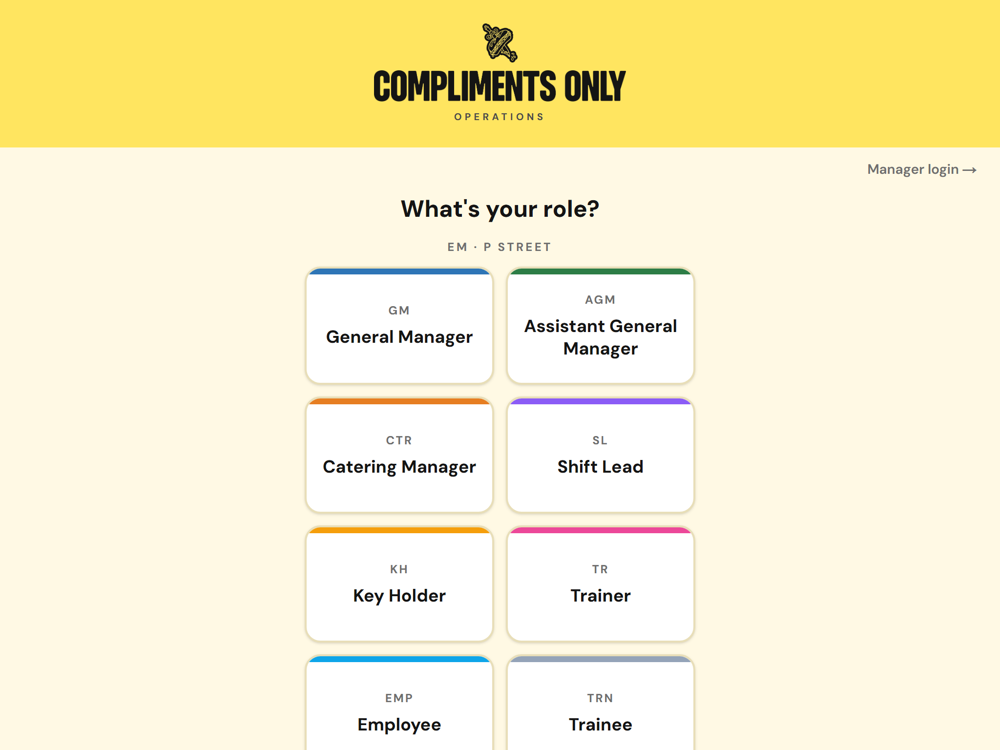

3. On "Who are you?", tap your name.

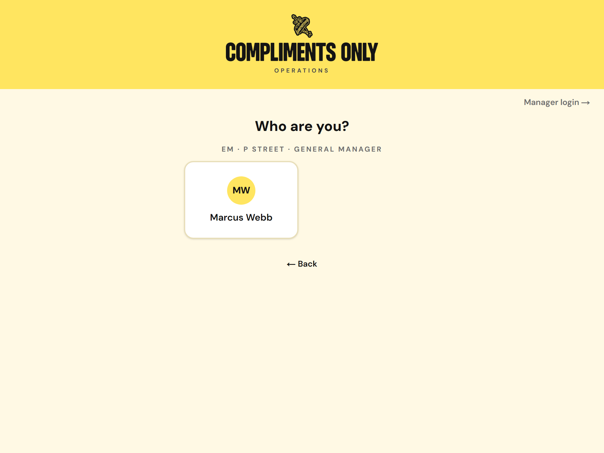

4. Tap your 4-digit PIN. There is no button to press after it. The last digit logs you in.

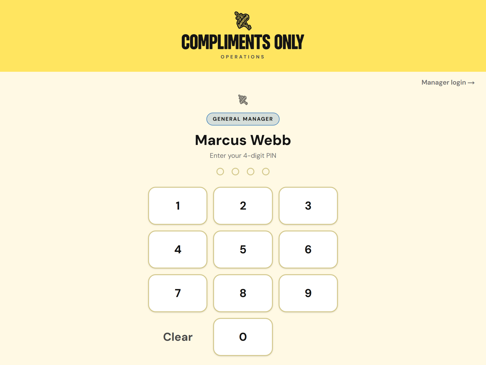

**Worth knowing**

- The login screens are always in English.
- AGM, Catering Manager and up can also use **Manager login →** at the top. It asks for your email and password.
- A wrong PIN shows **Wrong PIN. Try again.** Too many wrong tries lock the account for a while: **Account locked**.
- Too many log-ins from one tablet show **Too many tries** and how long to wait.
- If the keypad gives you trouble, tap **Use system keyboard** and type your PIN.
- The app logs you out after 10 minutes with no taps.

### Get to catering

1. On the dashboard, check the shop at the top.

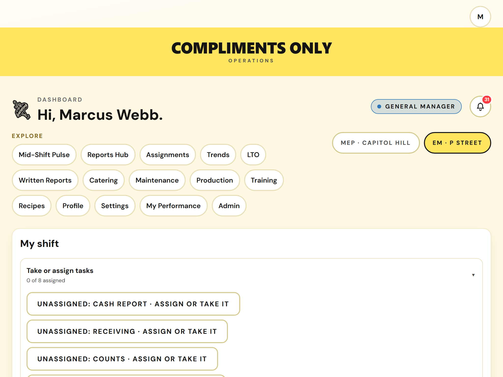

2. If you work at both shops, you see two shop buttons. Tap the shop you want.

3. In **Explore**, tap **Catering**.

**Worth knowing**

- The app opens on the shop you picked at login. If you switch shops, the app remembers the new one. Pages like **Catering Quotes** and **Prep Demand** open on that shop too.
- The **Catering Pipeline** board shows every shop you work at. Each card has a chip with its shop's name.

### Log out

1. Go back to the dashboard.

2. Scroll to the bottom and tap **Log out**.

**Worth knowing**

- You can also tap the round button with your initial at the top right, then **Sign out**.
- There is no "are you sure" box. You land back on "Where are you?".

### En español

Catering en CO-OPS es un tablero y unas cuantas listas. Tomas un prospecto, le pones precio con una cotización y lo vas moviendo hasta que sale la comida. La app también guarda tus clientes, tus cuentas de empresa y tus números.

También puedes leer esta guía en la app. Toca **Capacitación** en el menú **Explorar**.

#### Palabras de la app

| Palabra | Qué significa |
|---|---|
| Tienda | Uno de nuestros dos locales: P Street o Capitol Hill. |
| Dashboard | La página de inicio que ves al entrar. |
| Explorar | La fila de botones del dashboard que abre cada parte de la app. |
| Roles | Tu puesto en la app. Decide qué puedes ver y cambiar. |
| PIN | Tu código de 4 dígitos para entrar. Todos los roles tienen uno. |
| Página de catering | La página **Catering**. Tiene una tarjeta para cada parte del catering. |
| Prospecto | Un trabajo de catering en curso: quién, cuándo y para cuántas personas. |
| Flujo de catering | El tablero con todos los prospectos, en columnas. |
| Etapa | La columna donde está un prospecto, como **Consulta** o **Confirmado**. |
| Personas | Para cuántas personas es la comida. |
| Cotización | El precio que armas para un prospecto, línea por línea. |
| Borrador | Una cotización guardada que todavía no se envía. |
| Paquete | Un pedido armado con su propio precio, como una charola o un lunch. |
| A la carta | Un artículo del menú que agregas solo, como galletas o bebidas. |
| Depósito | La parte del total que el cliente paga por adelantado. La cotización lo muestra como **Depósito requerido**. |
| Toast | La caja registradora de la tienda. |
| Pedido de ezCater | Un pedido de catering hecho en la página de ezCater. Aparece solo. |
| Cliente | Una persona que nos pide catering. |
| Cuenta de empresa | Un negocio al que le hacemos catering, con su gente agrupada. |
| Sin volver | Un cliente o cuenta que no ha pedido en un tiempo. |
| Con consentimiento | La persona aceptó recibir correos de marketing. Solo ellos van en la lista de marketing. |
| Demanda de prep | La comida que la cocina va a necesitar para los caterings confirmados. |
| Pulso de medio turno | Una página en vivo con lo que pasa hoy en la tienda. |
| Nota de entrega | Una nota que dejas para el siguiente turno en el Pulso de medio turno. |
| Confirmación de contraseña | Algunos cambios piden tu contraseña, no tu PIN. |
| Guardado | La app guardó tu trabajo. En catering casi nunca sale un mensaje de "guardado". La tarjeta o página nueva te dice que funcionó. |

#### Quién puede hacer qué

- **Líder de Turno:** puede abrir Catering y leer el tablero, las cotizaciones, los clientes, las empresas y el panel. No puede cambiar nada.
- **Subgerente General y Gerente de Catering:** agregan, corrigen y mueven prospectos, arman y envían cotizaciones, y editan clientes y empresas. En la configuración: paquetes, preguntas frecuentes, demanda de prep y LTO.
- **Gerente General:** todo eso, más el menú de catering, la capacidad, las zonas de entrega, las páginas de clientes y las ventas.
- **Gerente de Operaciones y arriba:** precios, impuestos y tarifas de catering.
- **Gerente de Catering, o Gerente de Operaciones y arriba:** mover un pedido a la otra tienda y revisar artículos de ezCater.
- **Dueño y Estratega de Crecimiento:** ven el correo y el teléfono de una persona en la página **Clientes** de Admin, y descargan la lista de marketing.

#### Entrar

Lo haces cada vez que tomas la tablet. Las pantallas de entrada siempre salen en inglés.

1. En "Where are you?", toca tu tienda.

2. En "What's your role?", toca tu rol: AGM, CTR (Catering Manager) o GM.

3. En "Who are you?", toca tu nombre.

4. Marca tu PIN de 4 dígitos. No hay botón para terminar. El último dígito te deja entrar.

- Subgerente General, Gerente de Catering y arriba también pueden usar "Manager login →" arriba. Pide tu correo y contraseña.
- Si el PIN está mal, sale "Wrong PIN. Try again." Muchos intentos fallidos bloquean la cuenta un rato: "Account locked".
- Si entran muchas veces desde la misma tablet, sale "Too many tries" y cuánto tiempo esperar.
- Si el teclado te da problemas, toca "Use system keyboard" y escribe tu PIN.
- La app cierra tu sesión después de 10 minutos sin tocar nada.

#### Llegar a catering

1. En el dashboard, revisa la tienda de arriba.

2. Si trabajas en las dos tiendas, ves dos botones de tienda. Toca la que quieres.

3. En **Explorar**, toca **Catering**.

- La app abre en la tienda que escogiste al entrar. Si cambias de tienda, la app recuerda la nueva. Páginas como **Cotizaciones de Catering** y **Demanda de Prep** también abren en esa tienda.
- El tablero **Flujo de catering** muestra todas las tiendas donde trabajas. Cada tarjeta tiene una etiqueta con el nombre de su tienda.

#### Salir

1. Regresa al dashboard.

2. Baja hasta el final y toca **Cerrar sesión**.

- También puedes tocar el botón redondo con tu inicial, arriba a la derecha, y luego **Cerrar sesión**.
- No sale ningún "¿estás seguro?". Regresas a "Where are you?".

## The hub

The **Catering** page is where every catering job starts. Shift leads and up can open it.

### Open the catering hub

1. On the dashboard, tap **Catering** in **Explore**.

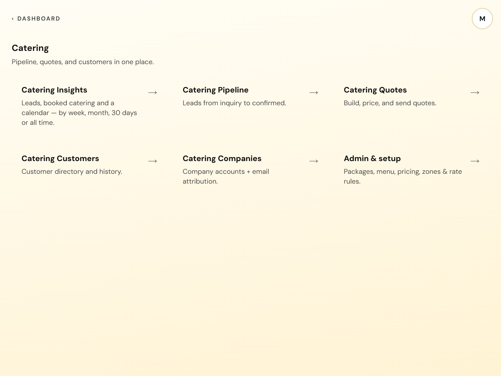

2. Tap the card you need.

**Worth knowing**

- **Catering Pipeline** is the board of leads. You use it most.
- **Catering Quotes** is where you build and price quotes.
- **Catering Customers** lists the people who order.
- **Catering Companies** lists the businesses we cater for.
- **Catering Insights** shows your numbers and a calendar.
- **Admin & setup** shows only for AGM, Catering Manager and up. It opens the setup pages.

### Catering on the Mid-Shift Pulse

The shop team can follow catering here during the day.

1. On the dashboard, tap **Mid-Shift Pulse** in **Explore**.

2. Find the **Catering** section. It shows the jobs **Due today** and the jobs booked for tomorrow. It shows if the AM and mid-day prep have started. Under **Not rung into Toast**, it lists ezCater orders that still need to go into Toast.

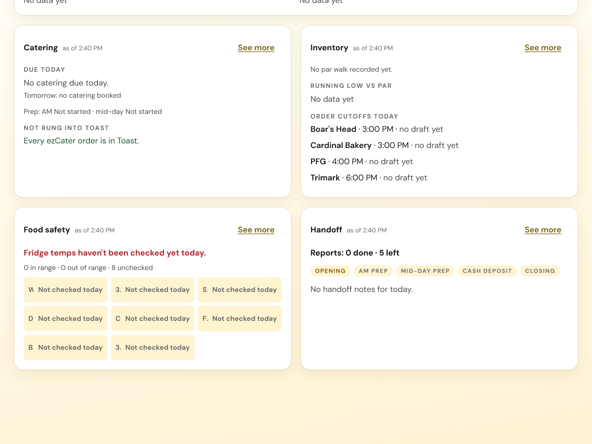

3. To leave a note for the next shift, open the **Handoff** section.

4. Tap **Write a handoff note** and pick who sees it: **For crew**, **For managers** or **For everyone**.

5. Tap **Post note**.

**Worth knowing**

- With no jobs, the section says **No catering due today.** and **Every ezCater order is in Toast.**
- The **Catering** section shows no money. The sales money on the Pulse shows only for the GM and up.
- AGM, Catering Manager and up can write notes and tap **Got it** on a note they read.
- The photo shows the **Handoff** section with no notes. Steps 4 and 5 are not in a photo.

### En español

La página **Catering** es donde empieza todo trabajo de catering. Los líderes de turno y arriba pueden abrirla.

#### Abrir la página de catering

1. En el dashboard, toca **Catering** en **Explorar**.

2. Toca la tarjeta que necesitas.

- **Flujo de catering** es el tablero de prospectos. Es la que más vas a usar.
- **Cotizaciones de Catering** es donde armas y pones precio a las cotizaciones.
- **Clientes de catering** es la lista de personas que piden.
- **Empresas de Catering** es la lista de negocios a los que les hacemos catering.
- **Panel de Catering** muestra tus números y un calendario.
- **Administración y configuración** sale solo para Subgerente General, Gerente de Catering y arriba. Abre las páginas de configuración.

#### Catering en el Pulso de medio turno

El equipo de la tienda puede seguir el catering aquí durante el día.

1. En el dashboard, toca **Pulso de medio turno** en **Explorar**.

2. Busca la sección **Catering**. Muestra los trabajos **Para hoy** y los que hay para mañana. Muestra si ya empezó la prep de la mañana y la de mediodía. En **Sin registrar en Toast** salen los pedidos de ezCater que faltan por pasar a Toast.

3. Para dejar una nota al siguiente turno, abre la sección **Entrega de turno**.

4. Toca **Escribir una nota de entrega** y escoge quién la ve: **Para el equipo**, **Para gerentes** o **Para todos**.

5. Toca **Publicar nota**.

- Si no hay trabajos, la sección dice **No hay catering para hoy.** y **Todos los pedidos de ezCater están en Toast.**
- La sección **Catering** no muestra dinero. El dinero de ventas en el Pulso solo lo ve el Gerente General y arriba.
- Subgerente General, Gerente de Catering y arriba pueden escribir notas y tocar **Recibido** en una nota que leyeron.
- La foto muestra la sección **Entrega de turno** sin notas. Los pasos 4 y 5 no salen en foto.

## The pipeline

The pipeline is the board of leads. Each lead is a card. Each column is a stage, in this order: **Inquiry**, **Quote sent**, **Confirmed**, **Out for delivery**, **Completed** and **Lost**. Shift leads can look. AGM, Catering Manager and up can add, fix and move leads.

### Read the board

1. On the hub, tap **Catering Pipeline**.

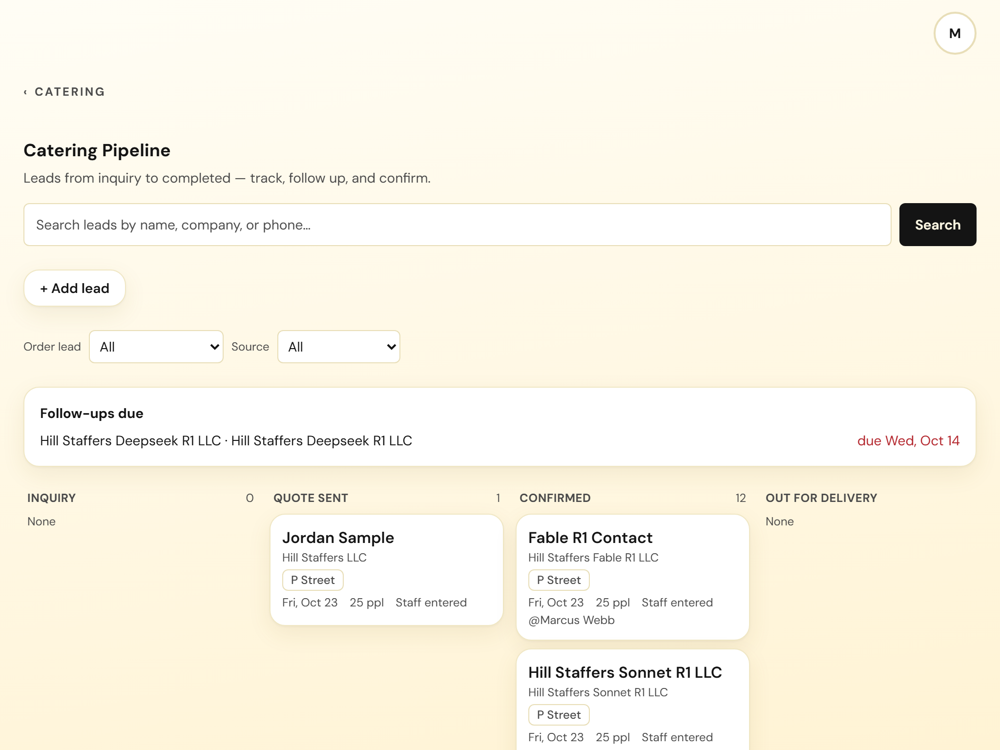

**Worth knowing**

- An empty column says **None**.
- The board shows every shop you work at. The chip on each card names the shop.
- The search box finds leads by name, company or phone. Type, then tap **Search**. It does not find ezCater leads by the word "ezCater". Use **Source** for that.
- If no lead matches, the page says **No leads match** and your words. Tap **Clear search** to go back to the board.
- Phone numbers come in with ezCater and online leads. The **Add lead** form has no phone box.
- **Order lead** shows only the leads of one person. **Source** shows only the leads that came in one way, like **Phone** or **EZCater**.
- On a small screen, the last columns are off to the right.

### Add a lead

You do this when someone calls, emails or walks in about catering.

1. Tap **+ Add lead**.

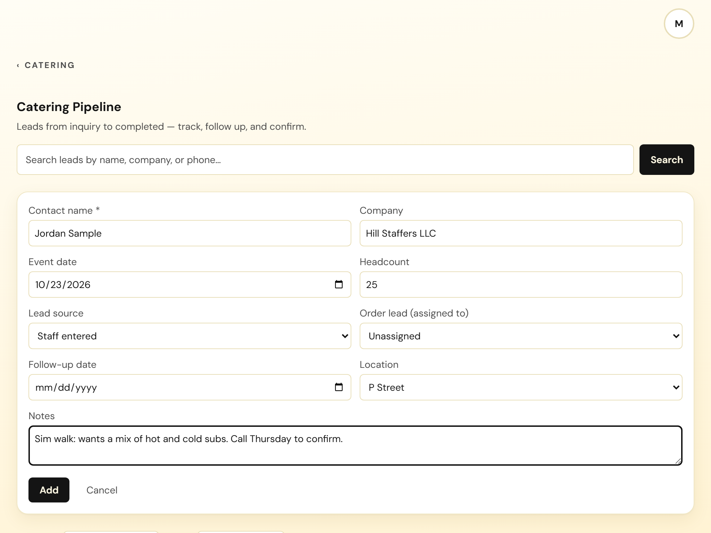

2. Type the **Contact name**. It is the only box you must fill in. If you only know the company, type the company name here. You can fix it later.

3. Fill in what you know: **Company**, **Event date**, **Headcount** and **Follow-up date**.

4. Check **Lead source**. It starts on **Staff entered**.

5. Under **Order lead (assigned to)**, pick who will follow up.

6. Set **Location** to the shop that will make the food. It starts on **No location (global)**, so change it.

7. Type your notes in **Notes**. Put in what they asked for and what you promised.

8. Tap **Add**.

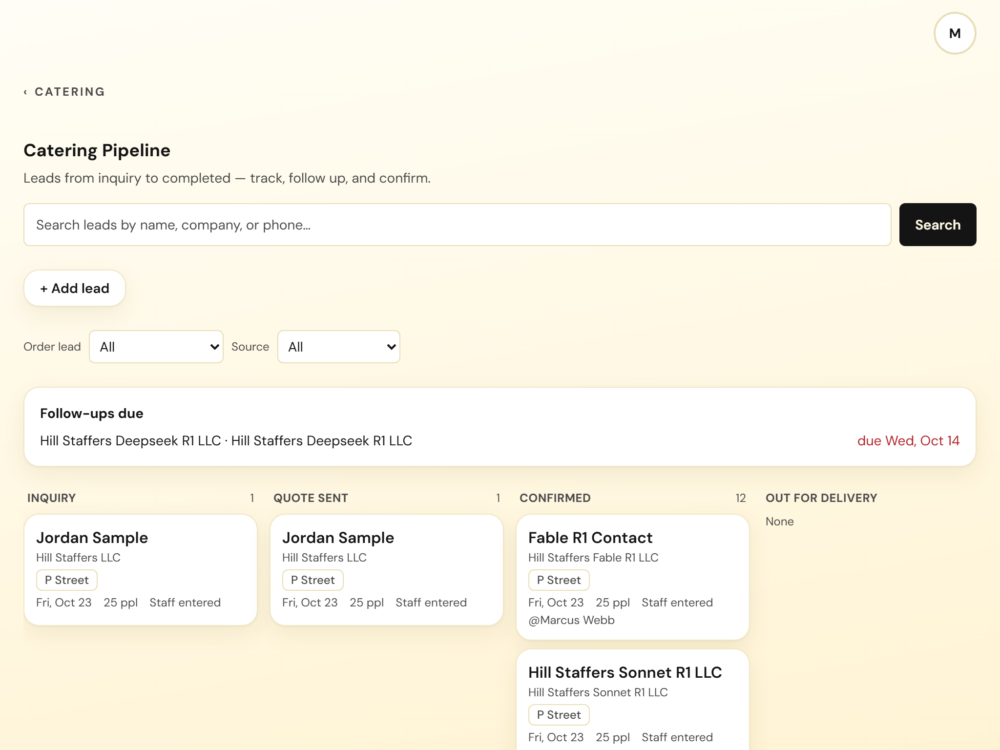

**Worth knowing**

- Write what you know now. You can add or fix notes later with **Edit details**.
- The form has no phone or email box. Put the email on the quote instead.
- There is no "saved" message. The new card in **Inquiry** is your sign it worked.
- Every new lead starts in **Inquiry**.

### Open a lead

1. Tap the card. It opens right there on the board.

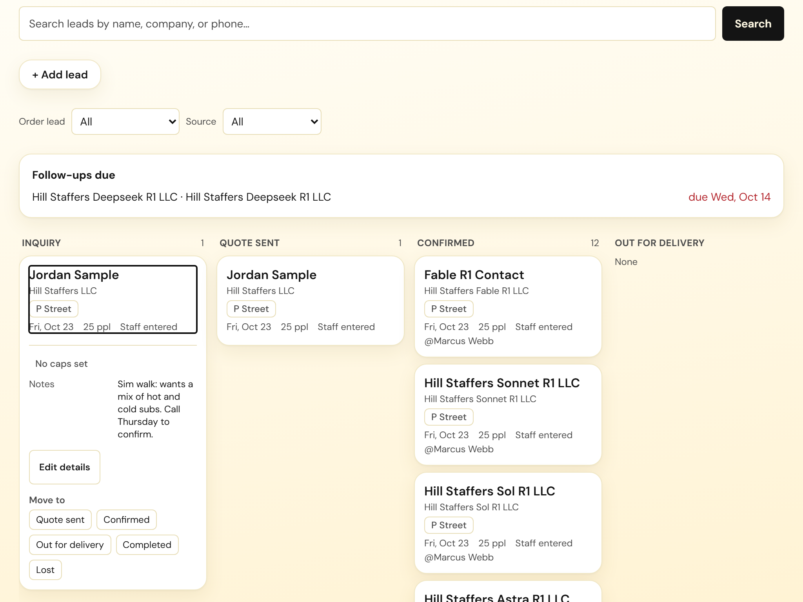

2. Tap the card again to close it.

**Worth knowing**

- There is no separate lead page. The card is the lead.
- The card shows the name, company, shop, date, headcount and source. Open it to see the notes and the follow-up date.
- **No caps set** shows on a lead with an event date. It means no booking limits are set for that shop yet. See **Capacity & Blackouts** in [Setup](#setup).

### Fix a lead

You do this when the client changes the date or the headcount, or you have a new note.

1. Open the card.

2. Tap **Edit details**.

3. The form opens inside the card, above **Move to**. Change what you need: **Contact name**, **Company**, **Event date**, **Headcount**, **Follow-up date** or **Notes**.

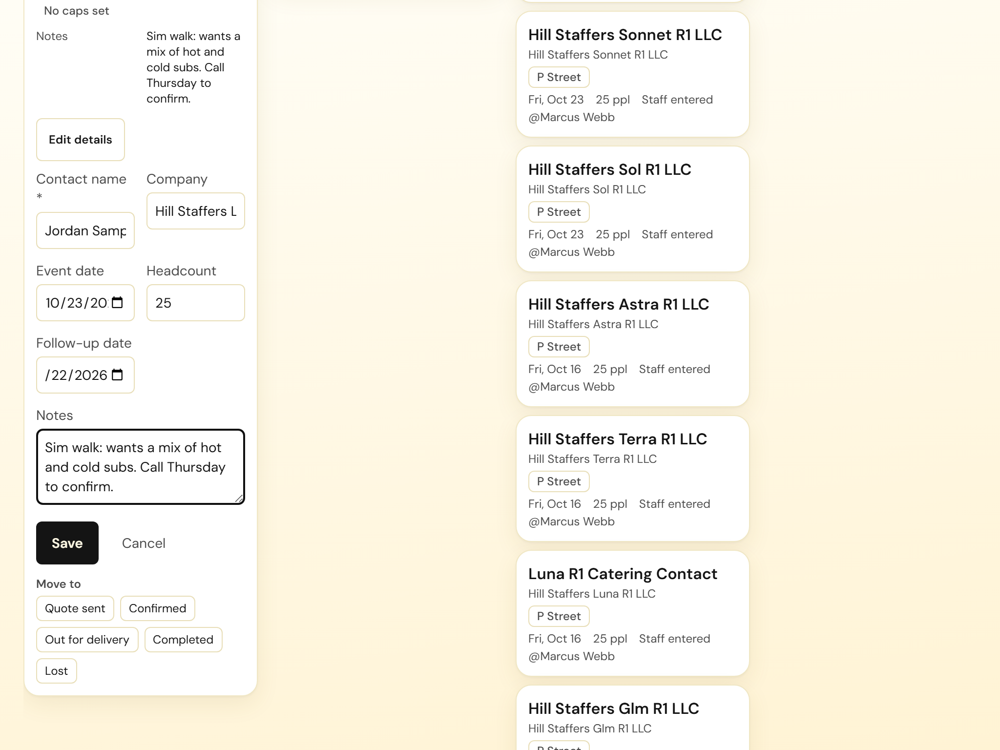

4. Tap **Save**. The form closes. The card stays open and shows your changes. A new follow-up date shows as **Follow-up date** on the card.

**Worth knowing**

- AGM, Catering Manager and up can do this.
- **Cancel** closes the form and keeps the lead as it was.
- The shop and the source can't change here. To change the shop, see "Move an order to the other shop" below.
- The form has no phone or email box.

### Move a lead

You do this each time a job moves forward.

1. Open the card.

2. Under **Move to**, tap the stage you want.

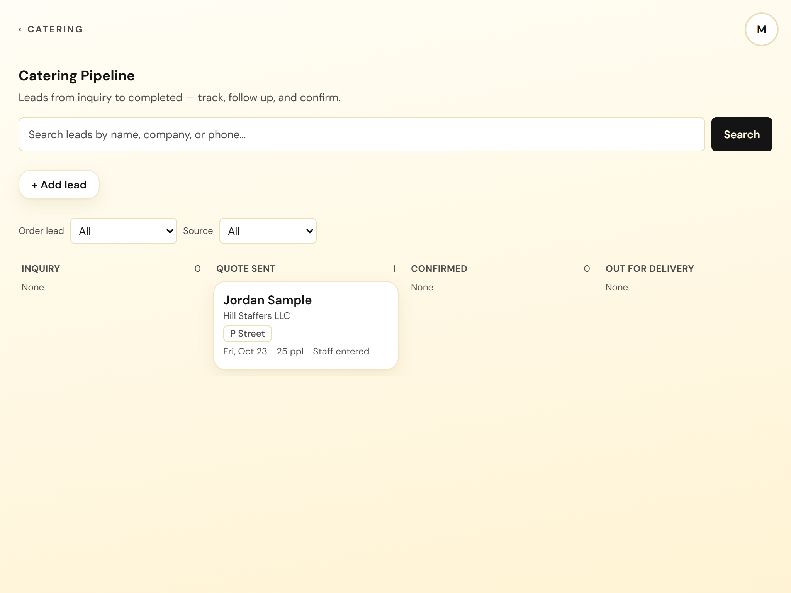

**Worth knowing**

- One tap moves it. There is no "are you sure" box. The card closes after the move.
- You can skip ahead.
- You can only go back from **Quote sent** or **Confirmed**.
- **Lost** works from any open stage.
- **Completed** and **Lost** are final. The lead can't move after that.
- **Confirmed** tells the kitchen to plan the food. This works only if the lead has a quote with an event date, picked under **Pipeline lead**. **Out for delivery** and **Completed** count that food as used. Going back to **Inquiry** or **Quote sent**, or moving to **Lost**, takes it off the plan.
- A lead with no quote can still move to **Confirmed**. The kitchen gets nothing to plan.
- When the client says yes, mark the quote accepted before you move the lead. See [When the client says yes](#when-the-client-says-yes).

### Move an order to the other shop

Only the Catering Manager, or a Manager of Operations and up, can do this. A GM or an AGM does not see the button. It is not shown in photos.

1. Open the card.

2. Tap **Move to other shop**.

3. Pick the **Destination shop** and a **Reason**. If the reason is **Other**, a note is a must.

4. Tap **Confirm move**. Enter your password if it asks.

**Worth knowing**

- The order's food and money go with it. Prep already done stays at the first shop.

### En español

El flujo de catering es el tablero de prospectos. Cada prospecto es una tarjeta. Cada columna es una etapa, en este orden: **Consulta**, **Cotización enviada**, **Confirmado**, **En reparto**, **Completado** y **Perdido**. Los líderes de turno pueden ver. Subgerente General, Gerente de Catering y arriba pueden agregar, corregir y mover prospectos.

#### Leer el tablero

1. En la página de catering, toca **Flujo de catering**.

- Una columna vacía dice **Ninguno**.
- El tablero muestra todas las tiendas donde trabajas. La etiqueta de cada tarjeta dice la tienda.
- El buscador encuentra prospectos por nombre, empresa o teléfono. Escribe y toca **Buscar**. No encuentra los de ezCater con la palabra "ezCater". Para eso usa **Origen**.
- Si ningún prospecto coincide, la página dice **No hay prospectos que coincidan** con tus palabras. Toca **Limpia la búsqueda** para volver al tablero.
- Los teléfonos llegan con los prospectos de ezCater y los de internet. El formulario **Agregar prospecto** no tiene casilla de teléfono.
- **Líder del pedido** muestra solo los prospectos de una persona. **Origen** muestra solo los que llegaron de una forma, como **Teléfono** o **EZCater**.
- En una pantalla chica, las últimas columnas quedan a la derecha.

#### Agregar un prospecto

Lo haces cuando alguien llama, escribe o llega a preguntar por catering.

1. Toca **+ Agregar prospecto**.

2. Escribe el **Nombre de contacto**. Es lo único obligatorio. Si solo sabes la empresa, escribe aquí el nombre de la empresa. Lo puedes corregir después.

3. Llena lo que sepas: **Empresa**, **Fecha del evento**, **Personas** y **Fecha de seguimiento**.

4. Revisa **Origen**. Empieza en **Ingresado por el equipo**.

5. En **Líder del pedido (asignado a)**, escoge quién le da seguimiento.

6. Pon en **Ubicación** la tienda que va a hacer la comida. Empieza en **Sin ubicación (global)**, así que cámbiala.

7. Escribe tus notas en **Notas**. Pon lo que pidieron y lo que prometiste.

8. Toca **Agrega**.

- Escribe ahora lo que sepas. Puedes agregar o corregir notas después con **Editar datos**.
- El formulario no tiene casilla de teléfono ni de correo. Pon el correo en la cotización.
- No sale mensaje de "guardado". La tarjeta nueva en **Consulta** te dice que funcionó.
- Todo prospecto nuevo empieza en **Consulta**.

#### Abrir un prospecto

1. Toca la tarjeta. Se abre ahí mismo en el tablero.

2. Tócala otra vez para cerrarla.

- No hay una página aparte para el prospecto. La tarjeta es el prospecto.
- La tarjeta muestra el nombre, la empresa, la tienda, la fecha, las personas y el origen. Ábrela para ver las notas y la fecha de seguimiento.
- **Sin límites configurados** sale en un prospecto con fecha del evento. Quiere decir que esa tienda todavía no tiene límites de reservas. Mira **Capacidad y bloqueos** en la configuración.

#### Corregir un prospecto

Lo haces cuando el cliente cambia la fecha o las personas, o tienes una nota nueva.

1. Abre la tarjeta.

2. Toca **Editar datos**.

3. El formulario se abre dentro de la tarjeta, arriba de **Mover a**. Cambia lo que necesites: **Nombre de contacto**, **Empresa**, **Fecha del evento**, **Personas**, **Fecha de seguimiento** o **Notas**.

4. Toca **Guarda**. El formulario se cierra. La tarjeta sigue abierta y muestra tus cambios. Una fecha de seguimiento nueva sale como **Fecha de seguimiento** en la tarjeta.

- Subgerente General, Gerente de Catering y arriba pueden hacerlo.
- **Cancela** cierra el formulario y deja el prospecto como estaba.
- Aquí no se cambian la tienda ni el origen. Para cambiar la tienda, mira "Mover un pedido a la otra tienda" abajo.
- El formulario no tiene casilla de teléfono ni de correo.

#### Mover un prospecto

Lo haces cada vez que un trabajo avanza.

1. Abre la tarjeta.

2. En **Mover a**, toca la etapa que quieres.

- Un toque lo mueve. No sale ningún "¿estás seguro?". La tarjeta se cierra después.
- Puedes saltarte etapas hacia adelante.
- Solo puedes regresar desde **Cotización enviada** o **Confirmado**.
- **Perdido** funciona desde cualquier etapa abierta.
- **Completado** y **Perdido** son finales. Ya no se puede mover.
- **Confirmado** le dice a la cocina que planee la comida. Solo funciona si el prospecto tiene una cotización con fecha del evento, escogida en **Prospecto**. **En reparto** y **Completado** cuentan esa comida como usada. Regresar a **Consulta** o **Cotización enviada**, o pasar a **Perdido**, la quita del plan.
- Un prospecto sin cotización también puede pasar a **Confirmado**. La cocina no recibe nada que planear.
- Cuando el cliente dice que sí, marca la cotización como aceptada antes de mover el prospecto. Mira "Cuando el cliente dice que sí" en Cotizaciones.

#### Mover un pedido a la otra tienda

Solo el Gerente de Catering, o el Gerente de Operaciones y arriba, puede hacerlo. Un Gerente General o un Subgerente General no ve el botón. No sale en fotos.

1. Abre la tarjeta.

2. Toca **Mover a otra tienda**.

3. Escoge la **Tienda de destino** y un **Motivo**. Si el motivo es **Otro**, la nota es obligatoria.

4. Toca **Confirmar cambio**. Escribe tu contraseña si te la pide.

- La comida y el dinero del pedido se van con él. La prep que ya se hizo se queda en la primera tienda.

## Quotes

A quote is the price for a lead, line by line. AGM, Catering Manager and up can build one. Shift leads can look.

### Start a quote

1. On the hub, tap **Catering Quotes**.

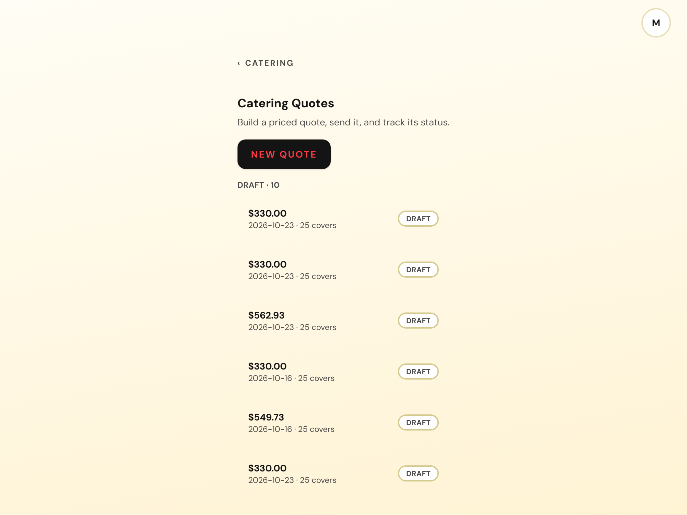

2. Tap **New quote**.

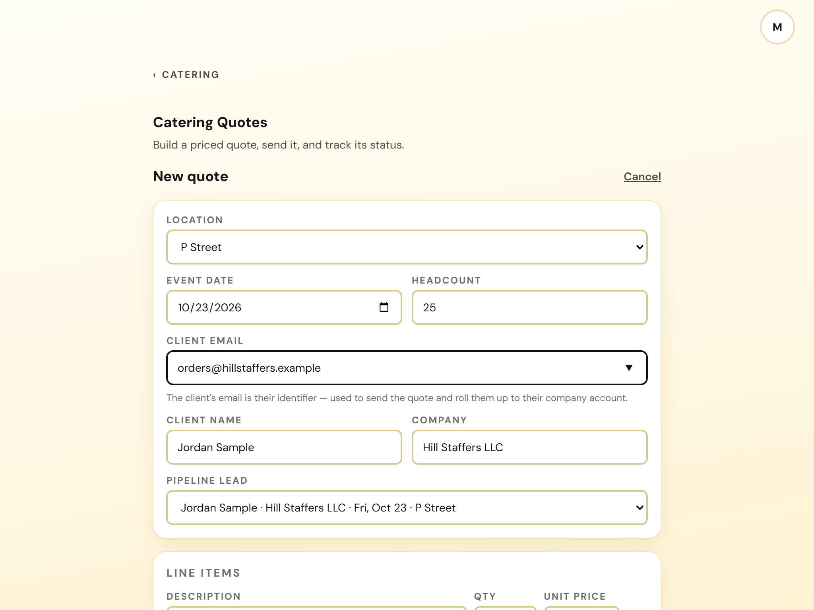

3. Under **Pipeline lead**, pick the lead this quote is for. Don't skip it. The kitchen plans the food from this quote when the lead moves to **Confirmed**.

4. Check **Location**, **Event date** and **Headcount**.

5. Type the **Client email**. Check **Client name** and **Company**.

**Worth knowing**

- Each lead in the list shows the contact, company, date and shop. That helps when two leads have the same name.
- Picking the lead fills in **Client name**, **Company**, **Event date** and **Headcount** if they are empty. It also sets **Location** to the lead's shop. It never fills in the email.
- **Location** starts on your shop.
- The screen says the client's email is how the app knows them. It is used to send the quote.
- Type a **Client email** the app already knows and it fills in **Client name** and **Company**. The box suggests known emails as you type.
- When you save a quote with a **Client email**, that person shows up in **Catering Customers**. The lead you picked shows on their page too.
- The email may belong to a client of the other shop. The quote still goes to that client, but you don't see their contact details.

### Add packages and items

1. Pick a package in **Add package**. It drops in as lines. The first one fills the empty line the quote starts with.

2. Pick single items in **Add à la carte**.

3. Fix each line's **Qty** and **Unit price** if you need to.

4. Tap the **×** on a line you don't want.

**Worth knowing**

- **Qty** never follows the headcount. Change it yourself.
- Some packages are priced per person, like **Light Lunch**. The **Packages** page marks them **Per head**. They come in at **Qty** 1. For 25 people, set **Qty** to 25. If you leave it at 1, you quote one lunch.
- A platter comes in as one line at **Qty** 1 with the platter's price. Leave it at 1 for one platter. It is not priced per person.
- An à la carte line starts at **Qty** 1.
- A package also adds a line that starts with "Choose your sub". Its **Qty** is the number of subs in the package. It has no price and adds no money.
- The app has no sub picker yet. Write the sub mix in the **Notes** box, like "10 turkey, 10 Italian, 5 veggie".
- A new quote starts with one empty line. Your first package or item takes its place.
- An à la carte item comes in with its price filled in.
- Tick **Delivery** if you will bring the food.
- Use the **Notes** box at the bottom for anything else.

### Check the totals and save

1. Scroll to the bottom of the form.

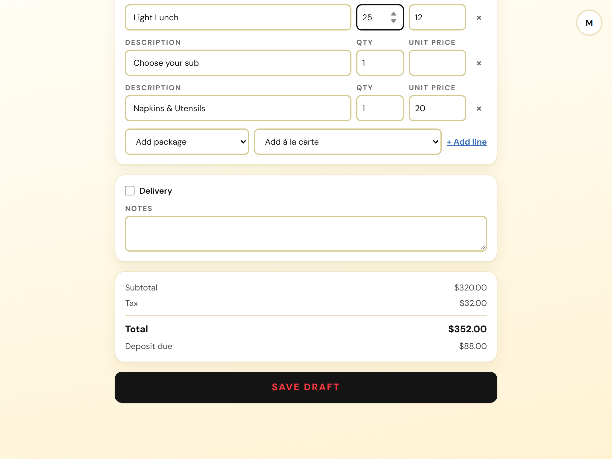

2. Read **Subtotal** and **Total**. **Tax** and **Deposit due** show too, but only when they apply.

3. Tap **Save draft**.

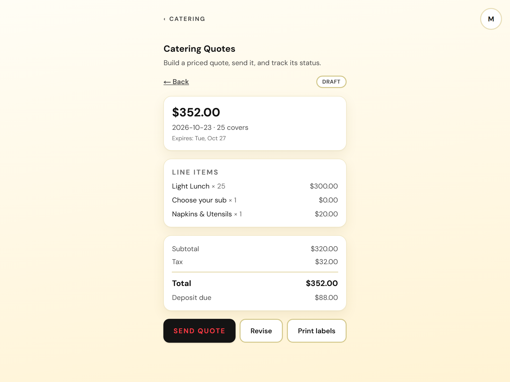

**Worth knowing**

- The totals change as you type.
- **Deposit due** is the part the client pays up front.
- A line with $0 does not show. That goes for **Tax**, **Deposit due**, **Delivery**, **Service charge** and **Gratuity**.
- The screen does not show the tax rate or the deposit rate.
- There is no "saved" message. The quote's own page opening is your sign it worked.
- You may see a message that starts with *No pricing rule for this location*. It means that shop has no prices set up yet. Tax and the other charges show $0 until a Manager of Operations sets them in **Pricing & Tax**. Ask them before you send the quote.

### Read the saved quote

**What you see:** the status (**draft** at first), the total, the date, the headcount, **Client**, **Lead**, **Expires**, the lines and the totals.

**What to do:** read every line back. Check that **Lead** names the right lead. Fix mistakes with **Revise** before you send.

**Worth knowing**

- **Client** shows the name, company and email. **Lead** shows the lead's contact, company and date.
- For a client of the other shop, **Client** says **another shop's client (contact details hidden)**.
- A quote can be **draft**, **sent**, **accepted**, **declined** or **expired**.
- **Send quote** marks the quote as sent and tries to email the client. Enter your password if it asks. This is not shown in photos.
- Read the message that appears after you send. It tells you if the email went out.
- If it says the email could not be delivered, send the price yourself and tell your GM.
- With no **Client email**, the quote is still marked sent. The message says nothing was emailed.
- After you send, the button says **Resend**.
- **Revise** lets you change it.
- **Print labels** opens labels you can print.
- **Mark accepted** and **Mark declined** show only after you send the quote.
- Move the lead on the board yourself with **Move to**.

### When the client says yes

You do this when the client agrees to the price. It tells the kitchen and the numbers that the job is real.

1. On **Catering Quotes**, open the quote.

2. If it is still a draft, tap **Send quote**. Enter your password if it asks.

3. Tap **Mark accepted**.

4. Go to **Catering Pipeline** and open the lead.

5. Under **Move to**, tap **Confirmed**.

**Worth knowing**

- Do all the steps. If you skip **Mark accepted**, the kitchen still plans the food. But **Catering Insights** shows the job as $0.
- To check the kitchen got it, open **Prep Demand** in setup. A job in the next 14 days shows on its event date.
- If the client says no, tap **Mark declined**. Then move the lead to **Lost**.
- These steps are not shown in photos.

### En español

Una cotización es el precio de un prospecto, línea por línea. Subgerente General, Gerente de Catering y arriba pueden armarla. Los líderes de turno pueden verla.

#### Empezar una cotización

1. En la página de catering, toca **Cotizaciones de Catering**.

2. Toca **Nueva cotización**.

3. En **Prospecto**, escoge el prospecto de esta cotización. No te lo saltes. La cocina planea la comida con esta cotización cuando el prospecto pasa a **Confirmado**.

4. Revisa **Ubicación**, **Fecha del evento** y **Personas**.

5. Escribe el **Correo del cliente**. Revisa el **Nombre del cliente** y la **Empresa**.

- Cada prospecto de la lista muestra el contacto, la empresa, la fecha y la tienda. Así distingues dos prospectos con el mismo nombre.
- Escoger el prospecto llena el **Nombre del cliente**, la **Empresa**, la **Fecha del evento** y las **Personas** si están vacíos. También pone la **Ubicación** en la tienda del prospecto. Nunca llena el correo.
- La **Ubicación** empieza en tu tienda.
- La pantalla dice que el correo del cliente es como la app lo reconoce. Se usa para enviar la cotización.
- Si escribes un **Correo del cliente** que la app ya conoce, llena el **Nombre del cliente** y la **Empresa**. La casilla te sugiere correos conocidos mientras escribes.
- Cuando guardas una cotización con **Correo del cliente**, esa persona aparece en **Clientes de catering**. El prospecto que escogiste también sale en su página.
- El correo puede ser de un cliente de la otra tienda. La cotización igual va a ese cliente, pero no ves sus datos de contacto.

#### Agregar paquetes y artículos

1. Escoge un paquete en **Agregar paquete**. Entra como líneas. El primero llena la línea vacía con la que empieza la cotización.

2. Escoge artículos sueltos en **Agregar a la carta**.

3. Corrige la **Cant.** y el **Precio unit.** de cada línea si hace falta.

4. Toca la **×** de la línea que no quieres.

- La **Cant.** nunca sigue a las personas. Cámbiala tú.
- Algunos paquetes tienen precio por persona, como **Light Lunch**. La página **Paquetes** los marca **Por persona**. Entran con **Cant.** 1. Para 25 personas, pon la **Cant.** en 25. Si la dejas en 1, cotizas un solo lunch.
- Una charola entra como una línea con **Cant.** 1 y el precio de la charola. Déjala en 1 para una charola. No tiene precio por persona.
- Una línea a la carta empieza en **Cant.** 1.
- Un paquete también agrega una línea que empieza con "Choose your sub". Su **Cant.** es el número de subs del paquete. No tiene precio y no suma dinero.
- La app todavía no tiene dónde escoger los subs. Escribe la mezcla de subs en la casilla **Notas**, por ejemplo "10 de pavo, 10 italianos, 5 vegetarianos".
- Una cotización nueva empieza con una línea vacía. Tu primer paquete o artículo toma su lugar.
- Un artículo a la carta entra con su precio ya puesto.
- Marca **Entrega a domicilio** si vas a llevar la comida.
- Usa la casilla **Notas** de abajo para lo demás.

#### Revisar los totales y guardar

1. Baja hasta el final del formulario.

2. Lee **Subtotal** y **Total**. **Impuesto** y **Depósito requerido** también salen, pero solo cuando aplican.

3. Toca **Guardar borrador**.

- Los totales cambian mientras escribes.
- **Depósito requerido** es la parte que el cliente paga por adelantado.
- Una línea en $0 no sale. Eso pasa con **Impuesto**, **Depósito requerido**, **Entrega**, **Cargo por servicio** y **Propina**.
- La pantalla no muestra la tasa de impuesto ni la del depósito.
- No sale mensaje de "guardado". Se abre la página de la cotización y así sabes que funcionó.
- Puede salir un mensaje que empieza con *No hay regla de precios para esta ubicación*. Quiere decir que esa tienda todavía no tiene precios configurados. El impuesto y los otros cargos salen en $0 hasta que un Gerente de Operaciones los configure en **Precios e impuestos**. Pregúntale antes de enviar la cotización.

#### Leer la cotización guardada

**Qué ves:** el estado (al principio **borrador**), el total, la fecha, las personas, **Cliente**, **Prospecto**, **Vence**, las líneas y los totales.

**Qué haces:** lee cada línea. Revisa que **Prospecto** diga el prospecto correcto. Corrige errores con **Revisar** antes de enviar.

- **Cliente** muestra el nombre, la empresa y el correo. **Prospecto** muestra el contacto, la empresa y la fecha del prospecto.
- Si es cliente de la otra tienda, **Cliente** dice **cliente de otra tienda (datos de contacto ocultos)**.
- Una cotización puede estar en **borrador**, **enviada**, **aceptada**, **rechazada** o **vencida**.
- **Enviar cotización** marca la cotización como enviada y trata de mandarle un correo al cliente. Escribe tu contraseña si te la pide. No sale en fotos.
- Lee el mensaje que sale después de enviar. Te dice si el correo salió.
- Si dice que el correo no pudo entregarse, mándale tú el precio al cliente y avisa a tu GM.
- Sin **Correo del cliente**, la cotización igual queda como enviada. El mensaje dice que no se mandó ningún correo.
- Después de enviar, el botón dice **Reenviar**.
- **Revisar** te deja cambiarla.
- **Imprimir etiquetas** abre etiquetas para imprimir.
- **Marcar aceptada** y **Marcar rechazada** salen solo después de enviar la cotización.
- Mueve tú el prospecto en el tablero con **Mover a**.

#### Cuando el cliente dice que sí

Lo haces cuando el cliente acepta el precio. Así la cocina y los números saben que el trabajo va.

1. En **Cotizaciones de Catering**, abre la cotización.

2. Si todavía es borrador, toca **Enviar cotización**. Escribe tu contraseña si te la pide.

3. Toca **Marcar aceptada**.

4. Ve a **Flujo de catering** y abre el prospecto.

5. En **Mover a**, toca **Confirmado**.

- Haz todos los pasos. Si te saltas **Marcar aceptada**, la cocina igual planea la comida. Pero el **Panel de Catering** muestra el trabajo en $0.
- Para revisar que la cocina lo recibió, abre **Demanda de Prep** en la configuración. Un trabajo de los próximos 14 días sale en su fecha del evento.
- Si el cliente dice que no, toca **Marcar rechazada**. Luego pasa el prospecto a **Perdido**.
- Estos pasos no salen en fotos.

## ezCater orders

Orders placed on ezCater come into CO-OPS on their own. You don't type them in.

### Find an ezCater order

1. Open **Catering Pipeline**.

2. Set **Source** to **EZCater**.

3. Tap a card to open it. An ezCater lead has an **ezCater order** box with the order's details.

**Worth knowing**

- This is not shown in photos. Our practice board had no ezCater orders.
- Check the shop on the card. It tells you which shop makes the food.
- The search box does not find ezCater orders by the word "ezCater". Use **Source**.

### When there are no ezCater orders

Some days no ezCater order comes in. Here is how that looks, so you know you are in the right place.

- On **Catering Pipeline**, with **Source** on **EZCater**, every column says **None**.
- The **Not in Toast yet** panel does not show.
- On **Catering sales**, it says **0 ezCater orders** and **Nothing in this range.**
- On the **Mid-Shift Pulse**, the **Catering** section says **Every ezCater order is in Toast.**

**Worth knowing**

- That is not an error. There is nothing to do. Check again later.
- If you expected an order and it is not there, tell your GM.

### Ring ezCater orders into Toast

1. On **Catering Pipeline**, look for the **Not in Toast yet** panel. It lists ezCater orders not yet rung into Toast.

2. When the list has 10 or more orders, a search box shows. Use it to find one by code, shop or date.

3. Ring each order into Toast.

**Worth knowing**

- The panel shows only when there is an order to list. It is not shown in photos.
- The GM can check the match later in **Catering sales**. See [Insights and sales](#insights-and-sales).

### Review ezCater items

Only the Catering Manager, or a Manager of Operations and up, can do this. It is not shown in photos.

1. Go to **Admin**, then **Catering**, then **ezCater item review**.

2. Look at each item. Read the line that says "Suggested match:" and an item name.

3. Tap **Approve** if it is right. Tap **Pick another** if it is wrong.

**Worth knowing**

- If you are not sure, leave it. Don't match an item just to clear the list.
- If the line says "Suggested match: Choose a match", the app has no guess. **Approve** stays grey. Tap **Pick another**.

### En español

Los pedidos hechos en ezCater llegan solos a CO-OPS. No los escribes tú.

#### Encontrar un pedido de ezCater

1. Abre **Flujo de catering**.

2. Pon **Origen** en **EZCater**.

3. Toca una tarjeta para abrirla. Un prospecto de ezCater tiene un recuadro **Pedido de ezCater** con los datos del pedido.

- No sale en fotos. Nuestro tablero de práctica no tenía pedidos de ezCater.
- Revisa la tienda en la tarjeta. Te dice qué tienda hace la comida.
- El buscador no encuentra pedidos de ezCater con la palabra "ezCater". Usa **Origen**.

#### Cuando no hay pedidos de ezCater

Algunos días no llega ningún pedido de ezCater. Así se ve, para que sepas que estás en el lugar correcto.

- En **Flujo de catering**, con **Origen** en **EZCater**, todas las columnas dicen **Ninguno**.
- El panel **Aún no registrado en Toast** no sale.
- En **Ventas de catering** dice **0 pedidos de ezCater** y **Nada en este rango.**
- En el **Pulso de medio turno**, la sección **Catering** dice **Todos los pedidos de ezCater están en Toast.**

- No es un error. No hay nada que hacer. Revisa más tarde.
- Si esperabas un pedido y no está, avisa a tu GM.

#### Registrar pedidos de ezCater en Toast

1. En **Flujo de catering**, busca el panel **Aún no registrado en Toast**. Muestra los pedidos de ezCater que faltan por registrar en Toast.

2. Cuando la lista tiene 10 pedidos o más, sale un buscador. Úsalo para encontrar uno por código, tienda o fecha.

3. Registra cada pedido en Toast.

- El panel solo sale cuando hay algún pedido en la lista. No sale en fotos.
- El Gerente General puede revisar la comparación después en **Ventas de catering**.

#### Revisar artículos de ezCater

Solo el Gerente de Catering, o el Gerente de Operaciones y arriba, puede hacerlo. No sale en fotos.

1. Ve a **Admin**, luego **Catering**, luego **Revisión de artículos de ezCater**.

2. Mira cada artículo. Lee la línea que dice "Coincidencia sugerida:" y el nombre de un artículo.

3. Toca **Aprobar** si está bien. Toca **Elegir otra** si está mal.

- Si no estás seguro, déjalo. No vincules un artículo solo para vaciar la lista.
- Si la línea dice "Coincidencia sugerida: Elige una coincidencia", la app no tiene sugerencia. **Aprobar** sigue gris. Toca **Elegir otra**.

## Customers and companies

Catering has its own lists of people and businesses. The GM and up also have the customer pages in Admin.

### Catering Customers

1. On the hub, tap **Catering Customers**.

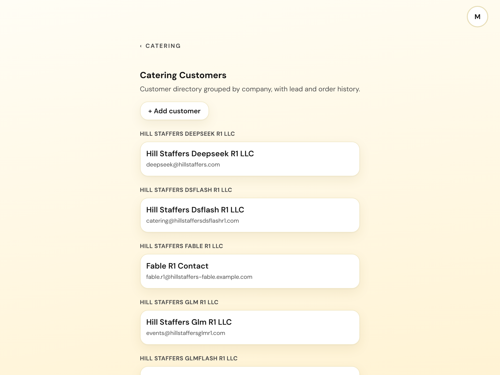

2. Tap a person to open them.

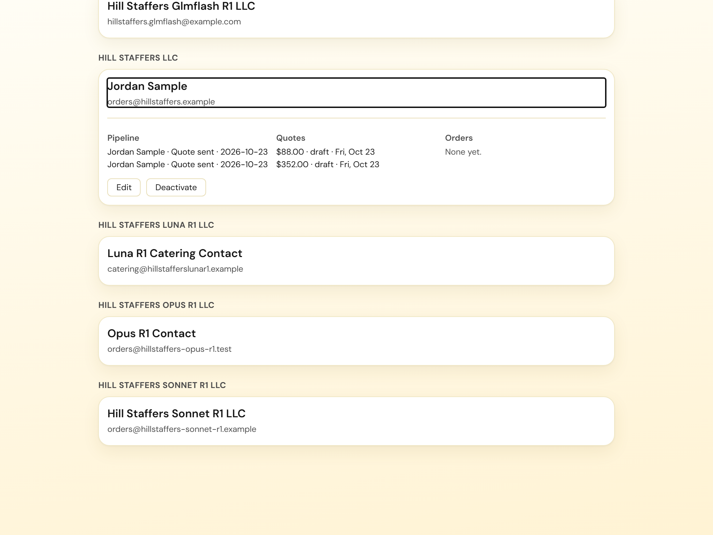

**Worth knowing**

- People are grouped by the company typed on them.
- Each row shows the person's name. It also shows their email and phone, but only if they are saved.
- Contacts you add in Catering Customers show their email and phone to anyone who can open that list. Shift leads and up can open it.
- **+ Add customer** adds a person by hand. **Edit** changes their details. AGM, Catering Manager and up can do this.
- **Deactivate** marks the person inactive. They stay on the list with "(inactive)" by their name. **Reactivate** brings them back.
- **Pipeline** lists the person's leads, with the stage and date. A lead joins this list when you save a quote with their **Client email** and that lead picked under **Pipeline lead**.
- **Quotes** lists the person's quotes, with the total, status and date.
- **Orders** may say **None yet.** even when the person has a quote. Quotes are in **Quotes**.

### Catering Companies

1. On the hub, tap **Catering Companies**.

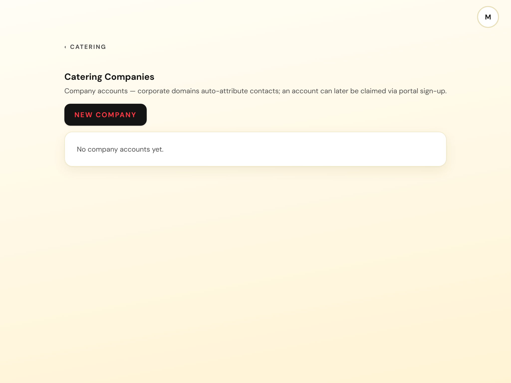

2. Tap **New company** to add a business you cater for.

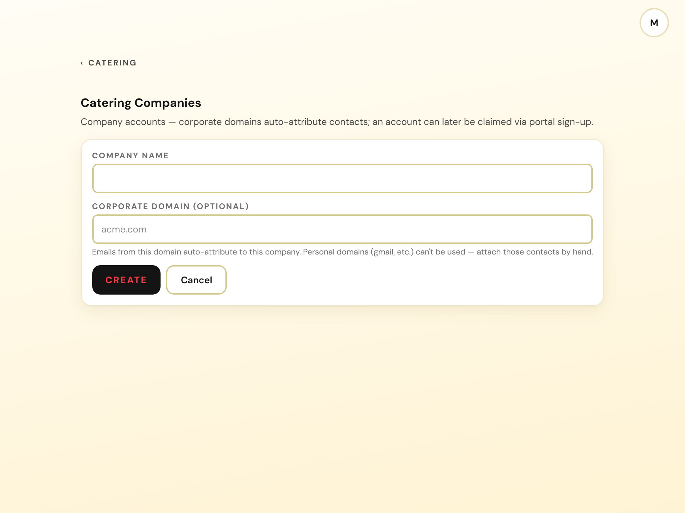

3. Type the **Company name**.

4. If the company has its own email domain, type it in **Corporate domain (optional)**, like "acme.com".

5. Tap **Create**. **Cancel** closes the form and saves nothing.

**Worth knowing**

- A personal domain, like gmail, can't be used. Add those people to the company by hand.

- A company typed on a customer is only a group name. It does not make a company account.
- The screen says a company's email domain can link its people to it on its own.

### Customers (GM and up)

The GM and up have a wider customer page in Admin. It covers everyone who orders, not just catering.

1. On the dashboard, tap **Admin**, then **Customers**.

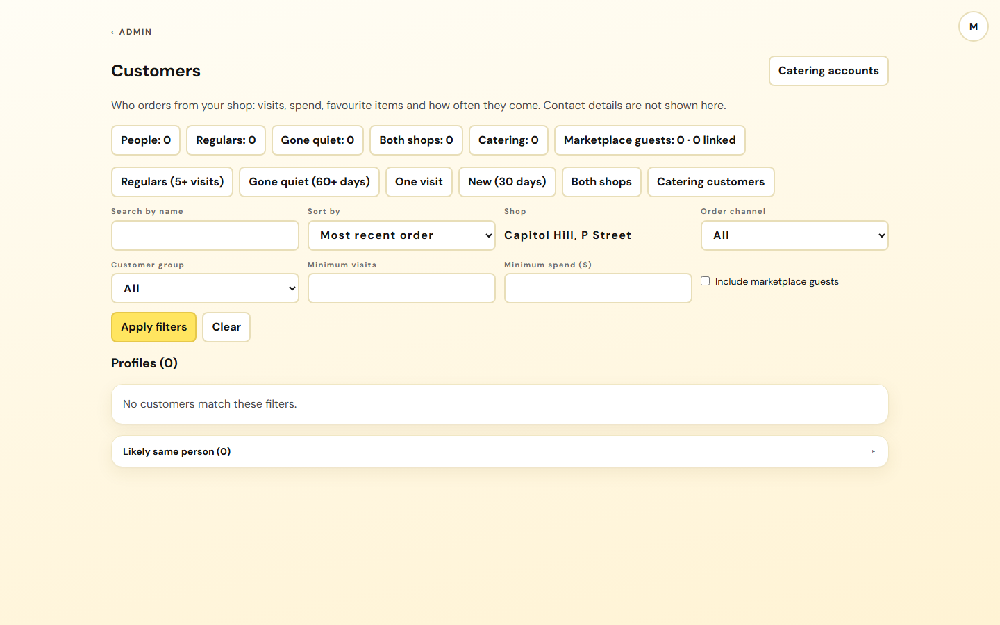

**Worth knowing**

- The GM sees their own shops. A Manager of Operations and up sees every shop.
- It shows visits, spend and favorite items. It does not show email or phone.
- **Gone quiet (60+ days)** shows people who have not been back in 60 days.
- **Catering customers** shows only the people who order catering.
- On this page, only the Owner and the Chief Growth Strategist can see a person's email or phone.

### Catering accounts (GM and up)

1. On **Customers**, tap **Catering accounts**.

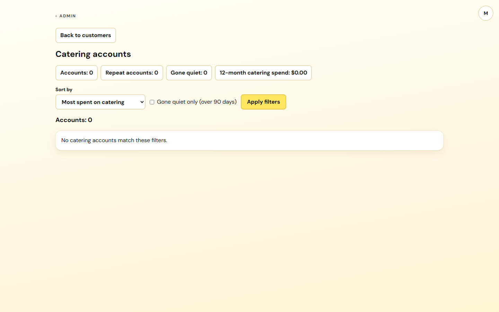

**Worth knowing**

- It shows each account's catering spend and orders.
- Tick **Gone quiet only (over 90 days)** to see accounts that stopped ordering. Then tap **Apply filters**.

### The marketing list

**Download opted-in list for this view** gives a file of people to email. It is not shown in photos.

**Worth knowing**

- The button is on the **Customers** page in Admin.
- Only the Owner and the Chief Growth Strategist see the button. A GM never sees it.
- It asks for a password check.
- Only people who opted in are on it. No one else can be added.
- If no one has opted in yet, the button says so.

### En español

Catering tiene sus propias listas de personas y negocios. El Gerente General y arriba también tienen las páginas de clientes en Admin.

#### Clientes de catering

1. En la página de catering, toca **Clientes de catering**.

2. Toca a una persona para abrirla.

- Las personas se agrupan por la empresa que tienen escrita.
- Cada fila muestra el nombre de la persona. También muestra su correo y su teléfono, pero solo si están guardados.
- Los contactos que agregas en Clientes de catering muestran su correo y su teléfono a todos los que pueden abrir esa lista. Los líderes de turno y arriba pueden abrirla.
- **+ Agregar cliente** agrega a alguien a mano. **Editar** cambia sus datos. Subgerente General, Gerente de Catering y arriba pueden hacerlo.
- **Desactivar** marca a la persona como inactiva. Se queda en la lista con "(inactivo)" junto a su nombre. **Reactivar** la regresa.
- **Prospectos** muestra los prospectos de la persona, con la etapa y la fecha. Un prospecto entra a esta lista cuando guardas una cotización con su **Correo del cliente** y ese prospecto escogido en **Prospecto**.
- **Cotizaciones** muestra las cotizaciones de la persona, con el total, el estado y la fecha.
- **Pedidos** puede decir **Nada aún.** aunque la persona tenga una cotización. Las cotizaciones están en **Cotizaciones**.

#### Empresas de Catering

1. En la página de catering, toca **Empresas de Catering**.

2. Toca **Nueva empresa** para agregar un negocio al que le haces catering.

3. Escribe el **Nombre de la empresa**.

4. Si la empresa tiene su propio dominio de correo, escríbelo en **Dominio corporativo (opcional)**, como "acme.com".

5. Toca **Crear**. **Cancelar** cierra el formulario y no guarda nada.

- Un dominio personal, como gmail, no se puede usar. Agrega a esas personas a la empresa a mano.

- Una empresa escrita en un cliente es solo un nombre de grupo. No crea una cuenta de empresa.
- La pantalla dice que el dominio de correo de una empresa puede ligar a su gente sola.

#### Clientes (Gerente General y arriba)

El Gerente General y arriba tienen una página de clientes más amplia en Admin. Cubre a todos los que piden, no solo catering.

1. En el dashboard, toca **Admin** y luego **Clientes**.

- El Gerente General ve sus propias tiendas. El Gerente de Operaciones y arriba ve todas.
- Muestra visitas, gasto y productos favoritos. No muestra correo ni teléfono.
- **Sin volver (60+ días)** muestra a quienes no han regresado en 60 días.
- **Clientes de catering** muestra solo a quienes piden catering.
- En esta página, solo el Dueño y el Estratega de Crecimiento pueden ver el correo o el teléfono de una persona.

#### Cuentas de catering (Gerente General y arriba)

1. En **Clientes**, toca **Cuentas de catering**.

- Muestra el gasto y los pedidos de catering de cada cuenta.
- Marca **Solo cuentas sin volver (más de 90 días)** para ver las cuentas que dejaron de pedir. Luego toca **Aplica filtros**.

#### La lista de marketing

**Descargar la lista de esta vista con consentimiento** te da un archivo de personas a quienes escribir. No sale en fotos.

- El botón está en la página **Clientes** de Admin.
- Solo el Dueño y el Estratega de Crecimiento ven el botón. Un Gerente General nunca lo ve.
- Pide confirmación de contraseña.
- Solo incluye a personas con consentimiento. No se puede agregar a nadie más.
- Si nadie ha aceptado todavía, el botón lo dice.

## Insights and sales

These pages show how catering is doing. Read them once a week.

### Catering Insights

Shift leads and up can open this page.

1. On the hub, tap **Catering Insights**.

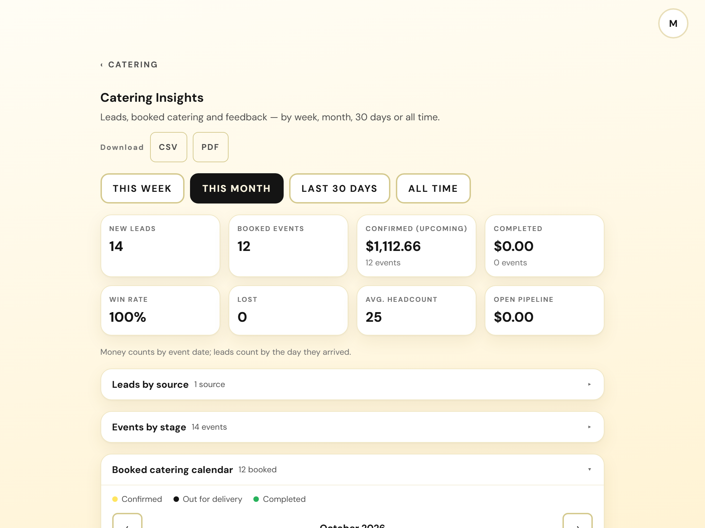

2. Pick a range: **This week**, **This month**, **Last 30 days** or **All time**.

3. Read the tiles.

4. Scroll down for the rest.

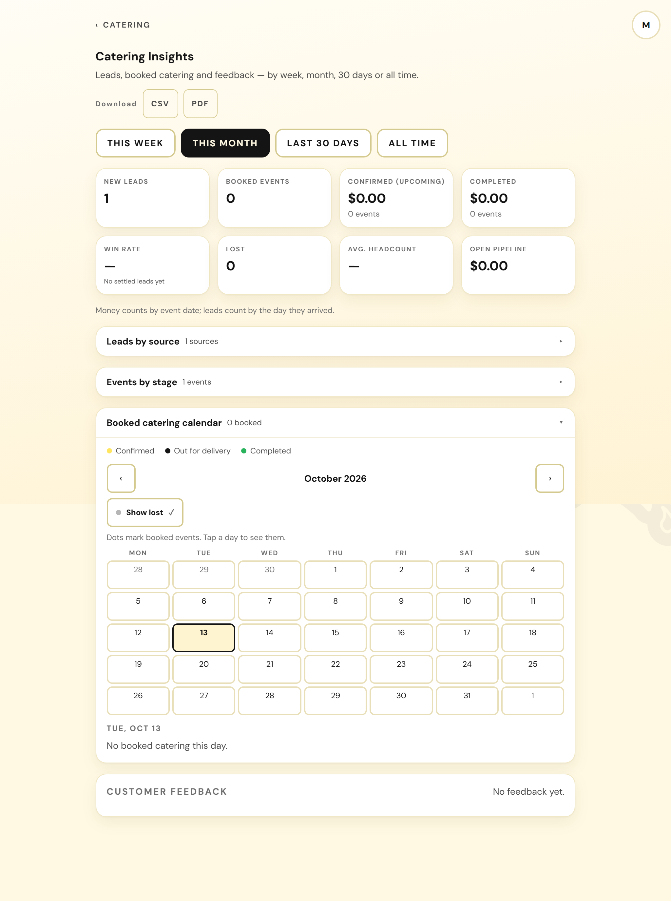

**Worth knowing**

- The page opens on **This month**. The dark button is the range you see.
- The screen says it: money counts by the event date. Leads count by the day they came in.
- Money is split into three tiles: **Confirmed (upcoming)**, **Completed** and **Open pipeline**.
- A job counts at its accepted quote. A draft or sent quote does not count. Orders that come in from ezCater or Toast count at their own total.
- **Open pipeline** adds up the leads still in **Inquiry** or **Quote sent**, on any date. It does not change with the range you pick. It uses the same money rule, so a lead with only a draft or sent quote adds $0.
- So a lead you typed shows $0 until you tap **Mark accepted** on its quote. See [When the client says yes](#when-the-client-says-yes).
- **Leads by source** and **Events by stage** open when you tap them.
- **Booked catering calendar** puts a dot on each booked day. Tap a day to see its jobs.
- **Customer feedback** is at the bottom.
- **Download** gives you a CSV or PDF file.

### Sales and catering sales (GM and up)

The GM and up can see sales. Seeing both shops at once takes a Manager of Operations and up.

1. On the dashboard, tap **Reports Hub**.

2. Under **Sales**, tap **Sales**.

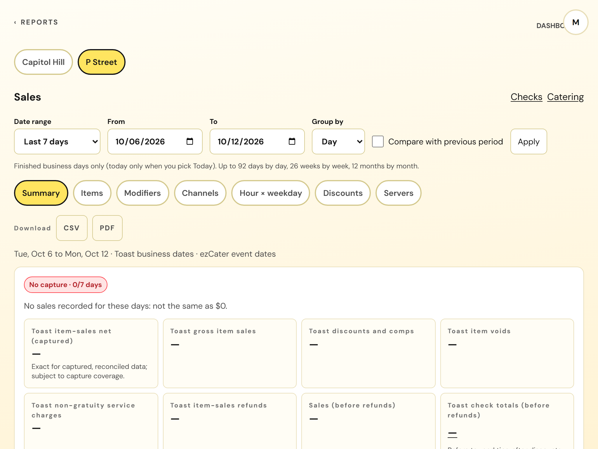

3. Tap the **Catering** tab.

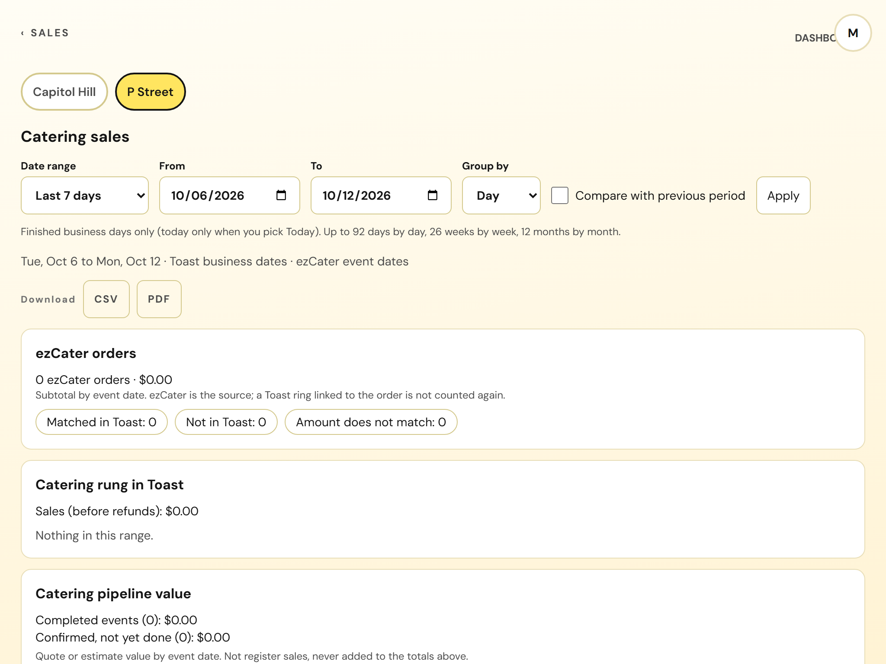

**Worth knowing**

- The ezCater part counts **Matched in Toast**, **Not in Toast** and **Amount does not match**.
- The screen says ezCater is the source. A Toast ring tied to the order is not counted twice.
- **Catering pipeline value** shows quote money by event date. It is not register sales and is never added to the sales totals.

### En español

Estas páginas muestran cómo va el catering. Léelas una vez por semana.

#### Panel de Catering

Los líderes de turno y arriba pueden abrir esta página.

1. En la página de catering, toca **Panel de Catering**.

2. Escoge un rango: **Esta semana**, **Este mes**, **Últimos 30 días** o **Histórico**.

3. Lee los recuadros.

4. Baja para ver el resto.

- La página abre en **Este mes**. El botón oscuro es el rango que ves.
- La pantalla lo dice: el dinero cuenta por la fecha del evento. Los prospectos cuentan por el día en que llegaron.
- El dinero se divide en tres recuadros: **Confirmado (por venir)**, **Completado** y **Pipeline abierto**.
- Un trabajo cuenta con su cotización aceptada. Una cotización en borrador o enviada no cuenta. Los pedidos que llegan de ezCater o Toast cuentan con su propio total.
- **Pipeline abierto** suma los prospectos que siguen en **Consulta** o **Cotización enviada**, de cualquier fecha. No cambia con el rango que escoges. Usa la misma regla del dinero, así que un prospecto con solo una cotización en borrador o enviada suma $0.
- Por eso un prospecto que escribiste sale en $0 hasta que tocas **Marcar aceptada** en su cotización. Mira "Cuando el cliente dice que sí" en Cotizaciones.
- **Leads por origen** y **Eventos por etapa** se abren cuando los tocas.
- **Calendario de catering confirmado** pone un punto en cada día con evento. Toca un día para ver sus trabajos.
- **Comentarios de clientes** está hasta abajo.
- **Descargar** te da un archivo CSV o PDF.

#### Ventas y ventas de catering (Gerente General y arriba)

El Gerente General y arriba pueden ver las ventas. Ver las dos tiendas a la vez requiere ser Gerente de Operaciones o más.

1. En el dashboard, toca **Centro de reportes**.

2. En **Ventas**, toca **Ventas**.

3. Toca la pestaña **Catering**.

- La parte de ezCater cuenta **Encontrado en Toast**, **No está en Toast** y **El monto no coincide**.
- La pantalla dice que ezCater es la fuente. Una cuenta de Toast ligada al pedido no se cuenta dos veces.
- **Valor del pipeline de catering** muestra el dinero de cotizaciones por fecha del evento. No son ventas de caja y nunca se suma a los totales de ventas.

## Setup

Setup is where catering is built: packages, menu, limits and zones. Do it on a computer. The pages are wide. AGM, Catering Manager and up can open it.

### Open setup

1. On the dashboard, tap **Admin**, then **Catering**. You can also tap **Admin & setup** on the catering hub.

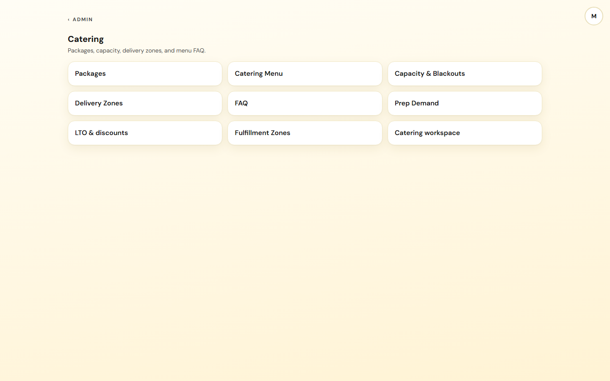

2. Tap a tile.

**Worth knowing**

- You only see the tiles your role can open. A GM sees nine tiles. **Pricing & Tax**, **Catering Rates** and **ezCater item review** are not among them.
- **Catering workspace** takes you back to the catering hub.

### Who can change what

| Tile | Who can open it |
|---|---|
| **Packages**, **FAQ**, **Prep Demand**, **LTO & discounts** | AGM, Catering Manager and up |
| **Catering Menu**, **Capacity & Blackouts**, **Delivery Zones**, **Fulfillment Zones** | GM and up |
| **Pricing & Tax**, **Catering Rates** | Manager of Operations and up |
| **ezCater item review** | Catering Manager, or Manager of Operations and up |

### Packages

1. Tap **Packages**.

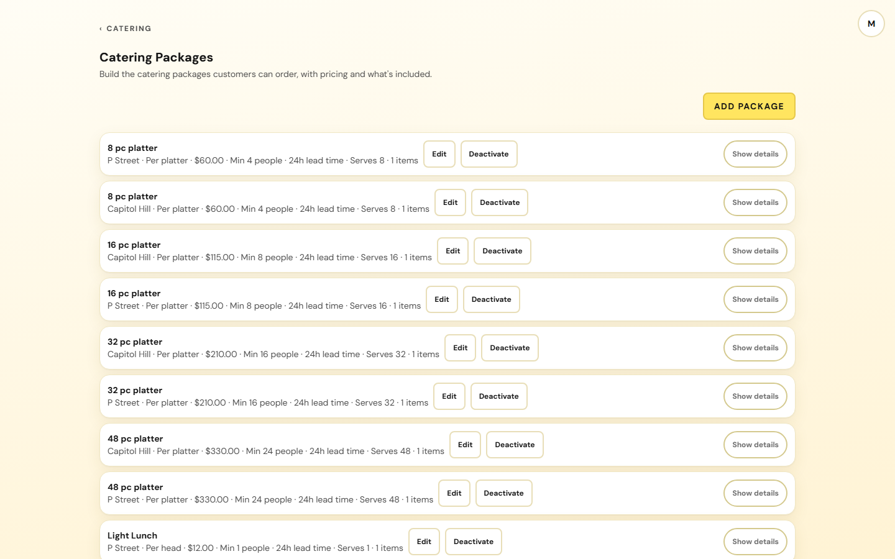

**Worth knowing**

- Each row shows the shop, the price, the minimum people, the lead time and how many it serves.
- **Add package** builds a new one. **Edit** changes one. **Deactivate** takes one off.
- These are the packages you pick from on a quote.

### Catering Menu

GM and up.

1. Tap **Catering Menu**.

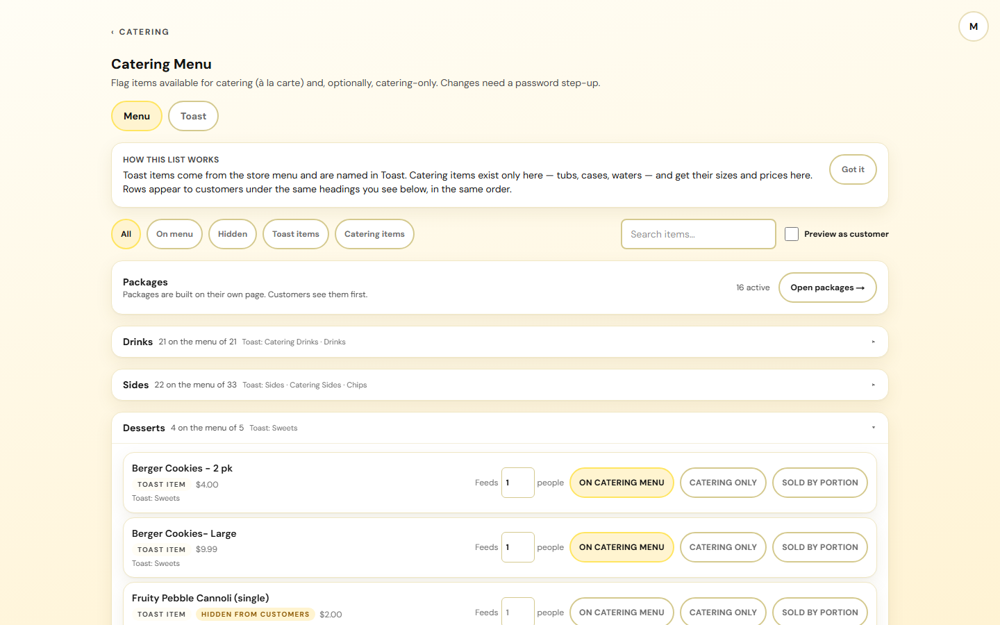

**Worth knowing**

- Items are in groups, like Drinks, Sides and Desserts. A group with 6 items or less starts open. Tap a group's name to open or close it.
- Each item has two switches: **On catering menu** and **Catering only**.
- An item marked **Toast item** has a third switch, **Sold by portion**. It lets clients order a quarter, half or whole.
- **Feeds** is how many people one item serves.
- The screen says Toast items come from the store menu. Catering items exist only on this page.
- **Preview as customer** shows the menu the way a client sees it.
- The screen says changes need a password check.

### Capacity & Blackouts

GM and up.

1. Tap **Capacity & Blackouts**.

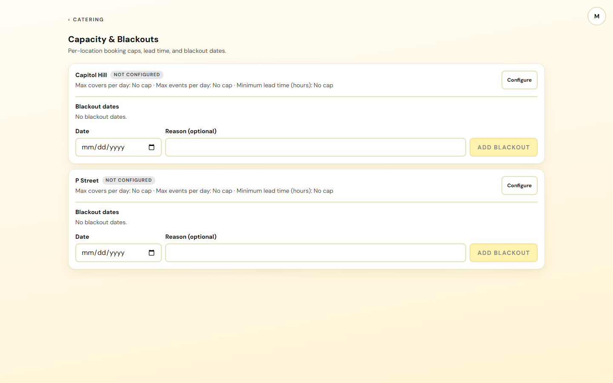

2. Tap **Configure** to set the most people per day, the most jobs per day and the shortest notice.

3. To block a day, pick the **Date**, type a **Reason (optional)** and tap **Add blackout**.

**Worth knowing**

- **Not configured** means no limits are set. That is why a lead card says **No caps set**.

### Delivery Zones and Fulfillment Zones

GM and up. These are two pages. You need both.

1. Tap **Delivery Zones**. Tap **Add zone** to set a delivery fee and a minimum order.

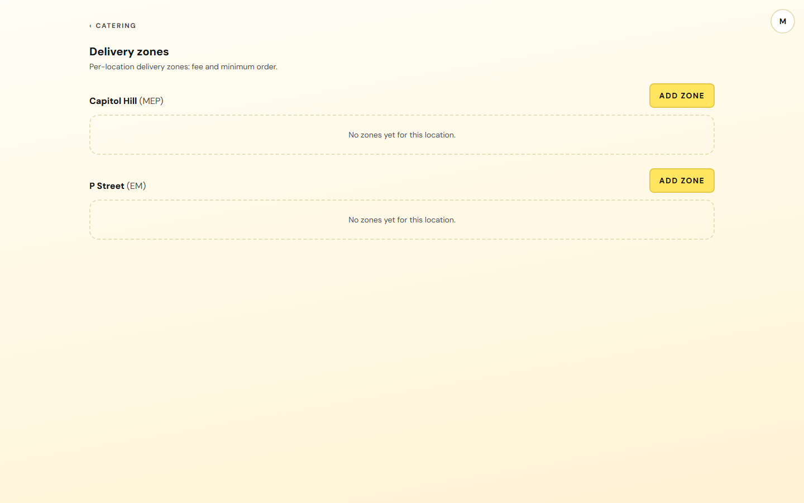

2. Go back. Tap **Fulfillment Zones**.

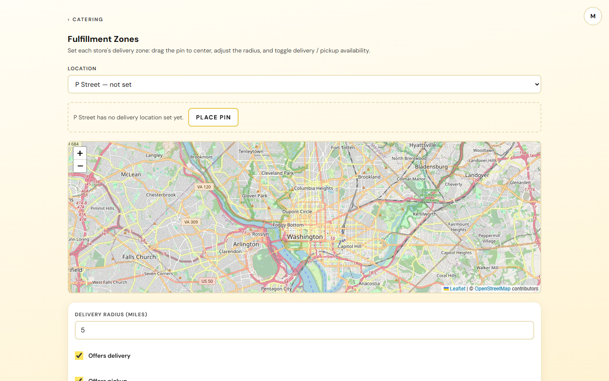

3. Check the shop. Drag the pin to the shop and set **Delivery radius (miles)**.

4. Tick **Offers delivery** and **Offers pickup** as they fit. Tap **Save zone**.

**Worth knowing**

- **Delivery Zones** is what you charge. **Fulfillment Zones** is how far you go.
- The map opens on your shop. Check the shop before you save.

### FAQ

1. Tap **FAQ**.

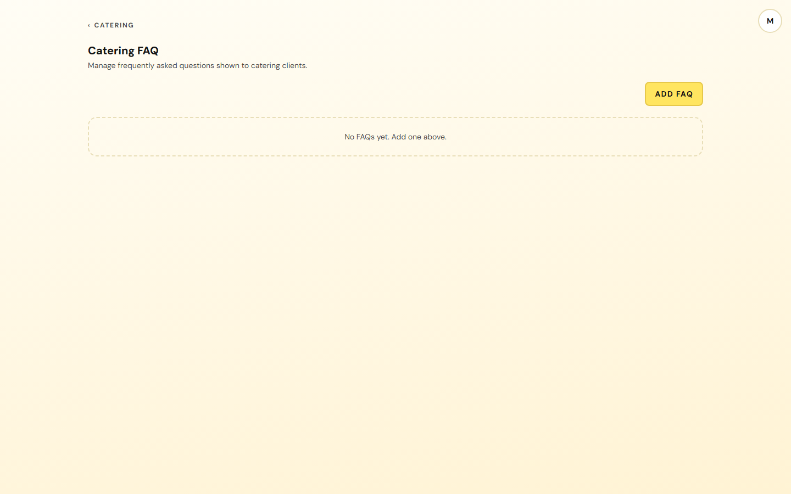

2. Tap **Add FAQ** for a question clients ask a lot.

**Worth knowing**

- Clients read these. Write them the way you would say them.

### Prep Demand

1. Tap **Prep Demand**.

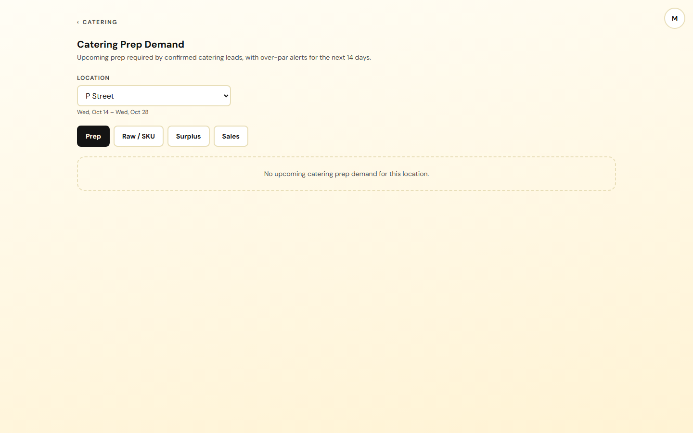

2. Check the shop in **Location**. It opens on your shop.

**Worth knowing**

- It shows the food the kitchen needs for the next 14 days.
- Only **Confirmed** leads count here, and only when the lead has a quote with an event date, picked under **Pipeline lead**. If you know a job is coming and the page is empty, check both.
- If the page says **No upcoming catering prep demand for this location.**, check the shop in **Location** first.
- A "Choose your sub" line with a **Needs pick** tag means the sub choice is not in the app. That is expected for now. The sub mix is in the quote's **Notes**.
- The tabs are **Prep**, **Raw / SKU**, **Surplus** and **Sales**.

### LTO & discounts

1. Tap **LTO & discounts**.

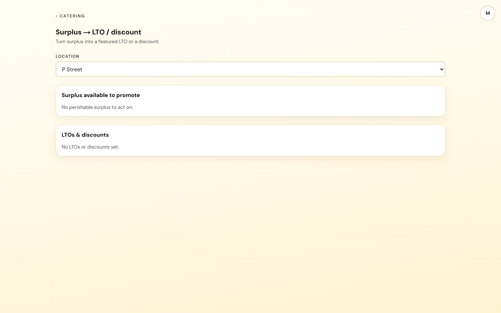

2. Check the shop in **Location**.

**Worth knowing**

- The screen says it turns extra food into a featured LTO or a discount.
- **No perishable surplus to act on.** means no catering order was canceled late with its food already prepped. This page only lists that food. It does not count other extra food in the kitchen.

### En español

En la configuración se arma el catering: paquetes, menú, límites y zonas. Hazlo en una computadora. Las páginas son anchas. Subgerente General, Gerente de Catering y arriba pueden abrirla.

#### Abrir la configuración

1. En el dashboard, toca **Admin** y luego **Catering**. También puedes tocar **Administración y configuración** en la página de catering.

2. Toca un recuadro.

- Solo ves los recuadros que tu rol puede abrir. Un Gerente General ve nueve recuadros. **Precios e impuestos**, **Tarifas de catering** y **Revisión de artículos de ezCater** no están entre ellos.
- **Espacio de trabajo de catering** te regresa a la página de catering.

#### Quién puede cambiar qué

| Recuadro | Quién puede abrirlo |
|---|---|
| **Paquetes**, **Preguntas frecuentes**, **Demanda de Prep**, **LTO y descuentos** | Subgerente General, Gerente de Catering y arriba |
| **Menú de Catering**, **Capacidad y bloqueos**, **Zonas de entrega**, **Zonas de Entrega** (el mapa) | Gerente General y arriba |
| **Precios e impuestos**, **Tarifas de catering** | Gerente de Operaciones y arriba |
| **Revisión de artículos de ezCater** | Gerente de Catering, o Gerente de Operaciones y arriba |

#### Paquetes

1. Toca **Paquetes**.

- Cada fila muestra la tienda, el precio, el mínimo de personas, el tiempo de anticipación y para cuántos alcanza.
- **Agregar paquete** crea uno nuevo. **Editar** cambia uno. **Desactivar** lo quita.
- Estos son los paquetes que escoges en una cotización.

#### Menú de Catering

Gerente General y arriba.

1. Toca **Menú de Catering**.

- Los artículos están en grupos, como bebidas, acompañantes y postres. Un grupo con 6 artículos o menos empieza abierto. Toca el nombre de un grupo para abrirlo o cerrarlo.
- Cada artículo tiene dos interruptores: **En el menú de catering** y **Solo catering**.
- Un artículo marcado **Artículo de Toast** tiene un tercer interruptor, **Por porción**. Deja que el cliente pida un cuarto, mitad o entero.
- **Rinde** es para cuántas personas alcanza un artículo.
- La pantalla dice que los artículos de Toast vienen del menú de la tienda. Los artículos de catering solo existen en esta página.
- **Ver como cliente** muestra el menú como lo ve el cliente.
- La pantalla dice que los cambios piden confirmación de contraseña.

#### Capacidad y bloqueos

Gerente General y arriba.

1. Toca **Capacidad y bloqueos**.

2. Toca **Configurar** para poner el máximo de personas por día, el máximo de trabajos por día y el aviso mínimo.

3. Para bloquear un día, escoge la fecha, escribe un **Motivo (opcional)** y toca **Agregar bloqueo**.

- **Sin configurar** quiere decir que no hay límites. Por eso la tarjeta del prospecto dice **Sin límites configurados**.

#### Zonas de entrega (dos páginas)

Gerente General y arriba. Son dos páginas y necesitas las dos. En español las dos se llaman casi igual: la primera es la de tarifas y la segunda es la del mapa.

1. Toca **Zonas de entrega**. Toca **Agrega zona** para poner la tarifa de entrega y el pedido mínimo.

2. Regresa. Toca **Zonas de Entrega**, la del mapa.

3. Revisa la tienda. Arrastra el marcador a la tienda y pon el **Radio de entrega (millas)**.

4. Marca **Ofrece entrega a domicilio** y **Ofrece recogida en tienda** según aplique. Toca **Guardar zona**.

- La página de tarifas es lo que cobras. La página del mapa es hasta dónde llegas.
- El mapa abre en tu tienda. Revisa la tienda antes de guardar.

#### Preguntas frecuentes

1. Toca **Preguntas frecuentes**.

2. Toca **Agregar Pregunta** para una pregunta que los clientes hacen mucho.

- Los clientes las leen. Escríbelas como las dirías.

#### Demanda de Prep

1. Toca **Demanda de Prep**.

2. Revisa la tienda en **Ubicación**. Abre en tu tienda.

- Muestra la comida que la cocina necesita para los próximos 14 días.
- Solo cuentan los prospectos en **Confirmado**, y solo si el prospecto tiene una cotización con fecha del evento, escogida en **Prospecto**. Si sabes que viene un trabajo y la página está vacía, revisa las dos cosas.
- Si la página dice **No hay demanda de prep de catering próxima para esta ubicación.**, primero revisa la tienda en **Ubicación**.
- Una línea "Choose your sub" con la etiqueta **Necesita elección** quiere decir que los subs no están escogidos en la app. Por ahora es normal. La mezcla de subs está en las **Notas** de la cotización.
- Las pestañas son **Prep**, **Crudo / SKU**, **Excedente** y **Ventas**.

#### LTO y descuentos

1. Toca **LTO y descuentos**.

2. Revisa la tienda en **Ubicación**.

- La pantalla dice que convierte la comida que sobra en un LTO destacado o un descuento.
- **Sin excedente perecedero para gestionar.** quiere decir que ningún pedido de catering se canceló tarde con su comida ya preparada. Esta página solo muestra esa comida. No cuenta otra comida que sobre en la cocina.
