# Manager guide

For key holders, trainers, shift leads, AGMs and GMs. It walks your day in order: start here, morning, all day, night, then your manager tools.

---

## Start here

Read this part once. It explains the app words and how you get in.

### What CO-OPS is

CO-OPS is the app we use to run the shop. You check the shop in the morning. You track prep, trucks and the closing list all day. At night you count, grade the team, do the cash and lock up. The app keeps a record of each step, with your name and the time.

### App words

The app uses these words. Each one is explained here, in the order you meet it.

| Word | What it means |
|---|---|
| Shop | One of our two places: P Street or Capitol Hill. |
| Dashboard | Your home page after you log in. |
| Roles | Your job in the app. From lowest: Trainee, Employee, Key Holder or Trainer, Shift Lead, AGM (and Catering Manager), GM, Manager of Operations, Owner. A higher role can do more. |
| PIN | Your 4-digit number. You log in with it. You also sign the cash deposit and the closing with it. |
| Station | One part of the shop, like Crunchy Boi Station or Prep Area. Each station has its own part of the closing checklist. |
| Position | One spot to fill at a station. Expo Station has two: Expeditor and Register & Delivery. |
| The board | The **Assignments** page. It shows who has which station and which task today. |
| Task | One of the daily reports on the board: Opening prep, AM prep, Mid-day prep, Receiving, Counts, Ordering, Cash report and PM report. |
| Take / assign | Take: you open a task and do it yourself. Assign: you give a task to someone on the team. |
| Par | How much of an item you want on hand. You prep or order up to par. |
| Prep | Getting food ready for the line: cutting, mixing, filling containers. |
| Opening verification | Part 1 of the morning **Opening Report**. You check each station against last night's count. |
| Closer count | Last night's AM prep count, or your morning recount. The opener checks it in the morning. |
| Opening prep | Part 2 of the **Opening Report**. You make food up to par. On the board this task is called **Opening prep**. |
| Mid-day prep | After the rush, you count and prep back up to par. |
| AM prep | The closing count. At night you count what is left, so the morning crew knows what is there. It is done at night, not in the morning. |
| Closing checklist | The day's list of closing jobs, station by station. It runs all day. |
| Walk-out | The last five checks before you leave: lights, devices, oven, front doors, back door. |
| PM report | The night report. You grade each person and can pick an MVP. |
| Cash deposit | The night cash count: drawer, deposit and cash tips, signed with your PIN. |
| Mid-Shift Pulse | A live view of the shop: stations, people, prep, fridges and notes. |
| Handoff note | A note on the Pulse for the next shift. |
| Delivery | A vendor's order coming in. You check it in on **Receiving**. |
| Purchase order | An order the app made for a vendor. You can only claim a missing item against one. |
| Vendor credit | What a vendor owes you for an item that was short. |
| Count | Writing down how much you have. The full stock count is called **Inventory Audit**. |
| Ordering walk | You walk the shelves and mark what to order from each vendor. |
| Production | You log food you made from raw stock outside the prep sheets. |
| 86 | Kitchen talk for an item you have run out of. |
| Saved | Most forms save by themselves as you type. Look for **Saved** or **Saved a moment ago**. |

### Log in with the tiles

You do this at the start of every shift. The login screens are always in English.

#### 1. Pick your shop

**What you see**

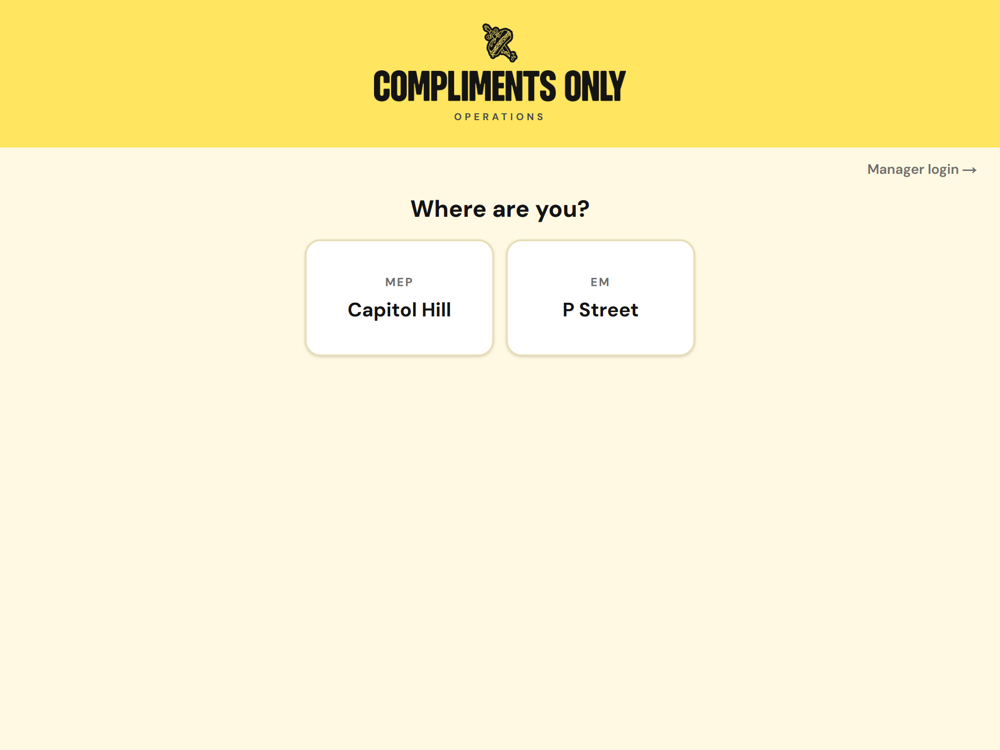

**What to do** — Tap the shop you are working at.

#### 2. Pick your role

**What you see**

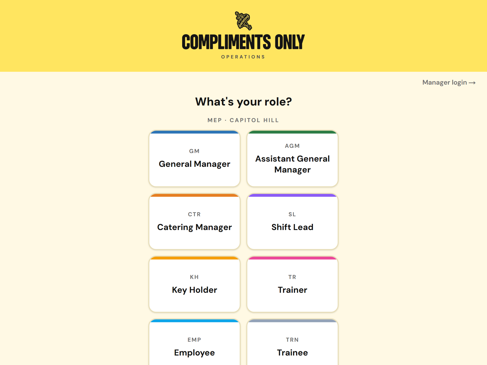

**What to do** — Tap your role.

**Worth knowing**

- There is no tile for Prep Manager, Social Media Manager, Manager of Operations or Owner. Use **Manager login →** instead.
- **← Back** goes back one screen.

#### 3. Pick your name

**What you see**

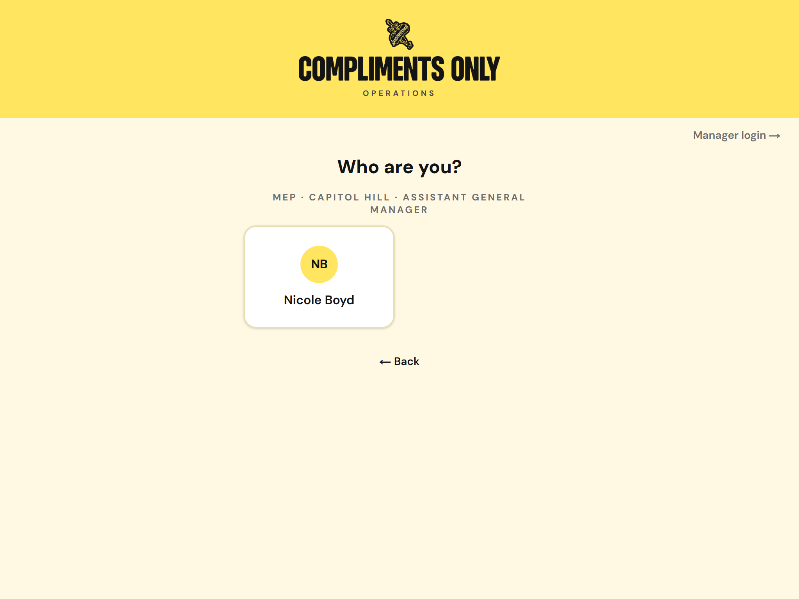

**What to do** — Tap your name.

#### 4. Type your PIN

**What you see**

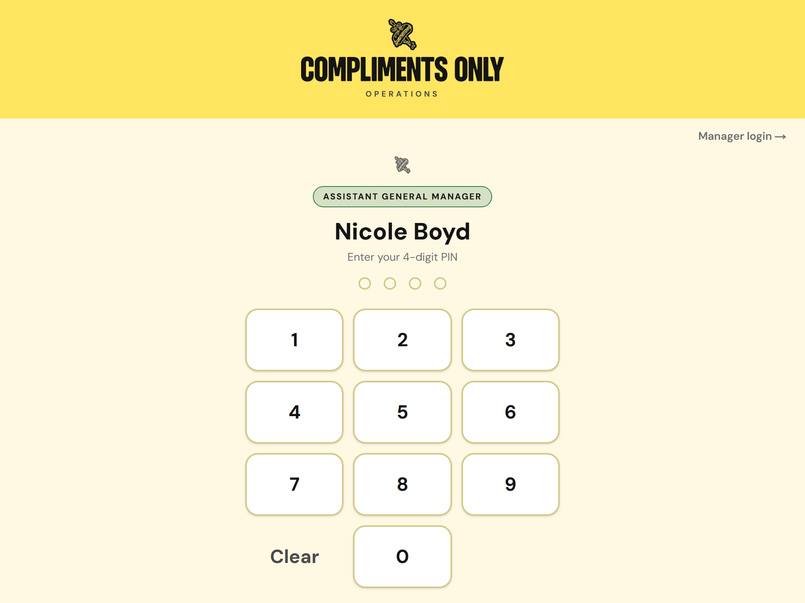

**What to do** — Tap your 4 digits. The fourth digit logs you in. There is no OK button.

**Worth knowing**

- **Clear** wipes what you typed.
- A wrong PIN shows **Wrong PIN. Try again.**
- Too many wrong tries locks the account for a while: **Account locked**.
- Many sign-ins on one device in a short time show **Too many tries**, with a wait time. This is not a wrong PIN. Wait, then try again.

### Use Manager login

AGMs and up also have an email and a password.

#### 1. Open the form

**What you see**

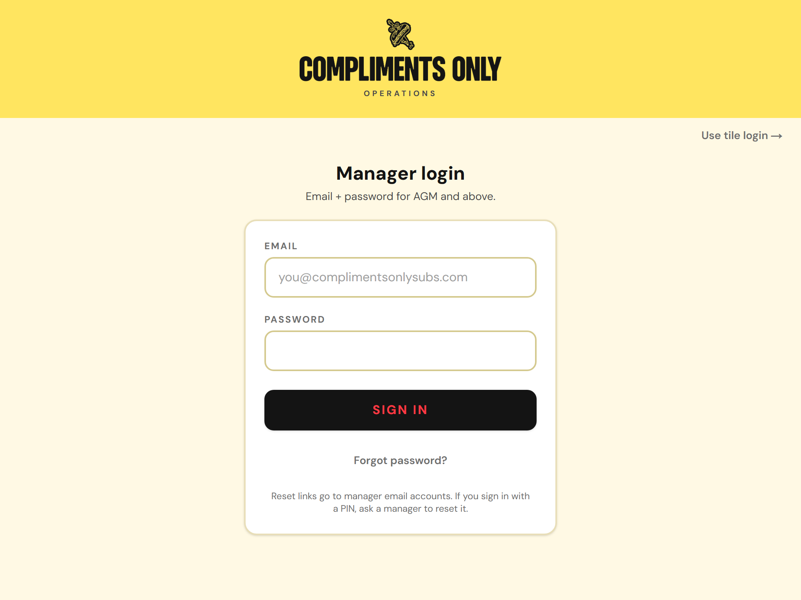

**What to do** — Tap **Manager login →** at the top right. Type your email and password. Tap **Sign in**.

**Worth knowing**

- **Use tile login →** takes you back to the tiles.
- **Forgot password?** sits under the button.

### Your dashboard

This is your home page. You land here after you log in.

#### 1. The top of the page

**What you see**

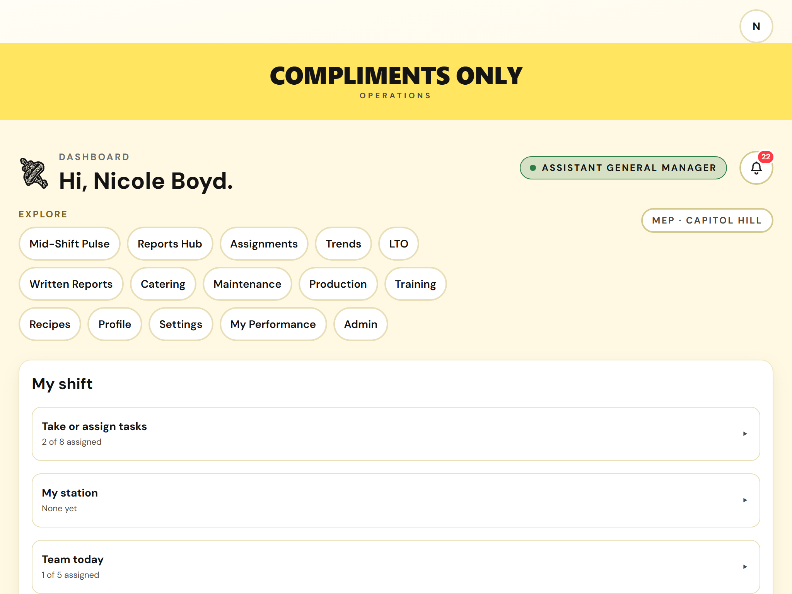

**What to do** — Check the shop name under your role. Then look at **My shift**.

**Worth knowing**

- The row of buttons under **Explore** is the menu.
- If you work at more than one shop, you can switch shops here. The app opens on the shop you picked at login. It keeps that shop on this device until you switch.
- If last night's closing was not confirmed, a warning shows here. Tap **Review yesterday's closing**.
- To read the app in Spanish, tap the round button with your first letter, top right. Pick **Español**.

#### 2. The rest of the page

**What you see**

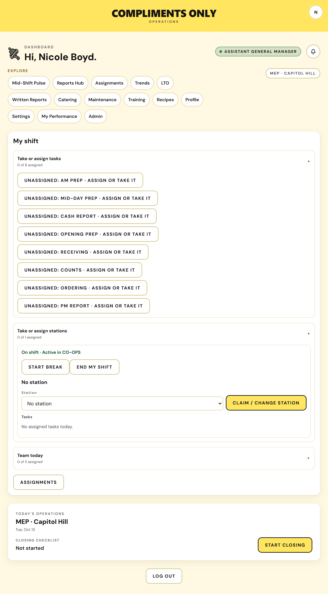

**What to do** — Find the **Today's operations** card. It holds the **Closing checklist**, with **Start closing** or **Continue closing**.

**Worth knowing**

- A **Reports** part shows only if you have a task or a station today.
- A report tile shows only to the person who has that task today. This is true for managers too.
- A task you took from the board counts as yours. Its tile then shows under **Reports**, like **Ordering** or **Inventory Audit**.
- If you hold a station, a **My station: …** card takes you to it.
- **Ordering**, **Counts** and **Receiving** are not in the menu. Open them from the board, or from the Reports Hub under **Inventory**.

### The board comes first

Start each shift on the board. It shows who has what today. You take tasks yourself or give them out.

#### 1. Open the board

**What you see**

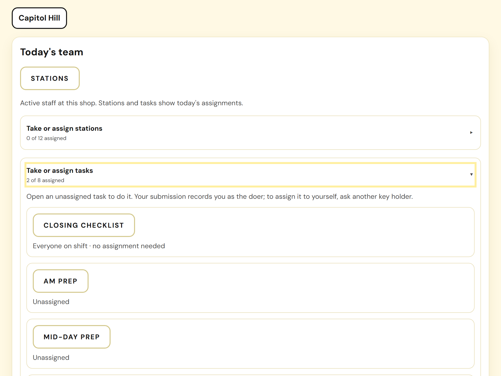

**What to do** — Tap **Assignments** in the menu. Or tap **Assignments** at the bottom of **My shift**.

**Worth knowing**

- **Take or assign tasks** lists the day's tasks. **Closing checklist** comes first. It needs no one assigned: **Everyone on shift · no assignment needed**.
- To take a task, tap it and do it. There is no Take button. The board then shows **Taken by …** with your name and the time.
- On your dashboard, an open task shows as **Unassigned: AM prep · assign or take it**.

#### 2. Place people at stations

**What you see**

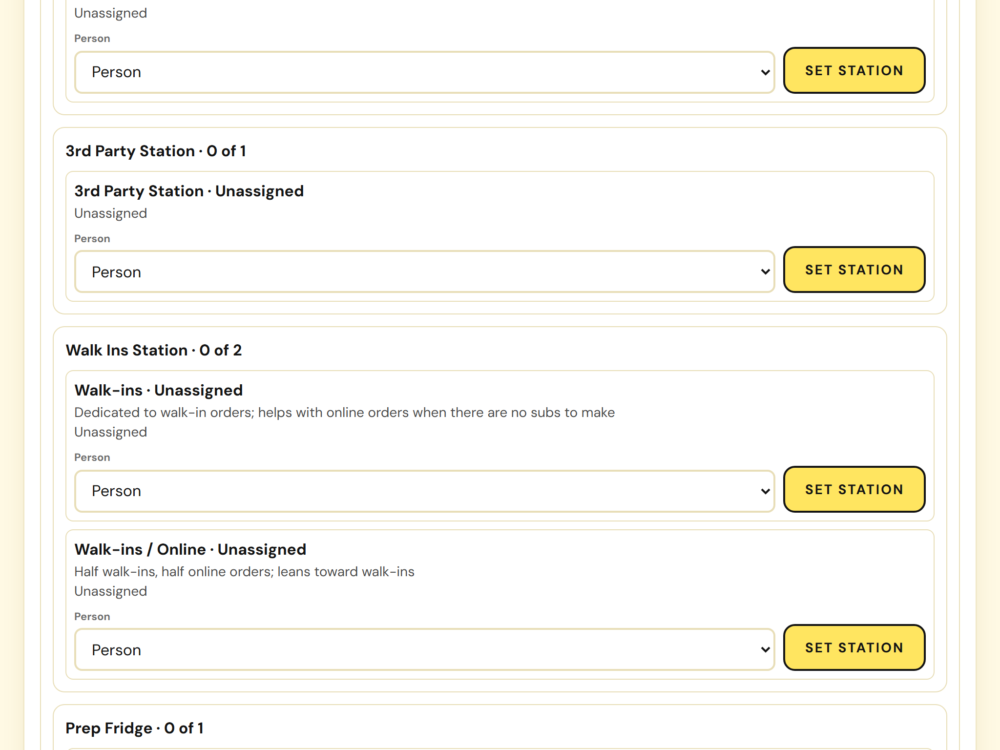

**What to do** — Open **Take or assign stations**. Pick a person under the station. Tap **Set station**. Then tap **Confirm change**.

**Worth knowing**

- On a person's card, the **Station** list marks some spots **fill first**. That is the first open spot at a station with no one on it.
- Crew can claim their own station from **My shift** on the dashboard, with **Claim / change station**.
- The **Stations** button on the board shows station times. Only a GM or above can change them. It asks for your password: **Confirm your password**.

#### 3. Assign a task to a person

**What you see**

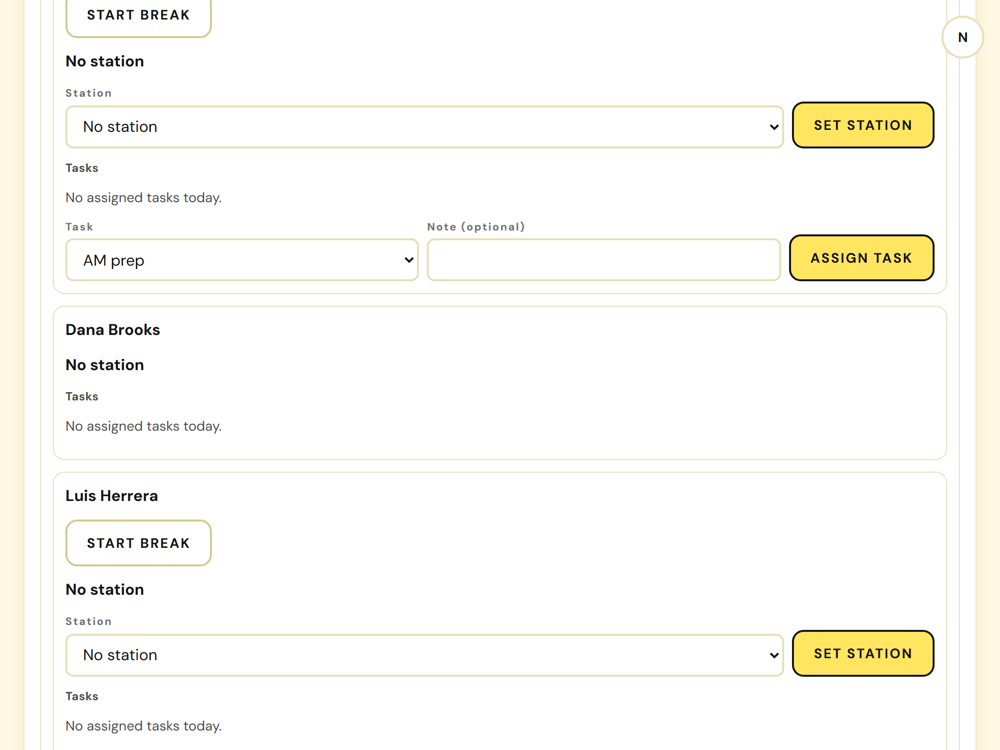

**What to do** — Open **Who has what**. Find the person's card. Pick the task. Add a note if you want. Tap **Assign task**. Then tap **Confirm change**.

**Worth knowing**

- Each change on the board asks you to confirm first: assign, set a station, retract and end a shift. **Cancel** backs out.
- You can only assign to people at your role or below.
- The list shows only tasks that person's role allows. An employee can get Opening prep, AM prep and Mid-day prep. Key holders and up can get every task.
- **Retract** takes an assignment back.
- If someone with a higher role made the assignment, you must pick a reason to change it.
- You can't assign a task to yourself. Ask another key holder, or just take it.
- Under a task held by someone else, an employee sees a message that starts **Assigned to someone else**. They can't open that task.

### Log out

Do this when you leave.

#### 1. Tap Log out

**What you see**

**What to do** — Scroll to the bottom of the dashboard. Tap **Log out**. You are back on the first login screen.

**Worth knowing**

- **Sign out** in the round menu, top right, does the same.
- The app logs you out after 10 minutes with no taps. The login screen then says **You were signed out after 10 minutes of inactivity.**

### En español

Lee esta parte una vez. Explica las palabras de la app y cómo entrar.

#### Qué es CO-OPS

CO-OPS es la app que usamos para manejar la tienda. En la mañana revisas la tienda. Durante el día llevas la prep, los camiones y la lista de cierre. En la noche cuentas, calificas al equipo, haces el efectivo y cierras. La app guarda cada paso con tu nombre y la hora.

#### Palabras de la app

| Palabra | Qué significa |
|---|---|
| Tienda | Uno de nuestros dos locales: P Street o Capitol Hill. |
| Dashboard (inicio) | Tu página principal después de entrar. |
| Roles | Tu puesto en la app. Del más bajo al más alto: Aprendiz, Empleado, Encargado de Llaves o Entrenador, Líder de Turno, Subgerente General (y Gerente de Catering), Gerente General, Gerente de Operaciones, Dueño. Un rol más alto puede hacer más. |
| PIN | Tu número de 4 dígitos. Entras con él. También firmas el depósito y el cierre. |
| Estación | Una parte de la tienda, como Crunchy Boi Station o Prep Area. Cada estación tiene su parte en la lista de cierre. |
| Puesto | Un lugar que se llena en una estación. Expo Station tiene dos: Expeditor y Register & Delivery. |
| El tablero | La página **Asignaciones**. Muestra quién tiene cada estación y cada tarea hoy. |
| Tarea | Uno de los reportes del día en el tablero: apertura, AM prep, prep de mediodía, recepción, conteos, pedidos, caja y reporte PM. |
| Tomar / asignar | Tomar: abres una tarea y la haces tú. Asignar: le das la tarea a alguien del equipo. |
| Par | Cuánto quieres tener de un artículo. Preparas o pides hasta llegar al par. |
| Prep | Dejar la comida lista para la línea: cortar, mezclar, llenar recipientes. |
| Verificación de apertura | Parte 1 del **Reporte de apertura** en la mañana. Revisas cada estación contra el conteo de anoche. |
| Conteo de cierre | El conteo de AM prep de anoche, o tu recuento de la mañana. El que abre lo revisa en la mañana. |
| Prep de apertura | Parte 2 del **Reporte de apertura**. Preparas comida hasta el par. En el tablero se llama **Preparación de apertura**. |
| Prep de mediodía | Después del rush, cuentas y preparas para volver al par. |
| AM prep | El conteo del cierre. En la noche cuentas lo que queda, para que el equipo de la mañana sepa qué hay. Se hace en la noche, no en la mañana. |
| Lista de cierre | Los trabajos de cierre del día, estación por estación. Corre todo el día. |
| Salida (walk-out) | Las cinco revisiones finales antes de irte: luces, aparatos, horno, puertas de enfrente, puerta de atrás. |
| Reporte PM | El reporte de la noche. Calificas a cada persona y puedes elegir un MVP. |
| Depósito de efectivo | El conteo de efectivo de la noche: caja, depósito y propinas, firmado con tu PIN. |
| Pulso de medio turno | Una vista en vivo de la tienda: estaciones, gente, prep, refrigeradores y notas. |
| Nota de entrega | Una nota en el Pulso para el siguiente turno. |
| Entrega | Un pedido de proveedor que llega. Lo registras en **Recepción**. |
| Orden de compra | Un pedido que la app hizo para un proveedor. Solo puedes reclamar un faltante contra una. |
| Crédito de proveedor | Lo que un proveedor te debe por algo que llegó de menos. |
| Conteo | Anotar cuánto tienes. El conteo completo de inventario se llama **Auditoría de inventario**. |
| Recorrido de pedido | Recorres los estantes y marcas qué pedir a cada proveedor. |
| Producción | Registras comida que hiciste con materia prima fuera de las listas de prep. |
| 86 | En la cocina, un artículo que se acabó. |
| Guardado | Casi todo se guarda solo mientras escribes. Busca **Guardado** o **Guardado hace un momento**. |

#### Entrar con los mosaicos

Lo haces al empezar cada turno. Las pantallas de entrada siempre están en inglés.

1. **Tu tienda.** En **Where are you?**, toca la tienda donde trabajas.
2. **Tu rol.** Toca tu rol. No hay mosaico para Prep Manager, Social Media Manager, Manager of Operations ni Owner: usa **Manager login →**. **← Back** regresa una pantalla.
3. **Tu nombre.** Toca tu nombre.
4. **Tu PIN.** Toca tus 4 dígitos. El cuarto dígito te deja entrar; no hay botón de OK. **Clear** borra lo que escribiste. Un PIN mal puesto dice **Wrong PIN. Try again.** Muchos intentos fallidos bloquean la cuenta un rato: **Account locked**. Muchas entradas en un mismo aparato en poco tiempo muestran **Too many tries**, con un tiempo de espera. No es un PIN mal puesto: espera y vuelve a intentar.

#### Entrar como gerente

Los subgerentes (AGM) y roles más altos también tienen correo y contraseña. Toca **Manager login →** arriba a la derecha. Escribe tu correo y contraseña y toca **Sign in**. **Use tile login →** te regresa a los mosaicos. **Forgot password?** está debajo del botón.

#### Tu dashboard

1. **Arriba.** Revisa el nombre de la tienda debajo de tu rol. Luego mira **Mi turno**. La fila de botones bajo **Explorar** es el menú. Si trabajas en más de una tienda, aquí cambias de tienda. La app abre en la tienda que elegiste al entrar y la recuerda en ese aparato hasta que cambies. Si el cierre de anoche no se confirmó, aquí sale un aviso: toca **Revisar el cierre de ayer**. Para ver la app en español, toca el botón redondo con tu inicial, arriba a la derecha, y elige **Español**.
2. **El resto.** Busca la tarjeta **Operaciones de hoy**. Ahí está la **Lista de cierre**, con **Empezar cierre** o **Continuar cierre**. La parte **Reportes** solo sale si tienes una tarea o una estación hoy. Una tarjeta de reporte solo la ve la persona que tiene esa tarea hoy, también si eres gerente. Una tarea que tomaste del tablero cuenta como tuya: su tarjeta sale en **Reportes**, como **Pedidos** o **Auditoría de inventario**. Si tienes estación, la tarjeta **Mi estación: …** te lleva a ella. **Pedidos**, **Conteos** y **Recepción** no están en el menú. Ábrelos desde el tablero, o desde el Centro de reportes en **Inventario**.

#### Primero, el tablero

Empieza cada turno en el tablero. Ahí ves quién tiene qué. Tomas tareas o las repartes.

1. **Abre el tablero.** Toca **Asignaciones** en el menú, o **Asignaciones** al final de **Mi turno**. **Tomar o asignar tareas** muestra las tareas del día. Primero sale **Lista de cierre**, que no necesita asignación: **Todos en el turno · no requiere asignación**. Para tomar una tarea, tócala y hazla; no hay botón de tomar. Luego el tablero muestra **Iniciado por …** con tu nombre y la hora. En tu dashboard, una tarea libre sale como **Sin asignar: Preparación de la mañana · asigna o haz la tarea**.
2. **Pon gente en las estaciones.** Abre **Tomar o asignar estaciones**. Elige a la persona en la estación, toca **Asignar estación** y luego **Confirma el cambio**. En la tarjeta de una persona, la lista **Estación** marca algunos lugares con **cubrir primero**: es el primer lugar libre de una estación sin nadie. El equipo puede elegir su propia estación desde **Mi turno** con **Elegir / cambiar estación**. El botón **Estaciones** del tablero muestra los horarios; solo un gerente general o más los cambia, y te pide tu contraseña: **Confirma tu contraseña**.
3. **Asigna una tarea.** Abre **Quién tiene qué**. Busca la tarjeta de la persona, elige la tarea, agrega una nota si quieres, toca **Asignar tarea** y luego **Confirma el cambio**. Cada cambio en el tablero pide confirmar primero: asignar, poner una estación, retirar y terminar un turno. **Cancelar** te regresa. Solo puedes asignar a gente de tu rol o menor. La lista muestra solo las tareas que ese rol permite: un empleado puede recibir apertura, AM prep y prep de mediodía; un encargado de llaves o más, todas. **Retirar** quita una asignación. Si la hizo alguien de rol más alto, debes elegir un motivo para cambiarla. No te puedes asignar una tarea a ti: pídeselo a otro encargado de llaves, o solo tómala. Debajo de una tarea de otra persona, un empleado ve un mensaje que empieza con **Asignada a otra persona**. No puede abrir esa tarea.

#### Salir

Baja al final del dashboard y toca **Cerrar sesión**. Vuelves a la primera pantalla. **Cerrar sesión** en el menú redondo de arriba hace lo mismo. La app te saca sola después de 10 minutos sin tocar nada; la pantalla de entrada dice **You were signed out after 10 minutes of inactivity.**

---

## Morning

The morning job is the **Opening Report**. Part 1 checks last night's count. Part 2 makes food up to par.

Plan your time. Part 2 has one row for every prep item, and every row needs a number. If last night's AM prep is missing, Part 1 also needs a recount on every prep row. Then the report is long. Start early, and get help with Part 2.

### Opening verification

You do this once a day, before the doors open at 10:30 AM. The opening is late after 10:30 AM.

#### 1. Open the Opening Report

**What you see**

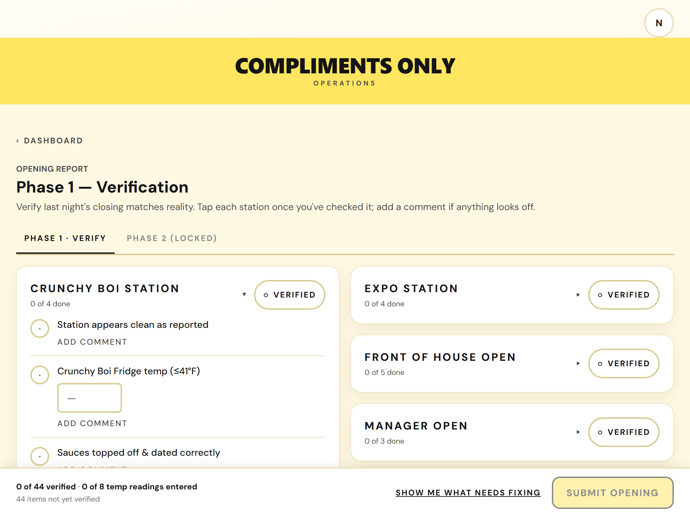

**What to do** — On the board, tap **Opening prep**. If the opening is assigned to you, you can also tap the **Opening Report** tile on the dashboard, then **Open / continue**.

**Worth knowing**

- Key holders and up can always open it. An employee can open it and submit it only when the opening is assigned to them today.
- If last night's closing is still open, you see **Waiting on last night's closing at …**. Tap **View last night's closing**. The opening unlocks once that closing is confirmed or released.
- The **Phase 2 (locked)** tab opens after you submit Part 1.

#### 2. Check each station

**What you see**

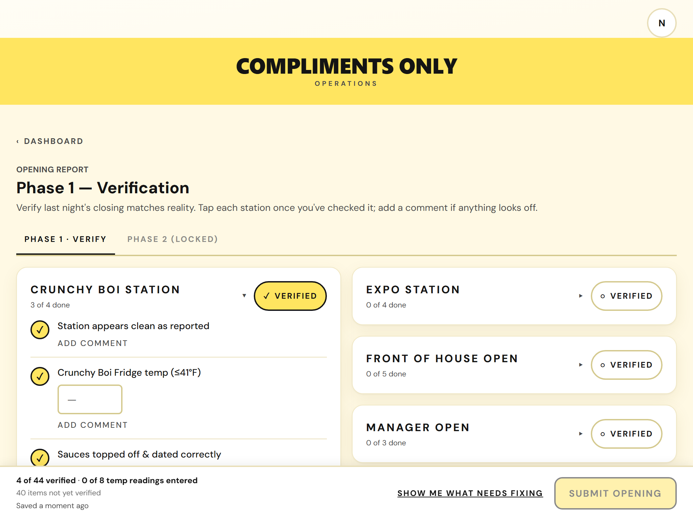

**What to do** — Walk to each station. Check that it looks like last night's close. Tap the station's name to open its card. Tap **Verified**. Then type the fridge temp in the box inside the card.

**Worth knowing**

- Most cards start closed. The temp box is inside, so open each station.
- **Verified** ticks the station's lines, but not the fridge temp. Each temp needs its own number.
- A temp still missing? The bottom bar says **Temp reading required for …**. Tap that line. It opens that station for you.
- If something looks wrong, tap **Add comment** on that line.
- The page saves as you go: **Saved a moment ago**. If someone else opens the same opening, they see your work.

#### 3. Check the prep sections

**What you see**

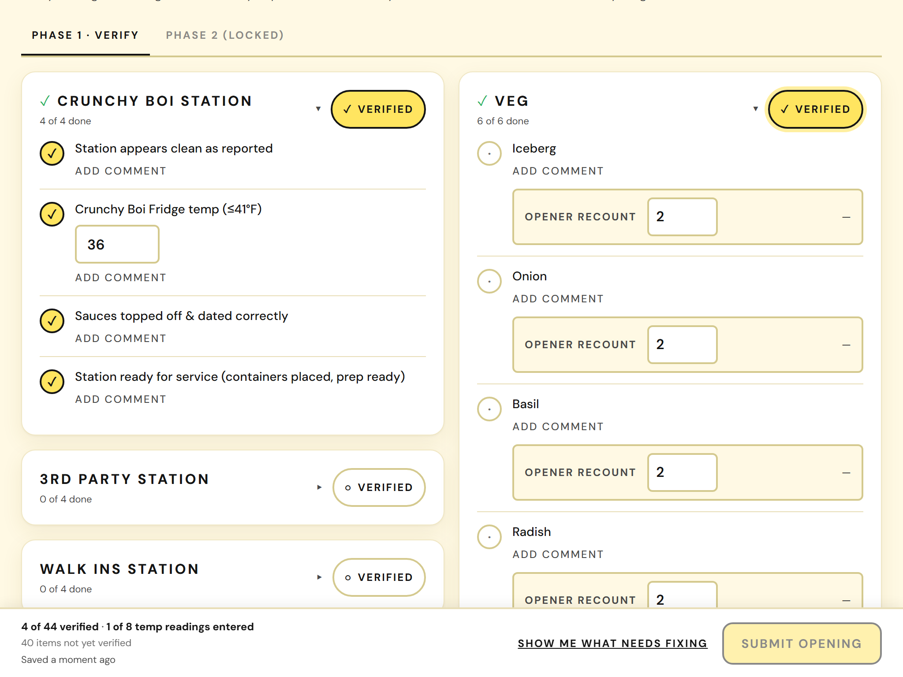

**What to do** — Open each prep section: Veg, Cooks, Sides, Sauces, Slicing. Tap its name to open it. Check the counts. Tap **Verify section**.

**Worth knowing**

- A row with no closer count needs a recount first. The button stays grey: **Recount items without closer data first**. Type what you see in **Opener recount**. The box is red until you type a number.
- Rows have no closer count when last night's AM prep is missing.
- A pink box then asks why: **No prior closing data detected**. Pick **Location was closed (planned)** or **Closing was missed / I don't know**.
- The recount you type becomes the **Closer count** on Phase 2. Prep need is worked out from it, so count for real. If nobody can count a row, don't guess a number.

#### 4. Submit Opening

**What you see**

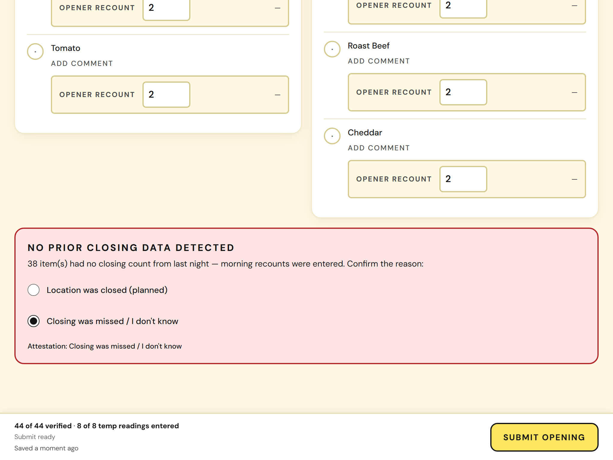

**What to do** — When the bottom bar says **Submit ready**, tap **Submit Opening**.

**Worth knowing**

- The button stays grey until each station is ticked, each temp is typed and every prep section says Verified. If the pink box showed, you must also pick a reason in it.
- The bottom bar names what is left, like **Pick a reason in the pink “No prior closing data detected” box**.
- **… of … verified** counts only the station ticks. The prep sections are a separate check.
- **Show me what needs fixing** takes you to what is left.
- After you submit, the **Phase 2 — Prep Entry** tab opens for everyone who can work the opening.

### Opening prep

You do this right after Part 1. You make the food you need to get to par.

#### 1. Read each row

**What you see**

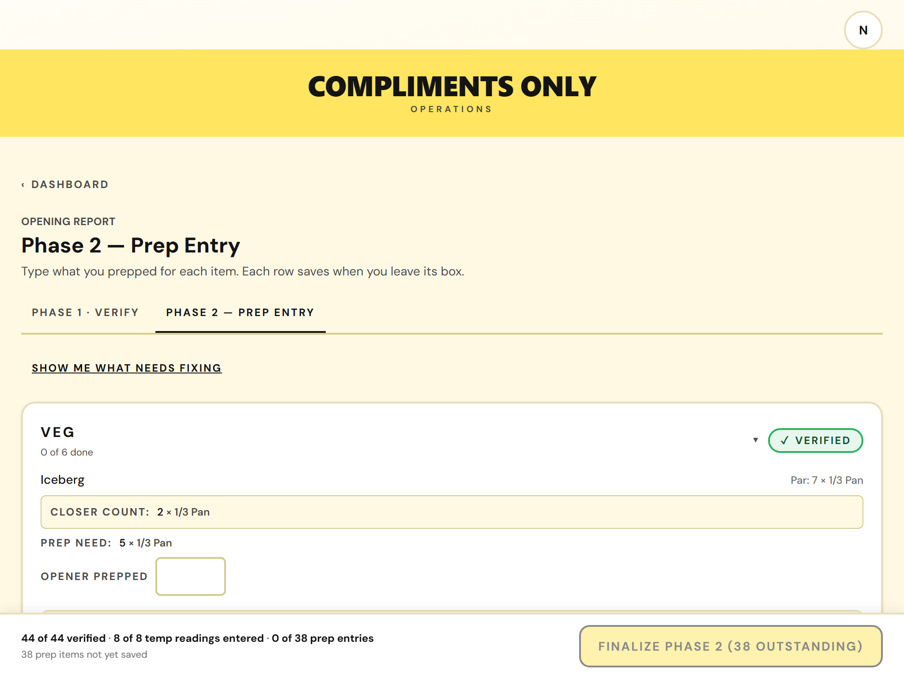

**What to do** — Each row shows **Par**, **Closer count** and **Prep need**. Make the amount in **Prep need**.

**Worth knowing**

- **Closer count** is last night's AM prep count. If you typed a recount in Part 1, it shows your recount.
- **Prep need** is what you must make to reach par.
- The title now reads **Phase 2 — Prep Entry**.
- Each section starts closed, except the first one with work left. Tap a section's name to open it.
- Two people can work Part 2 at the same time. Each row shows who saved it. Split the sections to finish faster.

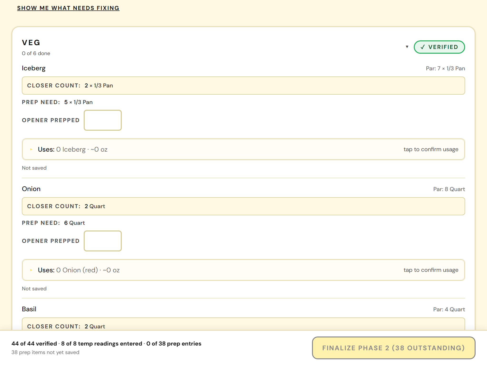

#### 2. Type what you made

**What you see**

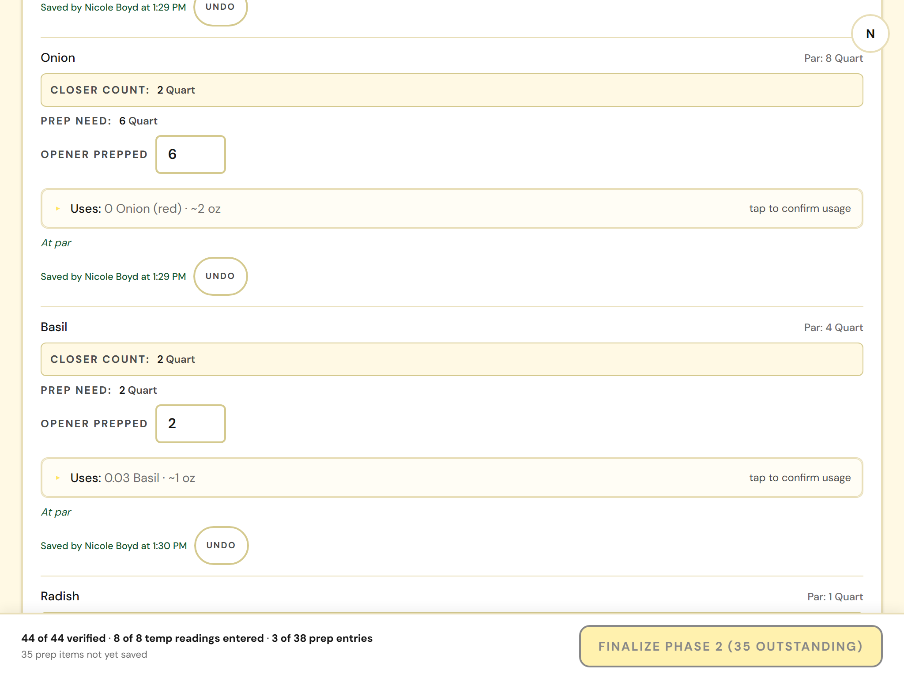

**What to do** — Type the amount you made in **Opener prepped**. Then tap outside the box.

**Worth knowing**

- A row saves when you leave its box. Then it says **Saved by … at …** with an **Undo** button. Until then it says **Not saved**.
- **Undo** takes two taps. The first tap shows **Tap again to undo** for about 4 seconds. Only a second tap undoes the row. The rows don't jump when a row saves.
- **At par** means you hit the need.
- A need like **5 × 1/3 Pan** means five 1/3 pans. Type 5. Use numbers only, like 5 or 5.5.
- Every row needs a number, even when you made none. Type 0 then.
- Made less than the need? The row says **Below prep need by …**. Tap it. Pick a reason and type a note. Managers get an alert.
- Made more than the need? The row says **Above prep need by …**. Tap it and pick a reason.
- The row saves only after the reason is in. Until then it says **Add a reason to save**.
- A row with no par says **No par set — type what you made**. Type what you made, or 0. It needs no reason.

#### 3. Finalize Phase 2

**What you see**

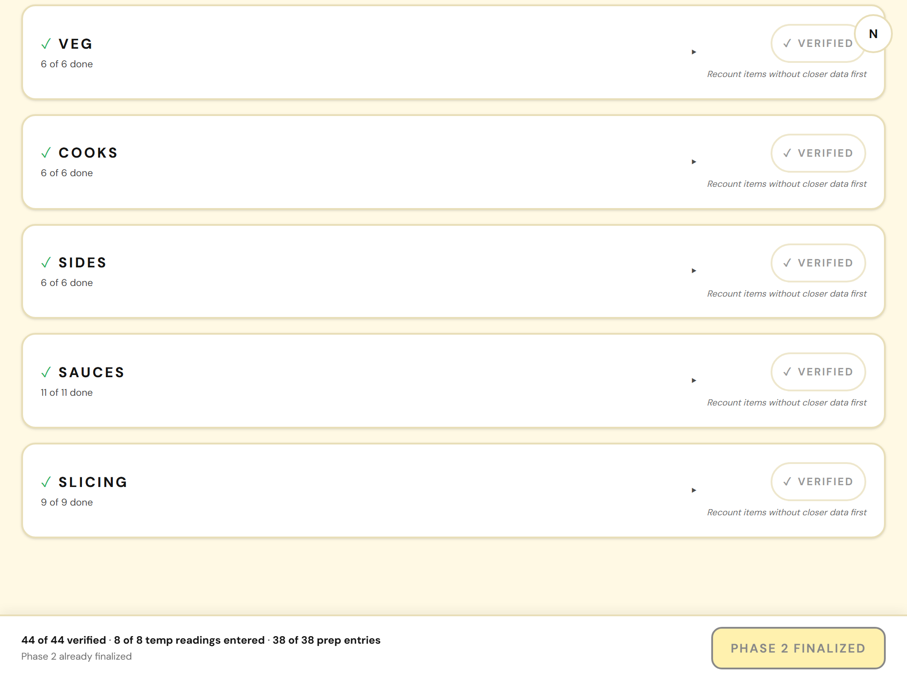

**What to do** — When every row is saved, tap **Finalize Phase 2**.

**Worth knowing**

- Until then, the button shows how many rows are left. Look for rows that say **Not saved** or **Add a reason to save**.
- No box asks you to confirm. The button then reads **Phase 2 finalized**, and the bottom bar says **Phase 2 already finalized**. The opening is done and can't be changed.
- The title still reads **Phase 2 — Prep Entry**. Each section shows a tick and closes.

### En español

El trabajo de la mañana es el **Reporte de apertura**. La parte 1 revisa el conteo de anoche. La parte 2 prepara comida hasta el par.

Calcula tu tiempo. La parte 2 tiene una fila por cada artículo de prep, y cada fila necesita un número. Si falta el AM prep de anoche, la parte 1 también pide un recuento en cada fila de prep. Entonces el reporte es largo. Empieza temprano y pide ayuda con la parte 2.

#### Verificación de apertura

Lo haces una vez al día, antes de abrir a las 10:30 AM. La apertura va tarde después de las 10:30 AM.

1. **Abre el Reporte de apertura.** En el tablero, toca **Preparación de apertura**. Si la apertura está asignada a ti, también puedes tocar la tarjeta **Reporte de apertura** en el dashboard y luego **Abrir / continuar**. Un encargado de llaves o más siempre puede abrirla. Un empleado puede abrirla y enviarla solo si hoy la tiene asignada. Si el cierre de anoche sigue abierto, ves **Esperando el cierre de anoche en …**; toca **Ver el cierre de anoche**. La apertura se abre cuando ese cierre se confirma o se libera. La pestaña **Fase 2 (bloqueada)** se abre cuando envías la parte 1.
2. **Revisa cada estación.** Ve a cada estación y mira que esté como quedó anoche. Toca el nombre de la estación para abrir su tarjeta. Toca **Verificar**. Luego escribe la temperatura del refrigerador en la casilla dentro de la tarjeta. Casi todas las tarjetas empiezan cerradas, y la casilla está adentro: abre cada estación. **Verificar** marca las líneas de la estación, pero no la temperatura: cada una necesita su número. ¿Falta una temperatura? La barra de abajo dice **Falta lectura de temperatura para …**; toca esa línea y se abre esa estación. Si algo no cuadra, toca **Añadir comentario** en esa línea. La página se guarda sola: **Guardado hace un momento**. Si otra persona abre la misma apertura, ve tu trabajo.
3. **Revisa las secciones de prep.** Abre cada sección (Veg, Cooks, Sides, Sauces, Slicing) tocando su nombre. Revisa los conteos y toca **Verificar sección**. Una fila sin conteo de cierre necesita un recuento primero; el botón queda gris: **Recuenta primero los items sin datos del cierre**. Escribe lo que ves en **Recuento del opener**. La casilla queda roja hasta que escribes un número. Las filas quedan sin conteo de cierre cuando falta el AM prep de anoche. Entonces un cuadro rosa pregunta por qué: **No se detectaron datos de cierre previo**. Elige **Ubicación cerrada (planificado)** o **Cierre omitido / No sé**. El recuento que escribes pasa a ser el **Conteo de cierre** en la Fase 2, y la necesidad de prep sale de él. Cuenta de verdad. Si nadie puede contar una fila, no adivines un número.
4. **Envía la apertura.** Cuando la barra de abajo diga **Listo para enviar**, toca **Enviar Apertura**. El botón sigue gris hasta que cada estación esté marcada, cada temperatura escrita y cada sección de prep esté verificada. Si salió el cuadro rosa, también debes elegir un motivo ahí. La barra de abajo dice qué falta, como **Elige un motivo en el recuadro rosa “No se detectaron datos de cierre previo”**. **… de … verificadas** cuenta solo las estaciones marcadas; las secciones de prep son otra revisión. **Muéstrame qué hay que corregir** te lleva a lo que falta. Al enviar, se abre la pestaña **Fase 2 — Entrada de Prep** para todos los que pueden trabajar la apertura.

#### Prep de apertura

Lo haces justo después de la parte 1. Preparas lo que falta para llegar al par.

1. **Lee cada fila.** Cada fila muestra **Par**, **Conteo de cierre** y **Por preparar**. Prepara la cantidad de **Por preparar**. El conteo de cierre es el AM prep de anoche; si escribiste un recuento en la parte 1, sale tu recuento. **Por preparar** es lo que debes hacer para llegar al par. El título ahora dice **Fase 2 — Entrada de Prep**. Cada sección empieza cerrada, menos la primera con trabajo pendiente: toca el nombre de una sección para abrirla. Dos personas pueden trabajar la parte 2 a la vez; cada fila dice quién la guardó. Repártanse las secciones para terminar antes.
2. **Escribe lo que preparaste.** Escribe la cantidad en **Preparado hoy** y toca fuera de la casilla. La fila se guarda cuando sales de la casilla; entonces dice **Guardado por … a las …** con un botón **Deshacer**. Antes dice **Sin guardar**. **Deshacer** pide dos toques: el primero muestra **Toca otra vez para deshacer** unos 4 segundos, y solo el segundo deshace la fila. Las filas no saltan cuando una fila se guarda. **Al par** quiere decir que llegaste. Una cantidad como **5 × 1/3 Pan** son cinco bandejas de 1/3: escribe 5. Usa solo números, como 5 o 5.5. Cada fila necesita un número, aunque no hayas hecho nada: entonces escribe 0. ¿Hiciste menos de lo necesario? La fila dice **Bajo el necesario por …**: tócala, elige un motivo y escribe una nota. Los gerentes reciben un aviso. ¿Hiciste más? La fila dice **Sobre el necesario por …**: tócala y elige un motivo. La fila se guarda solo cuando el motivo está puesto; antes dice **Agrega una razón para guardar**. Una fila sin par dice **Sin par — escribe lo que preparaste**: escribe lo que hiciste, o 0. No pide motivo.
3. **Finaliza la fase 2.** Cuando todas las filas estén guardadas, toca **Finalizar Fase 2**. Antes de eso, el botón dice cuántas filas faltan; busca las filas que dicen **Sin guardar** o **Agrega una razón para guardar**. No sale ningún cuadro para confirmar. Después el botón dice **Fase 2 finalizada** y la barra de abajo dice **Fase 2 ya finalizada**. La apertura está lista y ya no se puede cambiar. El título sigue diciendo **Fase 2 — Entrada de Prep**. Cada sección muestra una marca y se cierra.

---

## All day

Between open and close, you watch the shop, check in trucks, prep after the rush and keep the closing list moving.

### The Mid-Shift Pulse

Open it any time to see the shop at a glance. It updates every 60 seconds.

#### 1. Open the Pulse

**What you see**

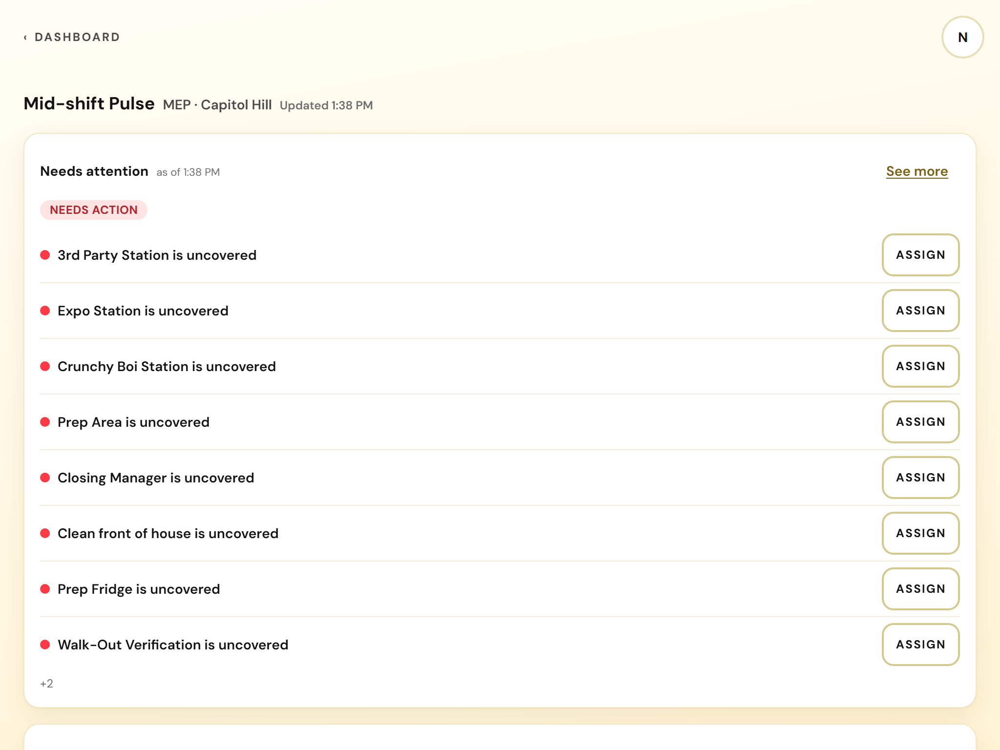

**What to do** — Tap **Mid-Shift Pulse** in the menu. Read **Needs attention** first.

**Worth knowing**

- **Needs attention** lists what needs action now. Tap the button on the line. A station with no one on it says "… is uncovered" and has **Assign**.
- Red lines come first: a report that is overdue, a late task, a fridge out of range, a vendor cutoff that passed with no order (**missed the … cutoff — call the vendor**), or an ezCater order not rung into Toast.
- Stations come next. A station with no one on it is red too.
- Smaller things come last, in yellow, like fridges not checked yet or items low against par.
- When nothing is late, the stations lead the list.
- The card shows the first 8 lines. Tap **See more** to see them all.
- Mid-day prep shows as late only after 3:30 PM.

#### 2. Read the cards

**What you see**

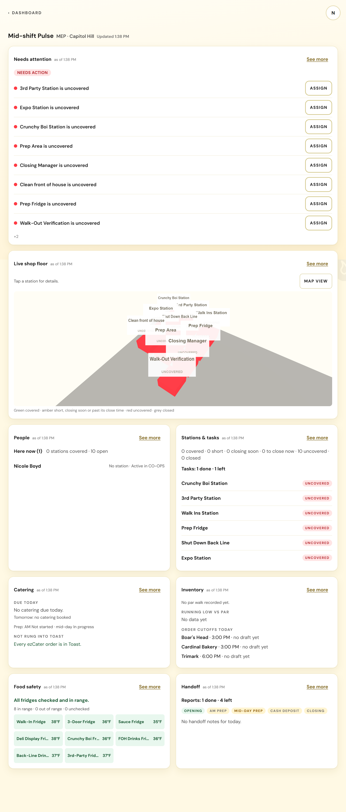

**What to do** — Scroll the cards. **Live shop floor** shows the stations; tap one for details. **Inventory** shows today's order cutoffs. **Food safety** shows the fridge temps. **Handoff** shows which reports are done.

**Worth knowing**

- **Stations & tasks** counts only the tasks given out on the board. **Handoff** counts all of today's reports. So the two numbers can differ.
- A missed cutoff shows in red on **Inventory** too: **missed cutoff — call the vendor**.
- What you see depends on your role.
- Key holders, trainers and shift leads see full detail, except money.
- AGMs also write handoff notes.
- GMs also see **Sales** and money. A GM can also **Arrange** the floor layout.
- A Manager of Operations and up can see **Both shops** side by side. A GM sees only their own shops.
- The title shows the code and name of the shop you are looking at. If you can see more than one shop, check it before you act.
- One button switches the floor picture. It reads **Map view** or **3D view**: the view you get when you tap it.

#### 3. See more

**What you see**

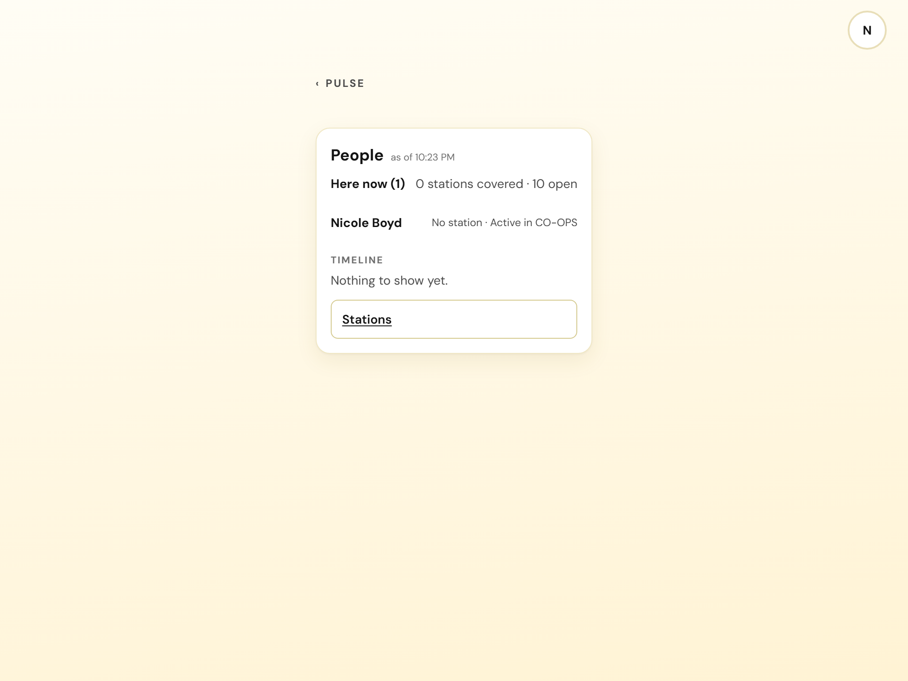

**What to do** — Tap **See more** on a card for the full list. Tap **‹ Pulse** to go back.

### Handoff notes

A handoff note tells the next shift what they need to know. Everyone can read them on the Pulse. AGMs and up write them.

#### 1. Write a note

**What you see**

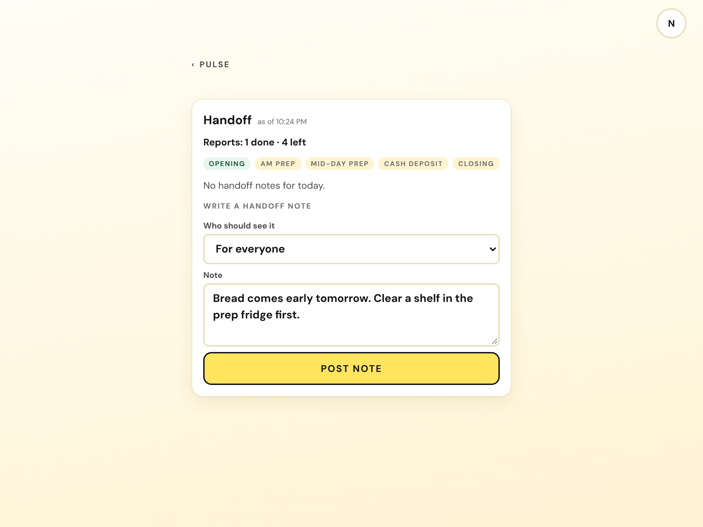

**What to do** — On the Pulse, scroll to the last card, **Handoff**. Tap the **See more** at the top right of that card, next to the word Handoff. Under **Write a handoff note**, pick **Who should see it**: **For everyone**, **For crew** or **For managers**. Type your **Note**. Tap **Post note**.

**Worth knowing**

- Every card has its own **See more**. Pick the one inside the **Handoff** card.
- A note can be up to 1000 characters.
- Crew see only notes for crew or for everyone. They don't see who wrote it.

#### 2. After you post

**What you see**

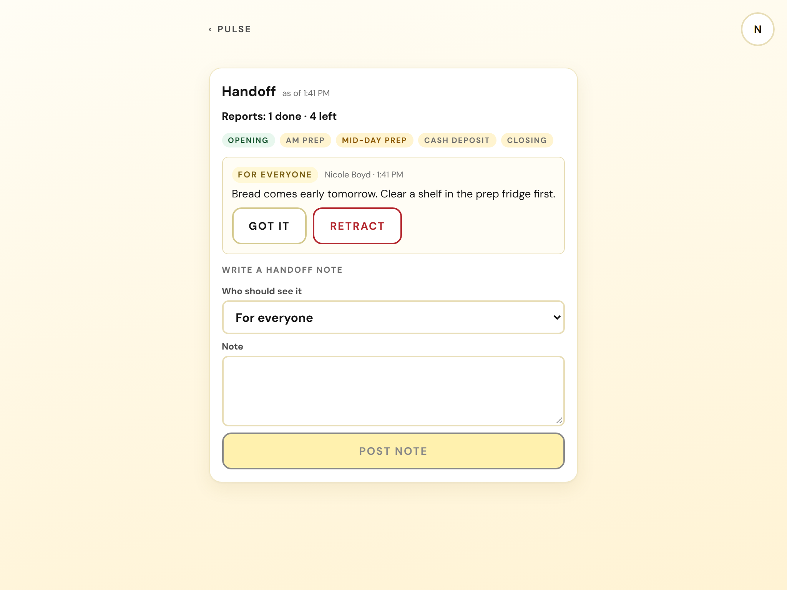

**What to do** — Check your note. It shows who wrote it, the time, and two buttons: **Got it** and **Retract**. AGMs and up tap **Got it** to show they read it.

**Worth knowing**

- After you tap **Got it**, the note says **You acknowledged this**.
- **Retract** takes a note down. Only the writer or a higher role can do it.
- The form clears after you post, so you can write another note.

### Check in a delivery

You do this each time a truck comes. Key holders and up.

#### 1. Open Receiving

**What you see**

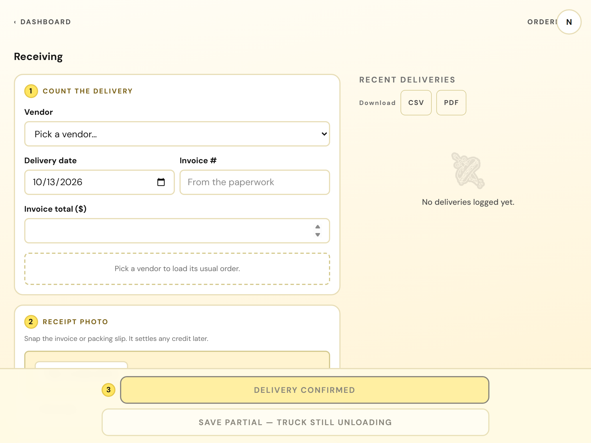

**What to do** — On the board, tap **Receiving**. You can also use the **Receiving** tile if it is assigned to you, or the Reports Hub: **Inventory**, then **Receiving**.

#### 2. Pick the vendor and count

**What you see**

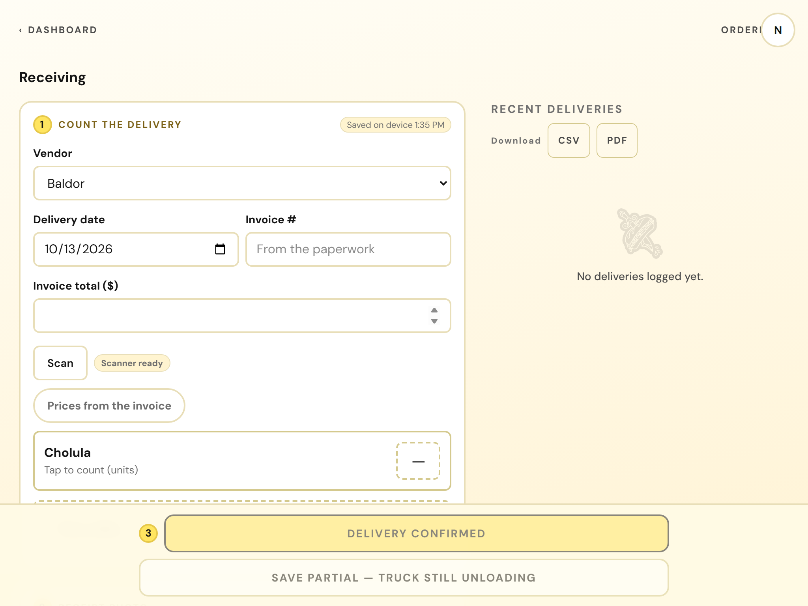

**What to do** — Under **Vendor**, tap **Pick a vendor…** and pick one. The vendor's usual order loads. Tap each line and type what came. Type the **Invoice #** and the **Invoice total ($)**.

**Worth knowing**

- The usual order may not match today's truck. It can be short, or hold items that did not come.
- A line marked **Suggested — from this vendor's usage** has no expected number. It says "Tap to count". Tap it and type what came.
- An item not on the list? Pick it in **Pick a SKU…**, then tap **+ Add item**.

#### 3. Flag a problem

**What you see**

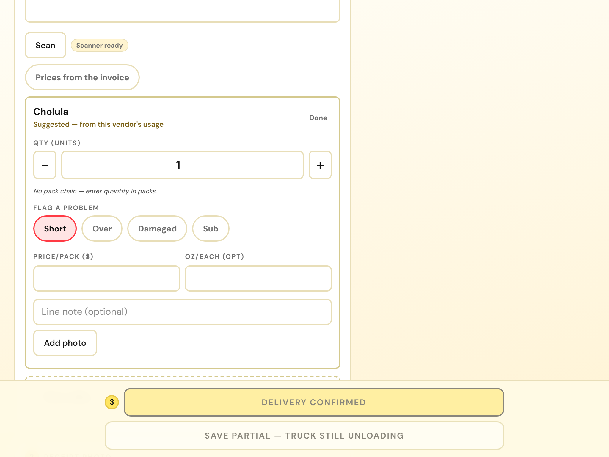

**What to do** — If a line is wrong, tap a button under **Flag a problem**: **Short**, **Over**, **Damaged** or **Sub**. Add a **Line note (optional)** if it helps.

**Worth knowing**

- A flag you picked turns pink with a solid red edge. Tap it again to take it off.
- Use **Short** when only part of an item came. Type what did come, then tap **Short**. This works on any delivery.
- A line needs a count above 0. So **Short** can't claim an item that never came at all.
- An item that never came is claimed with **Didn't arrive** in the next step. That works only when the delivery has a purchase order.

#### 4. Confirm the delivery

**What you see**

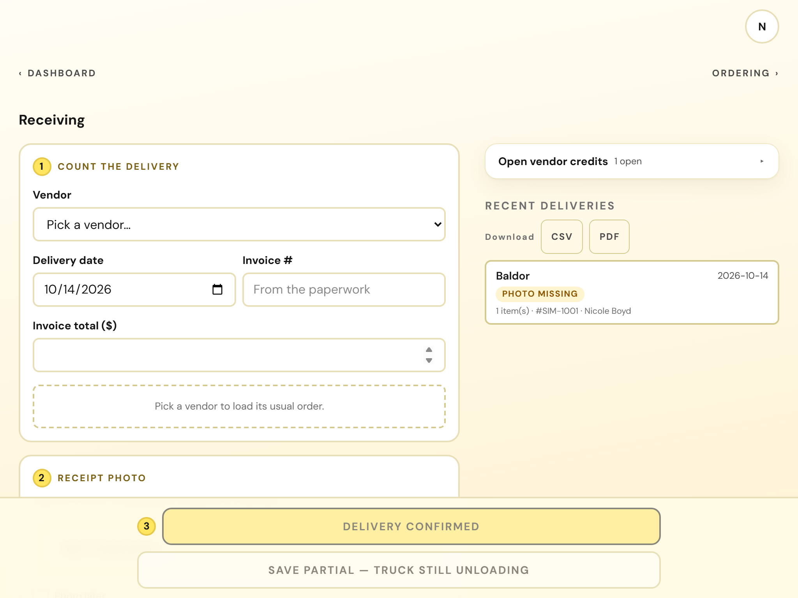

**What to do** — Tap **Take receipt photo**, or tick **Photo later**. Tap **Delivery confirmed**. If the truck is still unloading, tap **Save partial — truck still unloading** instead.

**Worth knowing**

- **Delivery confirmed** stays grey until at least one line has a count and you have taken the photo or ticked **Photo later**. A half-filled new-item line also blocks it.
- Type the **Invoice #** anyway. It helps match the paperwork later.
- Most of the time, one tap saves the delivery at once. There is no pop-up. The form clears for the next truck.
- A second step comes only for lines that show **Expected …**. Those come from a purchase order or the last delivery. If you leave one of them untouched (no count, no flag), the first tap lists it: **Some expected items were never confirmed**. Tap **Received** or **Didn't arrive** on each. The button now says **Tap again to confirm**. Tap it.
- Lines with no **Expected …**, like **Suggested** lines, never show in that list.
- With a purchase order, the app tells you how many shorts it will claim. With no purchase order, **Didn't arrive** claims nothing.
- Anything left blank is filed as not counted. It will show against the invoice.
- The delivery shows under **Recent deliveries**, lower on the same page. If you skipped the photo, it says **Photo missing**. Tap a delivery to see its lines, flags and credits.
- Each flag you picked (**Short**, **Over**, **Damaged** or **Sub**) opens a vendor credit. It shows under **Open vendor credits**, with how many are open.

### Mid-day prep

After the lunch rush, you count and prep back up to par. It is due from 2:00 PM and late after 3:30 PM.

#### 1. Start it

**What you see**

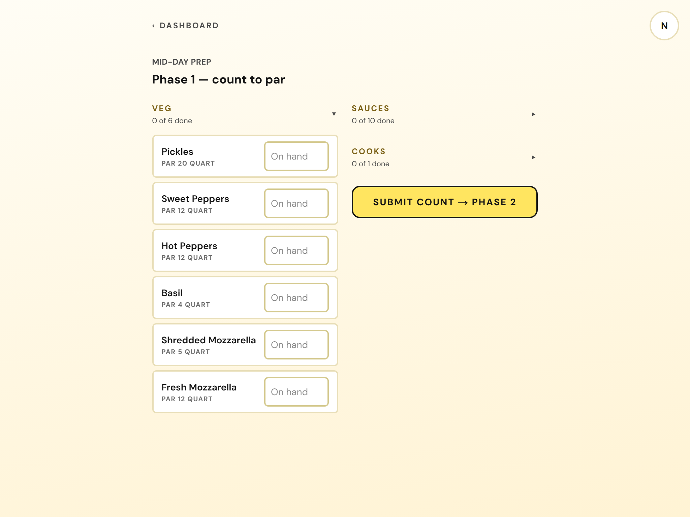

**What to do** — On the board, tap **Mid-day prep**, then **+ New mid-day prep**. If it is assigned to you, the **Mid-day Prep** tile works too.

**Worth knowing**

- Key holders and up can do it. An employee can do it when it is assigned to them today.
- A shop can do two a day at most. After that you see **Mid-day prep limit reached (2 per day).**

#### 2. Count to par

**What you see**

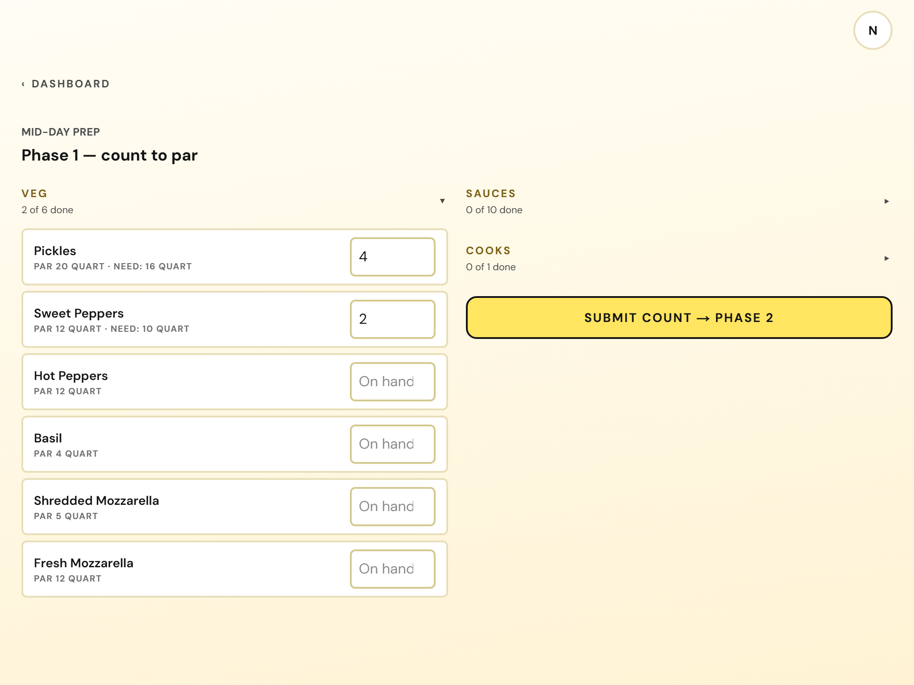

**What to do** — In **Phase 1 — count to par**, type what you have in **On hand** on each row. The row shows how much you need. Tap **Submit count → Phase 2**.

**Worth knowing**

- If a row can't load, a note says **Some items couldn't load** and names them. The rest still works. Tell a manager.

#### 3. Prep and finish

**What you see**

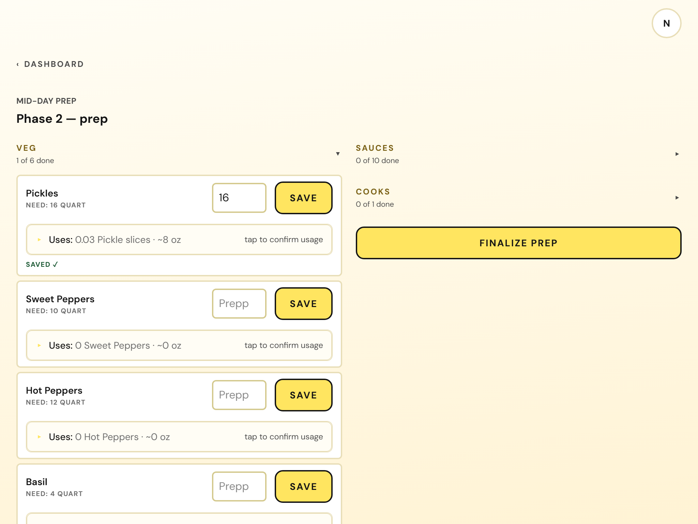

**What to do** — In **Phase 2 — prep**, each row shows **Need:**. Type what you made in **Prepped**. Tap **Save** on that row. Do this on every row. Then tap **Finalize prep**.

**Worth knowing**

- Each row has its own **Save**. A row is kept only after it says **Saved ✓**.
- Save every row before you tap **Finalize prep**. It does not stop you or warn you. A row you did not save is left out and shows **Made: —**.
- If you made more or less than the need, tap **Add over/under reason** on the row first. Then save it.
- When it is done, the page says **Finalized — prep made**, with who finished it and when. Each row shows what was **Made:**.
- This ticks the **Mid-day Prep** line on the closing checklist for you.
- After that, tapping **Mid-day prep** on the board opens the finished one.

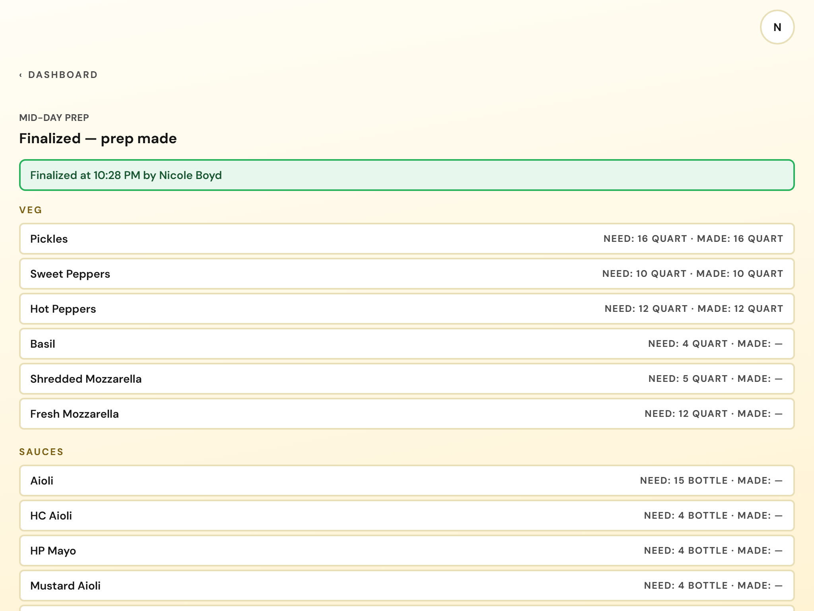

### Keep the closing checklist moving

The closing checklist is not only a night job. It runs all day, one station at a time.

#### 1. Open the checklist

**What you see**

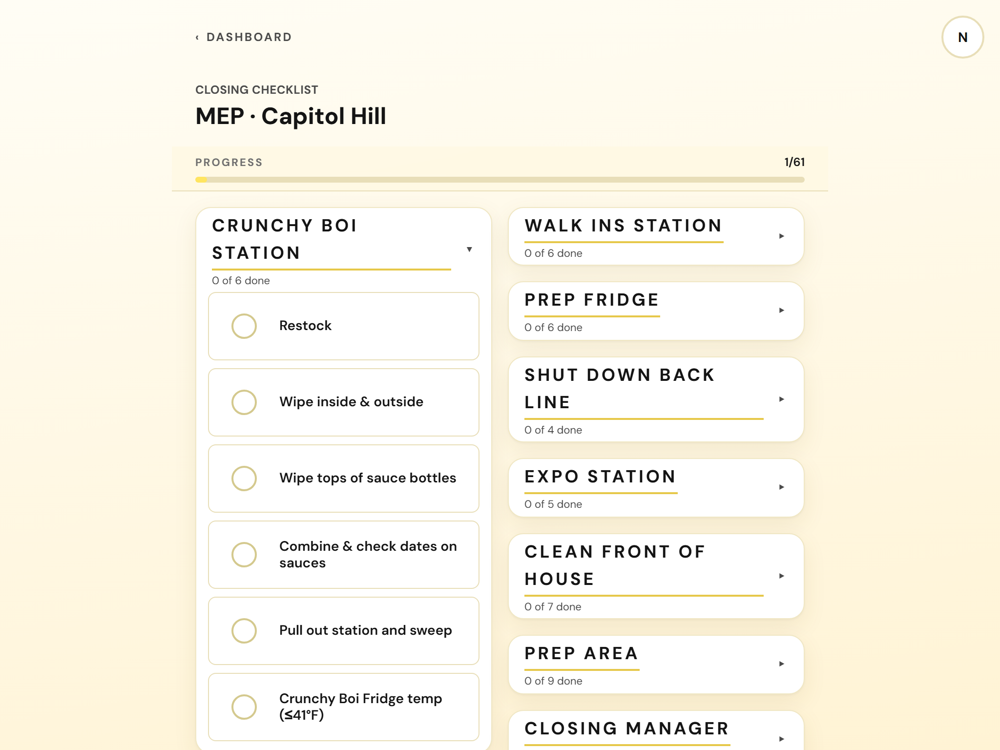

**What to do** — On the dashboard, tap **Start closing** or **Continue closing**. Or tap **Closing checklist** on the board.

**Worth knowing**

- No one needs to be assigned. Everyone on shift can use it.
- An employee or higher starts the day's list. Once it exists, a trainee can open it too.
- Some lines need a higher role. A station with such lines says how many are **awaiting higher role**.

#### 2. Close each station when it is done

**What you see**

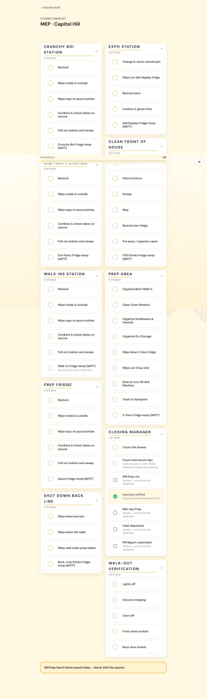

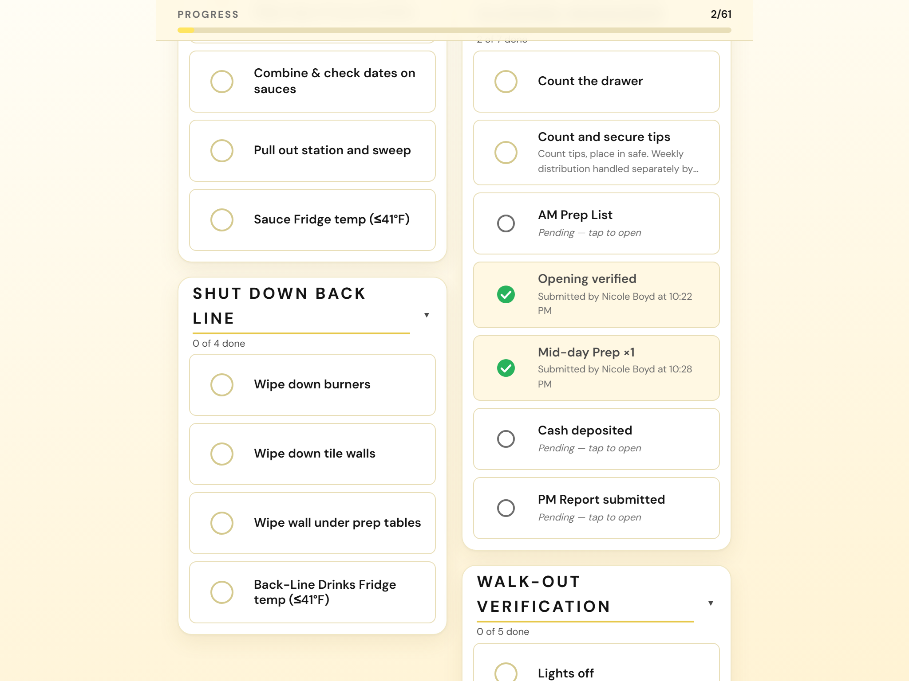

**What to do** — When a station winds down, tick its lines. When every line in a station is done, that station is closed. The board then shows **Closed · …** with the time.

**Worth knowing**

- The "usually closes" times on the board are hints only. Ticked lines close a station, not the clock.
- If a line is undone, the station opens again.
- Most report lines under **Closing Manager** are links, not tick boxes. They tick themselves when that report is filed. An open one says **Pending — tap to open**. Tap it to go to that report.
- Two lines there are normal tick lines: **Count the drawer** and **Count and secure tips**. Tick them yourself.
- **Add note** shows on a line after you tick it.
- The closing has its own fridge temp lines. Morning temps don't count for it.
- To fill a temp line, tap it. A **Temp (°F)** box opens. Type the temp and tap **Save**. The line ticks only after **Save**.
- The shop closes at 8:00 PM. The closing is late after 9:00 PM.

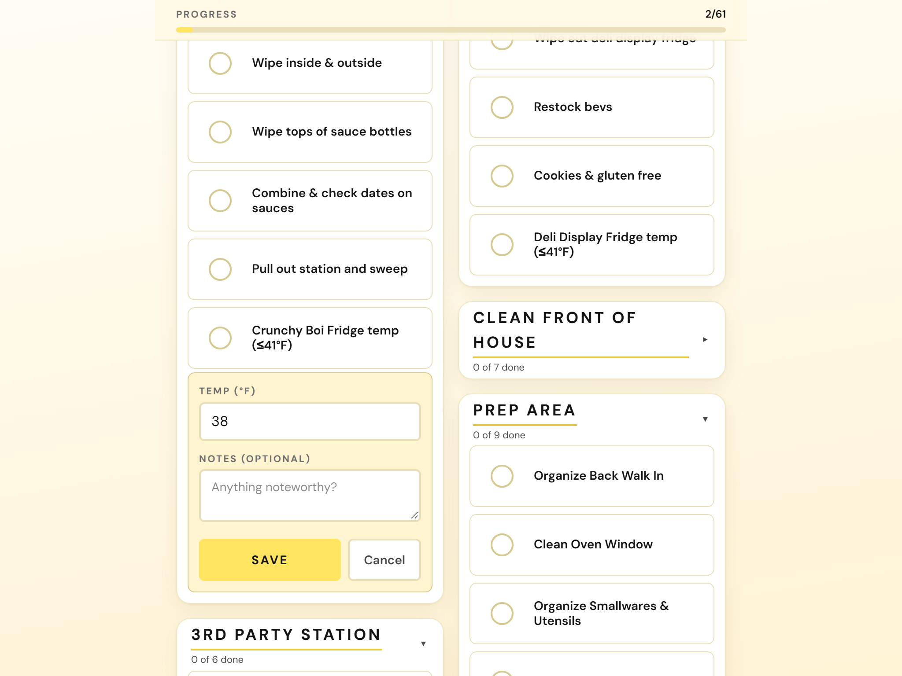

### Breaks and the end of a shift

Use these on the board or on **My shift**.

#### 1. Breaks and end of shift (not shown)

**What to do** — Tap **Start break** when someone goes on break. Tap **Back from break** when they return. When you leave, tap **End my shift**, then **Confirm change**.

**Worth knowing**

- **End my shift** frees your station and takes your open tasks off you.
- It does not clock you out of Toast.
- Key holders and up can do these for others at their role or below. For someone else, the button is **End shift**.

### En español

Entre la apertura y el cierre, vigilas la tienda, recibes camiones, preparas después del rush y mantienes la lista de cierre en marcha.

#### El Pulso de medio turno

Ábrelo cuando quieras ver la tienda de un vistazo. Se actualiza cada 60 segundos.

1. **Abre el Pulso.** Toca **Pulso de medio turno** en el menú. Lee primero **Requiere atención**: muestra lo que hay que resolver ya. Toca el botón de la línea; una estación sin nadie dice "… está sin cubrir" y tiene **Asignar**. Primero salen las líneas rojas: un reporte atrasado, una tarea tarde, un refrigerador fuera de rango, un corte de proveedor que pasó sin pedido (**se pasó el corte de las … — llama al proveedor**) o un pedido de ezCater que no está en Toast. Después, las estaciones; una estación sin nadie también sale en rojo. Al final, en amarillo, cosas menores, como refrigeradores sin revisar o artículos bajos respecto al par. Si nada va tarde, las estaciones encabezan la lista. La tarjeta muestra las primeras 8 líneas; toca **Ver más** para verlas todas. La prep de mediodía sale tarde solo después de las 3:30 PM.
2. **Lee las tarjetas.** **Piso en vivo** muestra las estaciones; toca una para ver detalles. **Inventario** muestra los cierres de pedido de hoy. **Seguridad alimentaria** muestra las temperaturas. **Entrega de turno** muestra qué reportes están listos. **Estaciones y tareas** cuenta solo las tareas repartidas en el tablero; **Entrega de turno** cuenta todos los reportes de hoy, así que los números pueden ser distintos. Un corte perdido también sale en rojo en **Inventario**: **se pasó el corte — llama al proveedor**. Lo que ves depende de tu rol. Encargados de llaves, entrenadores y líderes de turno ven todo menos el dinero. Los subgerentes también escriben notas de entrega. Los gerentes generales también ven **Ventas** y el dinero, y pueden usar **Organizar** en el plano. Un Gerente de Operaciones o más ve **Ambas tiendas** lado a lado; un gerente general solo ve sus tiendas. El título muestra el código y el nombre de la tienda que estás viendo. Si puedes ver más de una tienda, revísalo antes de actuar. Un solo botón cambia el plano: dice **Vista de mapa** o **Vista 3D**, la vista que sale al tocarlo.
3. **Ver más.** Toca **Ver más** en una tarjeta para la lista completa. Toca **‹ Pulso** para regresar.

#### Notas de entrega

Una nota de entrega le dice al siguiente turno lo que necesita saber. Todos la leen en el Pulso. Los subgerentes y roles más altos la escriben.

1. **Escribe una nota.** En el Pulso, baja hasta la última tarjeta, **Entrega de turno**. Toca el **Ver más** de arriba a la derecha de esa tarjeta, junto a su nombre. Cada tarjeta tiene su propio **Ver más**: usa el de **Entrega de turno**. Bajo **Escribir una nota de entrega**, elige **Quién debe verla**: **Para todos**, **Para el equipo** o **Para gerentes**. Escribe tu **Nota** y toca **Publicar nota**. Una nota puede tener hasta 1000 caracteres. El equipo solo ve las notas para el equipo o para todos, y no ve quién la escribió.
2. **Después de publicar.** Revisa tu nota. Muestra quién la escribió, la hora y dos botones: **Recibido** y **Retirar**. Los subgerentes y roles más altos tocan **Recibido** para mostrar que la leyeron; después la nota dice **Ya lo confirmaste**. **Retirar** quita la nota; solo puede hacerlo quien la escribió o un rol más alto. El formulario se vacía al publicar, así que puedes escribir otra nota.

#### Recibir una entrega

Lo haces cada vez que llega un camión. Encargado de llaves o más.

1. **Abre Recepción.** En el tablero, toca **Recepción**. También sirve la tarjeta **Recepción** si la tienes asignada, o el Centro de reportes: **Inventario** y luego **Recepción**.
2. **Elige el proveedor y cuenta.** En **Proveedor**, toca **Elige un proveedor…** y elige uno. Se carga su pedido habitual. Toca cada línea y escribe lo que llegó. Escribe **Factura #** y **Total de factura ($)**. El pedido habitual puede no cuadrar con el camión de hoy: le pueden faltar cosas o tener cosas que no llegaron. Una línea marcada **Sugerido — según el uso de este proveedor** no tiene número esperado; dice "Toca para contar". Tócala y escribe lo que llegó. ¿Llegó algo que no está en la lista? Elígelo en **Elige un SKU…** y toca **+ Agregar artículo**.
3. **Marca un problema.** Si una línea está mal, toca un botón bajo **Marca un problema**: **Faltante**, **De más**, **Dañado** o **Sustituto**. Agrega una **Nota de línea (opcional)** si ayuda. La marca que elegiste se pone rosa con borde rojo; tócala otra vez para quitarla. Usa **Faltante** cuando llegó solo una parte: escribe lo que sí llegó y toca **Faltante**. Esto sirve en cualquier entrega. Una línea necesita una cantidad mayor que 0, así que **Faltante** no reclama algo que no llegó nada. Lo que no llegó nada se reclama con **No llegó** en el siguiente paso, y solo si la entrega tiene orden de compra.
4. **Confirma la entrega.** Toca **Toma foto del recibo** o marca **Foto después**. Toca **Entrega confirmada**. Si el camión sigue descargando, toca **Guardar parcial — el camión sigue descargando**. **Entrega confirmada** sigue gris hasta que al menos una línea tenga cantidad y tomes la foto o marques **Foto después**. Una línea de artículo nuevo a medio llenar también lo bloquea. Escribe la **Factura #** de todos modos: ayuda a cuadrar los papeles después. Casi siempre, un solo toque guarda la entrega de una vez, sin ventana emergente, y el formulario se vacía para el siguiente camión. Solo hay un segundo paso con las líneas que dicen **Esperado …**, que vienen de una orden de compra o de la última entrega. Si dejas una de esas sin tocar (sin cantidad ni marca), el primer toque la muestra: **No confirmaste algunos artículos esperados**. Toca **Sí llegó** o **No llegó** en cada una. El botón ahora dice **Toca otra vez para confirmar**; tócalo. Las líneas sin **Esperado …**, como las **Sugerido**, nunca salen en esa lista. Con orden de compra, la app te dice cuántos faltantes va a reclamar. Sin orden de compra, **No llegó** no reclama nada. Lo que dejes sin responder se registra como no contado y aparece contra la factura. La entrega sale en **Entregas recientes**, más abajo en la misma página; si no tomaste foto, dice **Falta foto**. Toca una entrega para ver sus líneas, marcas y créditos. Cada marca que elegiste (**Faltante**, **De más**, **Dañado** o **Sustituto**) abre un crédito de proveedor. Aparece en **Créditos de proveedor abiertos**, con cuántos hay abiertos.

#### Prep de mediodía

Después del rush del almuerzo, cuentas y preparas hasta volver al par. Toca desde las 2:00 PM y va tarde después de las 3:30 PM.

1. **Empieza.** En el tablero, toca **Preparación del mediodía** y luego **+ Nueva preparación de mediodía**. Si la tienes asignada, también sirve la tarjeta **Preparación de mediodía**. Un encargado de llaves o más puede hacerla; un empleado, si hoy la tiene asignada. Una tienda puede hacer dos al día como máximo; después ves **Límite de preparación de mediodía alcanzado (2 por día).**
2. **Cuenta al par.** En **Fase 1 — conteo al par**, escribe lo que tienes en **En mano** en cada fila. La fila muestra cuánto falta. Toca **Enviar conteo → Fase 2**. Si una fila no carga, una nota dice **Algunos artículos no se pudieron cargar** y los nombra; lo demás funciona. Avísale a un gerente.
3. **Prepara y termina.** En **Fase 2 — preparación**, cada fila muestra **Falta:**. Escribe lo que preparaste en **Preparado** y toca **Guardar** en esa fila. Hazlo en cada fila. Luego toca **Finalizar preparación**. Cada fila tiene su propio **Guardar**, y queda solo cuando dice **Guardado ✓**. Guarda cada fila antes de finalizar: el botón no te detiene ni te avisa. Una fila sin guardar queda fuera y muestra **Hecho: —**. Si hiciste más o menos de lo necesario, primero toca **Agregar razón sobre/bajo par** en la fila y luego guárdala. Al terminar, la página dice **Finalizada — preparación hecha**, con quién la terminó y a qué hora, y cada fila muestra lo **Hecho:**. La línea de prep de mediodía en la lista de cierre se marca sola. Después, tocar **Preparación del mediodía** en el tablero abre la que ya terminaste.

#### Mantén la lista de cierre en marcha

La lista de cierre no es solo de la noche. Corre todo el día, estación por estación.

1. **Abre la lista.** En el dashboard, toca **Empezar cierre** o **Continuar cierre**. O toca **Lista de cierre** en el tablero. No hace falta asignar a nadie; todos en el turno la usan. Un empleado o más empieza la lista del día; ya creada, un aprendiz también la abre. Algunas líneas necesitan un rol más alto; la estación dice cuántas están **esperando rol superior**.
2. **Cierra cada estación cuando termine.** Cuando una estación va bajando, marca sus líneas. Cuando todas las líneas de una estación están listas, esa estación queda cerrada, y el tablero muestra **Cerrada · …** con la hora. Las horas de "cierra normalmente" son solo una guía: las líneas marcadas cierran la estación, no el reloj. Si se desmarca una línea, la estación se vuelve a abrir. Casi todas las líneas de reportes bajo **Gerente de cierre** (Closing Manager) son enlaces, no casillas; se marcan solas al enviar el reporte. Una pendiente dice **Pendiente — toca para abrir**: tócala para ir a ese reporte. Dos líneas ahí son casillas normales: **Contar la caja** y **Contar y guardar propinas**. Márcalas tú. **Agregar nota** sale en una línea después de marcarla. El cierre tiene sus propias líneas de temperatura; las de la mañana no cuentan. Para llenar una línea de temperatura, tócala: se abre la casilla **Temp (°F)**. Escribe la temperatura y toca **Guardar**. La línea se marca solo después de **Guardar**. La tienda cierra a las 8:00 PM y el cierre va tarde después de las 9:00 PM.

#### Descansos y fin de turno

Úsalos en el tablero o en **Mi turno**. Toca **Iniciar descanso** cuando alguien sale a descansar y **Volver del descanso** cuando regresa. Cuando te vas, toca **Terminar mi turno** y luego **Confirma el cambio**. Eso libera tu estación y te quita las tareas abiertas. No te saca del reloj de Toast. Un encargado de llaves o más puede hacerlo por otros de su rol o menor; para otra persona el botón es **Terminar turno**.

---

## Night

Night jobs go in this order: AM prep, the PM report, the cash deposit, then confirm the closing.

### AM prep: the closing count

AM prep is a night job. Before you leave, you count what is left. The morning crew reads your count as their **Closer count**. On the board it is listed as **AM prep**, but you do it at night.

#### 1. Start the closing checklist first (not shown)

**What to do** — On the dashboard, tap **Start closing** if the closing has not started yet.

**Worth knowing**

- AM prep won't submit until the closing is started. You would see **Closing not yet started — start it from the dashboard, then re-submit AM Prep**. Your counts are kept.

#### 2. Open AM prep

**What you see**

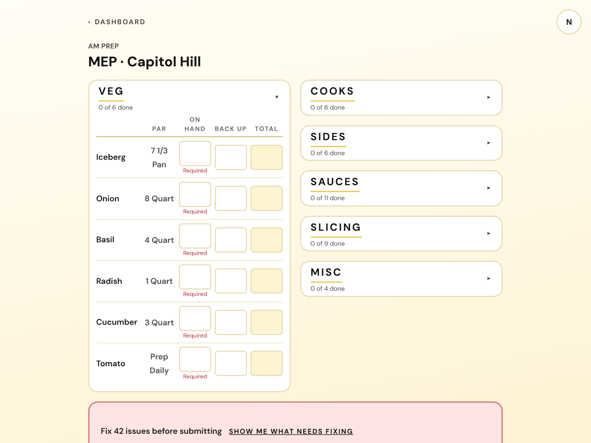

**What to do** — On the board, tap **AM prep**. If it is assigned to you, use the **AM Prep** tile and tap **Start AM Prep**. You can also tap the AM Prep line on the closing checklist.

**Worth knowing**

- Key holders and up can do it. An employee can do it when it is assigned to them today.

#### 3. Count every row

**What you see**

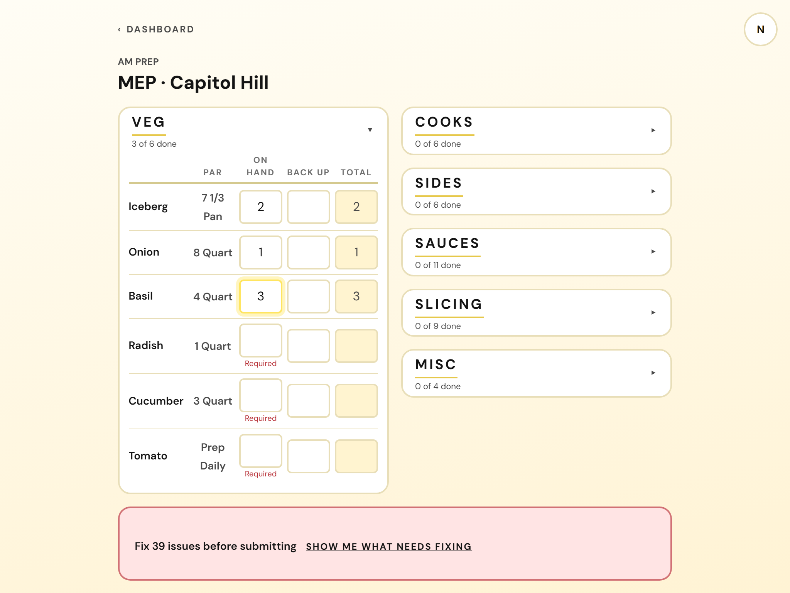

**What to do** — Type what is on the line in **ON HAND**. Type the bulk container in **BACK UP**. **TOTAL** fills itself.

**Worth knowing**

- Every row needs a number. A red **Required** tag marks the empty ones.
- **BACK UP** can stay empty. It is the bulk the opener starts from.
- In Sauces and Slicing, the first box is **LINE**: what is on the line. In Sides, it is **PORT**: the portioned items.
- Misc rows are questions. Tap **YES** or **NO**.
- If a row can't load, a note says **Some items couldn't load** and names them. The rest of the page still works and still submits. Tell a manager. They fix it in Admin.
- The count saves as you go. Another person can pick it up where you left off. The page then says who saved it last.

#### 4. Submit AM Prep

**What you see**

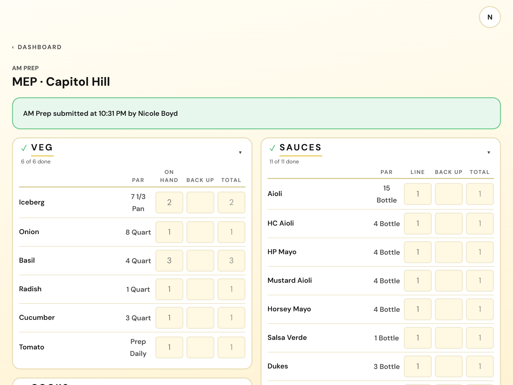

**What to do** — Tap **Submit AM Prep**.

**Worth knowing**

- Until every row is filled, the button reads **Fix issues before submitting**. Tap **Show me what needs fixing**.
- When it goes in, a banner says **AM Prep submitted at … by …**. The AM Prep line on the closing ticks itself.
- From 6 PM, until AM prep is in, the closing shows a yellow note: **Tonight’s AM prep count isn’t in yet. The closer does it before lock-up.** It never blocks the closing.

### PM report

You do this once a night. Key holders and up.

#### 1. Open the PM report

**What you see**

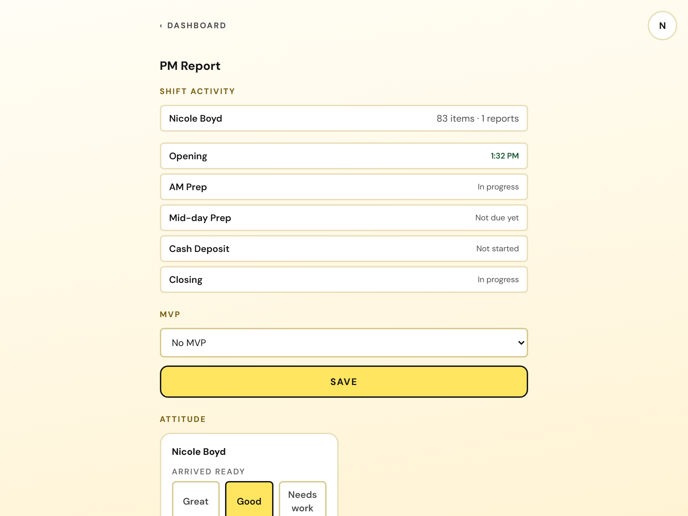

**What to do** — On the board, tap **PM report**. If it is assigned to you, the **PM Report** tile works too.

**Worth knowing**

- **Shift activity** shows who did what and which reports are in.

#### 2. Grade each person

**What you see**

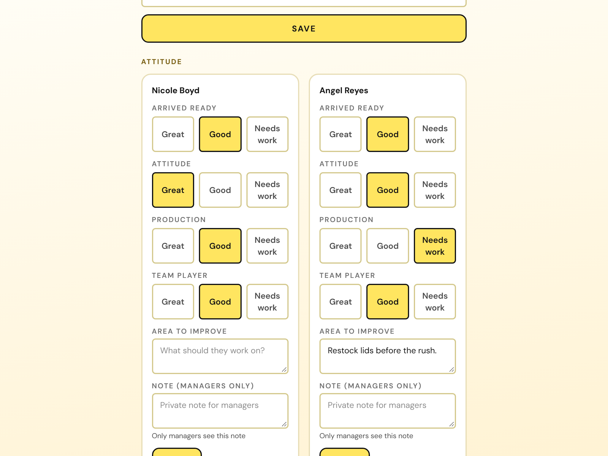

**What to do** — Each person gets four grades: **Arrived ready**, **Attitude**, **Production** and **Team player**. Tap **Great**, **Good** or **Needs work** on each. Tap **Save** on the card.

**Worth knowing**

- Nothing is picked to start. **Save** stays grey until all four lines have a grade: **Pick a grade on every line to save.**
- After you tap **Save**, the button says **Saved ✓** for about two seconds. Then it goes back to **Save**. Your grades are kept.
- Only saved cards count. A card you don't save is not graded.
- Type in **Area to improve** if they need to work on something.
- **Note (managers only)** is private: **Only managers see this note**.
- At first the list shows today's team at this shop: people who were on shift, held a station or had a task. Anyone already graded shows too. To add someone, use **Select employee…** at the bottom.

#### 3. Pick an MVP

**What you see**

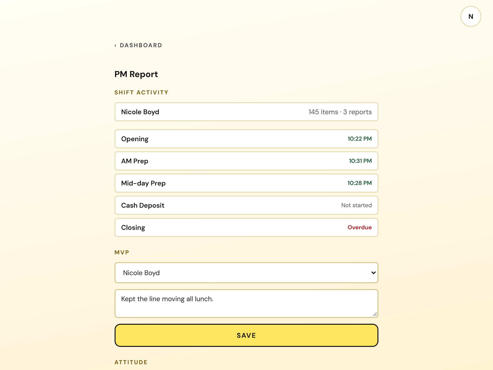

**What to do** — Under **MVP**, pick a person. Type why in **Why MVP?**. Tap **Save**.

**Worth knowing**

- The MVP is your choice. You can leave **No MVP**.

#### 4. Submit it

**What you see**

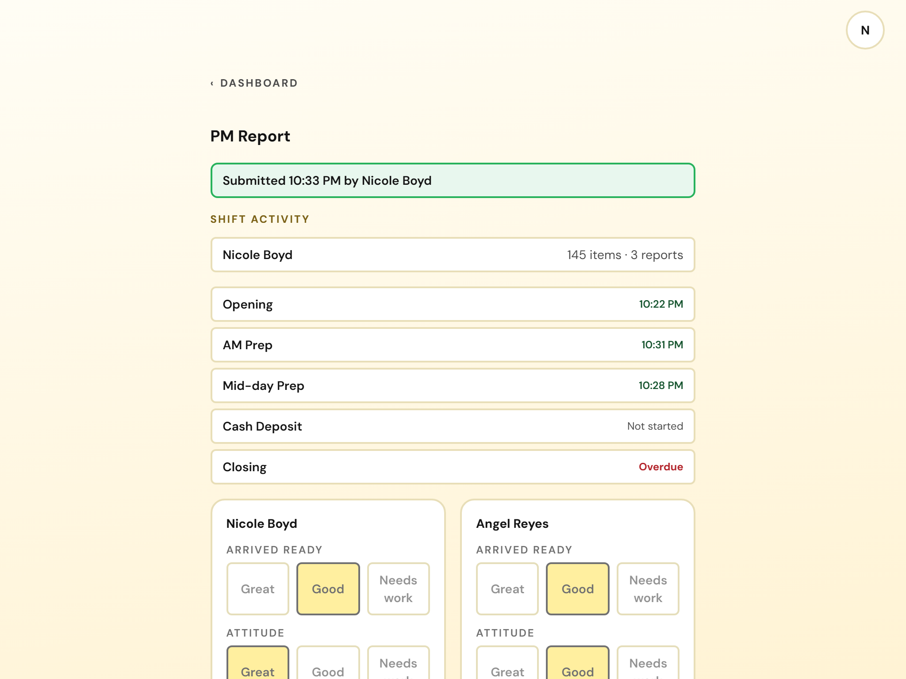

**What to do** — Tap **Submit PM Report**.

**Worth knowing**

- A green banner says **Submitted … by …**. The grades lock.
- Each person you graded gets a **New shift feedback** notice. They see their grades in **My Performance**.

### Cash deposit

You do this once a night, before you confirm the closing. Key holders and up.

#### 1. Open it

**What you see**

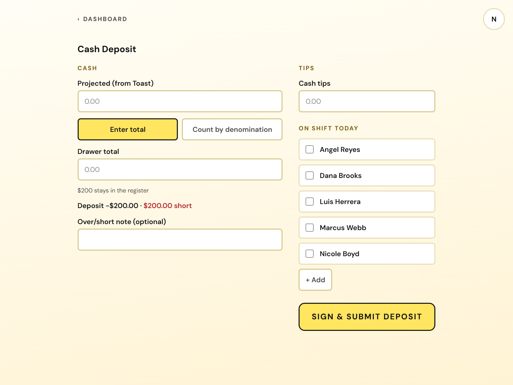

**What to do** — On the board, tap **Cash report**. The page is called **Cash Deposit**. You can also use the **Cash Deposit** tile, or the **Do the cash deposit** button on the closing.

#### 2. Fill it in

**What you see**

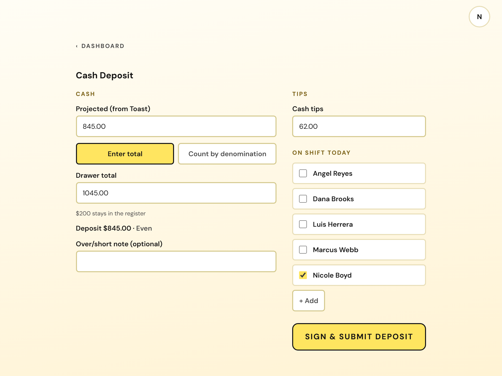

**What to do** — Check the **Projected (from Toast)** amount. It fills in by itself with today's cash sales in Toast. Under it, a line says when: "From Toast · 10:40 PM". Count the drawer with **Enter total** or **Count by denomination**. Type the **Drawer total** and the **Cash tips**. Tick who worked under **On shift today**.

**Worth knowing**

- No Toast number yet? The box stays empty and says so. Type the projected amount yourself.
- You can change the number. The form then says "Changed from Toast" with Toast's number. The saved deposit keeps Toast's number too.
- **$200 stays in the register**. The deposit is the drawer total minus $200.
- So the drawer total includes the $200. Count all the cash in the drawer.
- On an even night, the drawer total is the projected amount plus $200. Example: projected $845, drawer $1,045, deposit $845, **Even**.
- The app compares the deposit to the projected amount and shows over or short. This shows once you have typed the projected amount and the drawer.
- If it is off, explain in **Over/short note (optional)**.
- **On shift today** lists the whole team. Tick only the people who worked. **+ Add** adds a name.

#### 3. Sign it

**What you see**

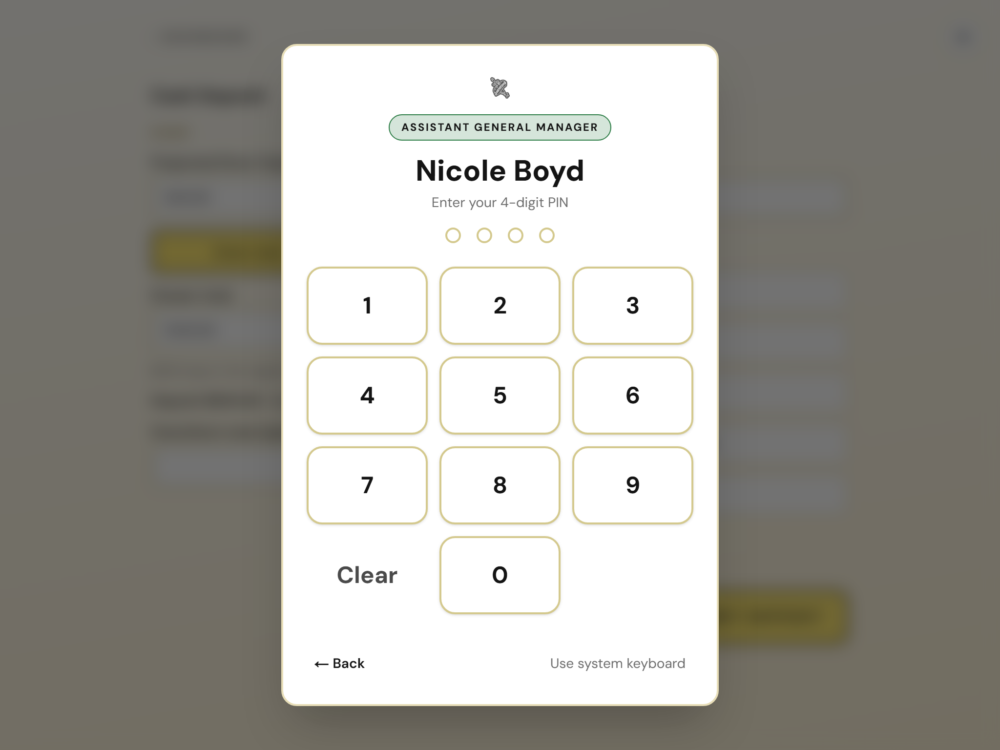

**What to do** — Tap **Sign & submit deposit**. Type your PIN.

#### 4. Done

**What you see**

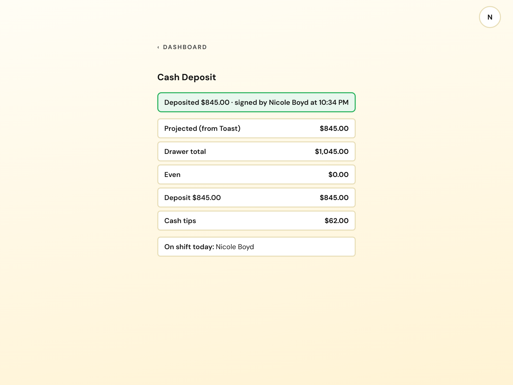

**What to do** — Check the amounts.

**Worth knowing**

- A green line says **Deposited … · signed by … at …**. Below it are the amounts, the deposit, the cash tips and who was on shift.
- On an even night, this page says **Even**, just like the form did.
- Once signed, the deposit is read-only. You can't redo it. Check the amounts before you sign.
- If the closing is confirmed before anyone files the deposit, the page is locked: **Today's closing is already finalized — the cash deposit is locked.**
- Filing it ticks the cash line on the closing. You can't confirm the closing without it.

### Confirm the closing

This is the last job of the night. Key holders and up.

#### 1. Do the walk-out

**What you see**

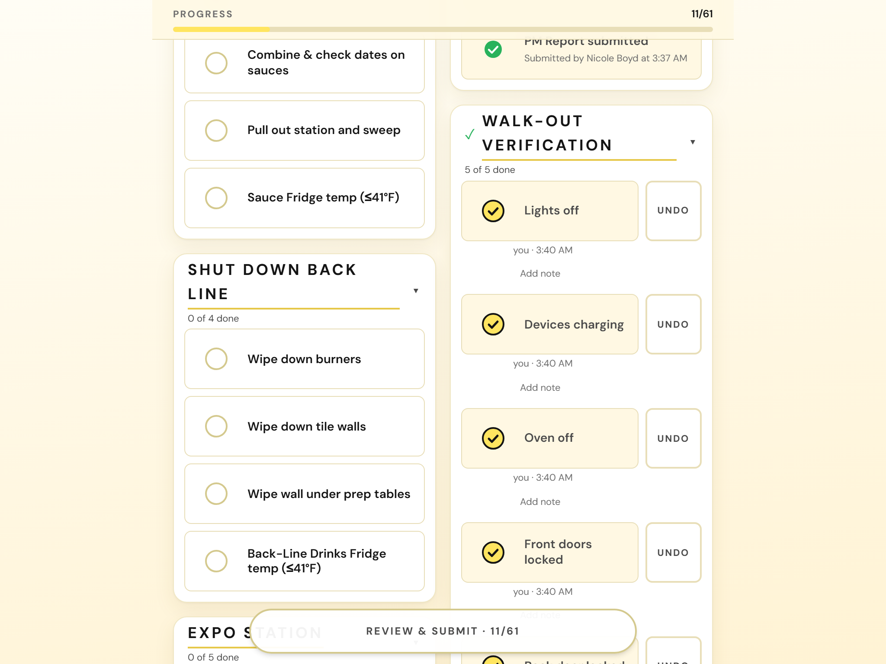

**What to do** — Tap **Continue closing**. In **Walk-Out Verification**, tick all five: lights off, devices charging, oven off, front doors locked, back door locked.

**Worth knowing**

- You can't confirm the closing until all five are ticked.

#### 2. Review and explain

**What you see**

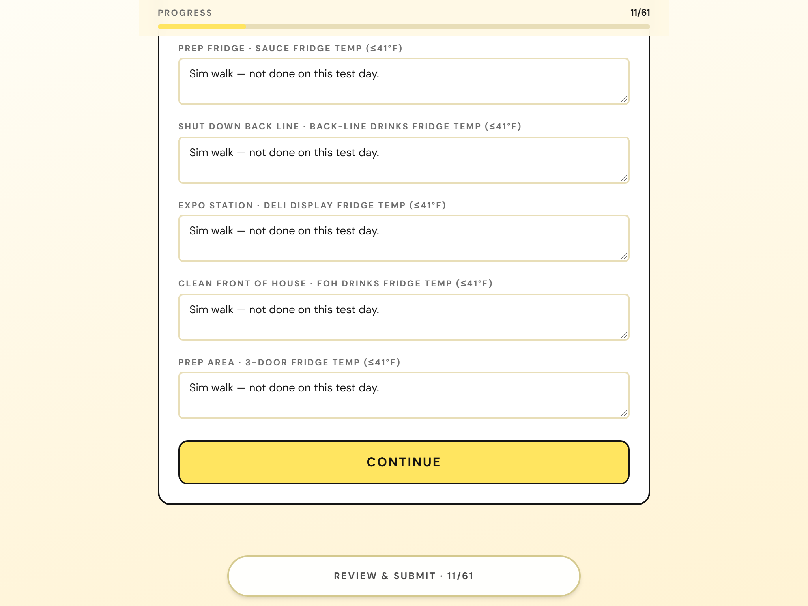

**What to do** — Tap **Review & submit**. If lines are still open, it reads **Review & submit (incomplete)**. Type a reason in each **Why couldn't this be completed?** box. Tap the yellow **Continue** at the bottom of the reasons panel.

**Worth knowing**

- Some lines are hard stops. No reason will do. You must finish them.
- The cash deposit must be in. If not, you see **Cash deposit required before you can finalize the closing.**
- Your role must be as high as the highest role on any ticked line.

#### 3. Confirm with your PIN

**What you see**

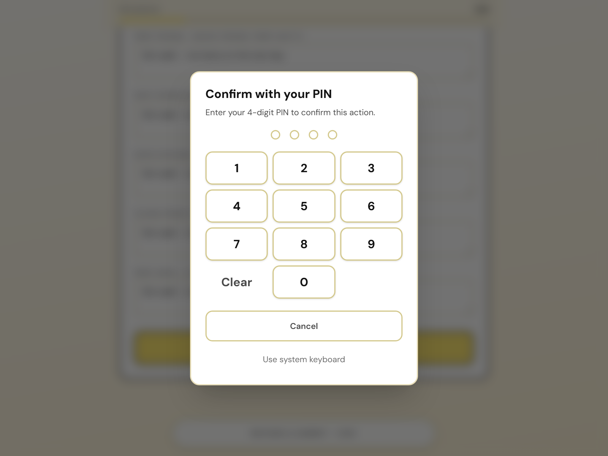

**What to do** — In **Confirm with your PIN**, type your PIN.

**Worth knowing**

- The fourth digit sends it. The keypad then waits a moment. Don't tap again.

#### 4. The closing is done

**What you see**

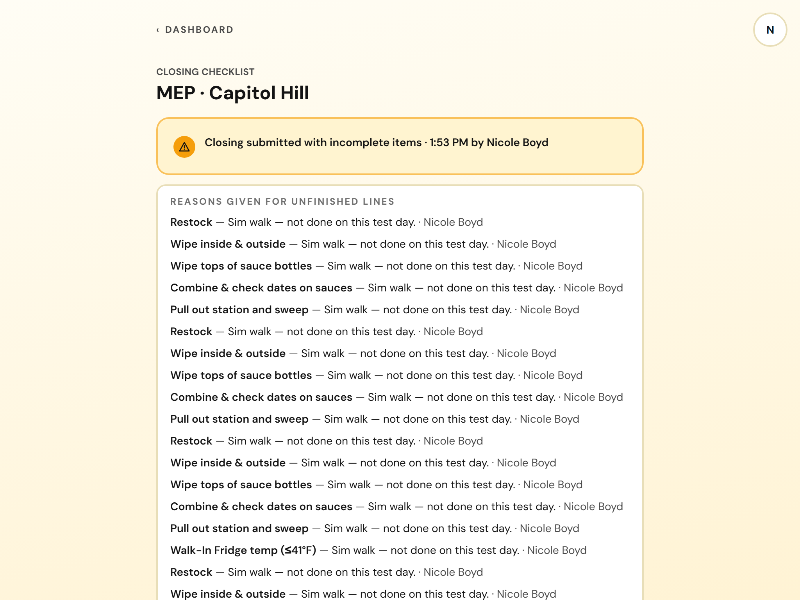

**What to do** — Check the banner. With every line done, it says **Closing confirmed … by …**, with the time and "you". With reasons, it says **Closing submitted with incomplete items … by …**. Every line turns grey.

**Worth knowing**

- Under the banner, **Reasons given for unfinished lines** lists each line, its reason and who wrote it. It shows right away.
- The list can't be changed after this.
- The dashboard card then says **Closed** or **Closed with items incomplete**, with **Review closing**.
- If no one confirms, the dashboard warns the next day. The opener has to wait until it is confirmed or released.

### If you see "This checklist is already confirmed."

This can show right after your PIN.

#### 1. Check the dashboard

**What to do** — If you see **This checklist is already confirmed.**, someone already submitted this closing. Maybe they did it on another device. It is saved. Don't redo it. Go to the dashboard. The closing card says **Closed** or **Closed with items incomplete**. Tap **Review closing** to see it.

### En español

En la noche, el orden es: AM prep, reporte PM, depósito de efectivo y confirmar el cierre.

#### AM prep: el conteo del cierre

AM prep es un trabajo de la noche. Antes de irte, cuentas lo que queda. El equipo de la mañana lee tu conteo como su **Conteo de cierre**. Ojo: en el tablero la tarea se llama **Preparación de la mañana**, pero se hace en la noche.

1. **Primero empieza la lista de cierre (sin foto).** En el dashboard, toca **Empezar cierre** si el cierre no ha empezado. AM prep no se envía hasta que el cierre esté empezado; verías **El cierre no ha comenzado — ábrelo desde el dashboard, luego envía de nuevo**. Tus conteos se guardan.
2. **Abre AM prep.** En el tablero, toca **Preparación de la mañana**. Si la tienes asignada, usa la tarjeta **Lista de Prep AM** y toca **Iniciar Lista de Prep AM**. También puedes tocar la línea de AM Prep en la lista de cierre. Un encargado de llaves o más puede hacerlo; un empleado, si hoy lo tiene asignado.
3. **Cuenta cada fila.** Escribe lo que hay en la línea en **EN MANO**. Escribe el recipiente a granel en **RESPALDO**. **TOTAL** se llena solo. Cada fila necesita un número; una etiqueta roja **Obligatorio** marca las vacías. **RESPALDO** puede quedar vacío: es lo que tiene a granel el que abre. En Sauces y Slicing, la primera casilla es **LÍNEA**: lo que hay en la línea. En Sides es **PORC**: las porciones. Las filas de Misc son preguntas: toca **SÍ** o **NO**. Si una fila no carga, una nota dice **Algunos artículos no se pudieron cargar** y los nombra. El resto de la página funciona y se puede enviar. Avísale a un gerente; lo corrige en Admin. El conteo se guarda solo. Otra persona puede seguir donde lo dejaste; la página dice quién guardó por última vez.
4. **Envía.** Toca **Enviar Lista de Prep AM**. Hasta llenar todas las filas, el botón dice **Corrige los errores antes de enviar**; toca **Muéstrame qué hay que corregir**. Al enviarlo, un aviso dice **Lista de Prep AM enviada a las … por …** y la línea de AM Prep del cierre se marca sola. Desde las 6 PM, mientras no esté el AM prep, el cierre muestra una nota amarilla: **El conteo de preparación AM de esta noche aún no está. Quien cierra lo hace antes de cerrar el local.** Nunca bloquea el cierre.

#### Reporte PM

Lo haces una vez por noche. Encargado de llaves o más.

1. **Abre el reporte PM.** En el tablero, toca **Reporte PM**. Si lo tienes asignado, también sirve la tarjeta **Reporte PM**. **Actividad del turno** muestra quién hizo qué y qué reportes están.
2. **Califica a cada persona.** Cada persona tiene cuatro notas: **Llegó listo**, **Actitud**, **Producción** y **Trabajo en equipo**. En cada una toca **Excelente**, **Bien** o **Necesita mejorar**, y luego **Guardar** en la tarjeta. Al inicio no hay nada marcado. **Guardar** sigue gris hasta que las cuatro líneas tengan nota: **Elige una calificación en cada línea para guardar.** Al tocar **Guardar**, el botón dice **Guardado ✓** unos dos segundos y luego vuelve a **Guardar**; tus notas quedan guardadas. Solo cuentan las tarjetas guardadas; una tarjeta sin guardar no queda calificada. Escribe en **Área a mejorar** si hace falta. **Nota (solo gerentes)** es privada: **Solo los gerentes ven esta nota**. Al principio sale el equipo de hoy en esta tienda: quienes estuvieron en turno, tuvieron estación o tuvieron una tarea. También salen los que ya calificaste. Para agregar a alguien, usa **Selecciona empleado…** abajo.
3. **Elige un MVP.** En **MVP**, elige a una persona. Escribe por qué en **¿Por qué MVP?** y toca **Guardar**. Es tu decisión; puedes dejar **Sin MVP**.
4. **Envíalo.** Toca **Enviar Reporte PM**. Un aviso verde dice **Enviado … por …** y las notas quedan fijas. Cada persona que calificaste recibe el aviso **Nuevo comentario de turno** y ve sus notas en **Mi Desempeño**.

#### Depósito de efectivo

Lo haces una vez por noche, antes de confirmar el cierre. Encargado de llaves o más.

1. **Ábrelo.** En el tablero, toca **Reporte de caja**. La página se llama **Depósito de efectivo**. También sirve la tarjeta **Depósito de efectivo** o el botón **Hacer el depósito de efectivo** en el cierre.
2. **Llénalo.** Revisa **Proyectado (de Toast)**. Se llena solo con las ventas en efectivo de hoy en Toast. Debajo, una línea dice cuándo: "De Toast · 10:40 PM". ¿Toast todavía no tiene la cifra? La casilla queda vacía y lo dice: escribe tú lo proyectado. Puedes cambiar el número; el formulario dice entonces "Cambiado respecto a Toast" con la cifra de Toast, y el depósito guardado también guarda la cifra de Toast. Cuenta la caja con **Ingresar total** o **Contar por billete**. Escribe **Total de la caja** y **Propinas en efectivo**. Marca en **En turno hoy** a quienes trabajaron. **$200 se quedan en la caja**: el depósito es el total de la caja menos $200. O sea, el total de la caja incluye los $200: cuenta todo el efectivo de la caja. En una noche exacta, el total de la caja es lo proyectado más $200. Ejemplo: proyectado $845, caja $1,045, depósito $845, **Exacto**. La app compara el depósito con lo proyectado y muestra si sobra o falta; esto sale cuando ya escribiste lo proyectado y la caja. Si no cuadra, explica en **Nota de sobra/falta (opcional)**. **En turno hoy** muestra a todo el equipo: marca solo a quienes trabajaron. **+ Agregar** suma un nombre.
3. **Fírmalo.** Toca **Firmar y enviar depósito** y escribe tu PIN.
4. **Listo.** Revisa los montos. Una línea verde dice **Depositado … · firmado por … a las …**. Debajo están los montos, el depósito, las propinas y quién estuvo en turno. En una noche exacta, esta página dice **Exacto**, igual que el formulario. Ya firmado, el depósito es de solo lectura: no lo puedes rehacer. Revisa los montos antes de firmar. Si el cierre se confirma antes de que alguien envíe el depósito, la página queda bloqueada: **El cierre de hoy ya está finalizado — el depósito de efectivo está bloqueado.** Al enviarlo se marca la línea de efectivo del cierre. Sin él no puedes confirmar el cierre.

#### Confirmar el cierre

Es el último trabajo de la noche. Encargado de llaves o más.

1. **Haz la salida.** Toca **Continuar cierre**. En **Verificación de salida** (Walk-Out Verification), marca las cinco: luces apagadas, aparatos cargando, horno apagado, puertas de enfrente con llave, puerta de atrás con llave. No puedes confirmar el cierre hasta marcar las cinco.
2. **Revisa y explica.** Toca **Revisar y enviar**. Si quedan líneas abiertas, dice **Revisar y enviar (incompleto)**. Escribe un motivo en cada casilla **¿Por qué no se completó?** y toca el botón amarillo **Continuar** al final del panel de motivos. Algunas líneas son obligatorias sin excusa: debes terminarlas. El depósito de efectivo debe estar; si no, ves **Se requiere el depósito de efectivo antes de finalizar el cierre.** Tu rol debe ser igual o más alto que el rol más alto de las líneas marcadas.
3. **Confirma con tu PIN.** En **Confirma con tu PIN**, escribe tu PIN. El cuarto dígito lo envía; luego el teclado espera un momento. No vuelvas a tocar.
4. **El cierre está listo.** Revisa el aviso. Si todo se hizo, dice **Cierre confirmado … por …**, con la hora y "tú". Con motivos, dice **Cierre enviado con ítems sin completar … por …**. Todas las líneas se ponen grises. Debajo del aviso, **Motivos indicados para las líneas sin terminar** muestra enseguida cada línea, su motivo y quién lo escribió. Ya no se puede cambiar. La tarjeta del dashboard dice **Cerrado** o **Cerrado con pendientes**, con **Revisar cierre**. Si nadie confirma, el dashboard avisa al día siguiente, y el que abre tiene que esperar a que se confirme o se libere.

#### Si ves "Esta lista ya está confirmada."

Si ves **Esta lista ya está confirmada.** justo después de tu PIN, alguien ya envió este cierre, quizás en otro aparato. Está guardado; no lo rehagas. Ve al dashboard: la tarjeta del cierre dice **Cerrado** o **Cerrado con pendientes**. Toca **Revisar cierre** para verlo.

---

## Manager tools

These are the jobs and pages you use beyond the daily reports.

### Counts (Inventory Audit)

Run a full count when the owner asks for one. Key holders and up can record it.

#### 1. Open it

**What you see**

**What to do** — On the board, tap **Counts**. If it is assigned to you, the **Inventory Audit** tile works too.

**Worth knowing**

- AGMs and up can also open it from the Reports Hub: **Inventory**, then **Counts and variance**.
- Only AGMs and up see the on-hand side of the page.

#### 2. Add your lines

**What you see**

**What to do** — Pick the item in **Pick an item…**. Fill in **Unit**. Type **How many**. For a part of a container, tick **Loose (below a full container)** and type the part. Tap **+ Add item** for the next line.

**Worth knowing**

- **Unit** is a list or a box, by item. An item with packs set up shows a list (**Pick a unit…**), like Case or head. Pick one. Many items have no list. Then **Unit** is a box that says **Unit (e.g. tub)**. Type the unit, like each or tub.
- A unit is required. A line with no unit is not saved, even with a number in **How many**.
- **Record audit** stays grey until at least one line has all three: an item, a unit and **How many**.
- **How many** must be more than 0.
- Count each unit once. Count full containers first, then loose ones.
- Finish every line you want saved. A yellow note warns you: **… unfinished line(s) — they won't be saved**.
- If a unit won't work for an item, a red message says nothing was saved. Pick a unit from that item's list. No list, and the typed unit still fails? The item has no pack size or weight set up yet. Remove that line and ask your GM to add it.

#### 3. Confirm it

**What you see**

**What to do** — Key holders, trainers and shift leads: type your PIN in the **PIN** box next to the button first. **Record audit** stays grey until it has 4 digits. Then tap **Record audit**. AGMs and up: tap **Record audit**. Then type your password in **Confirm your password**.

#### 4. The recorded count

**What you see**

**What to do** — The form clears. AGMs and up: check the on-hand list. On a tablet it is on the right. On a phone it is below. It now says **Anchored to the audit on …**. That means on-hand now starts from your count.

**Worth knowing**

- A note may say the count went under one vendor. **Count by vendor instead** lets you split it.
- An item marked **below zero — count it** shows 0. The app thinks you have less than none, so its numbers are off. Count that item next.

### Ordering walk

Walk the shelves and mark what to order, before each vendor's cutoff. Key holders and up.

#### 1. Open the walk

**What you see**

**What to do** — Ordering is not in the menu. On the board, tap **Ordering**. You can also use the **Ordering** tile if it is assigned to you, or the Reports Hub: **Inventory**, then **Ordering**.

**Worth knowing**

- **Cutoff today** lists the vendors with a cutoff today, and the time.
- A cutoff that passed with no order placed shows in red: **Missed cutoff — call the vendor**. Call the vendor to place the order.
- Each item shows its par and about how much is on hand.

#### 2. Mark what to order

**What you see**

**What to do** — Use **+** and **−** under **Order to par** to set how many to order.

**Worth knowing**

- Quick buttons sit under each item, like **Suggest 2**, **Empty · order 3** and **We're full · 0**.
- **Suggest** lights up when your number matches the app's suggestion.

#### 3. Review the order

**What you see**

**What to do** — Tap **Review order**. Check each vendor's list. Tap **Record walk** to save it. The button also shows how many you marked, like **Record walk · 2 SKUs**. **Keep walking** takes you back.

#### 4. The draft order

**What you see**

**What to do** — Find your order. A green box says **Walk recorded — … SKUs.** A new order shows under **Draft orders**. If the vendor already had a draft today, your items go into it. Then a green link says **…: added to today's draft — PO …**, and **Draft orders** can be empty. Tap the link to open that order. Use it to place the order with the vendor.

**Worth knowing**

- If a vendor minimum is shown, check it before you order. The app does not warn when an order is under it.
- Some drafts show how the vendor takes orders, like a portal with a **Copy** button.
- **Start a new walk** begins again.

### Production

Log food you make from raw stock outside the prep sheets. Employees and up can do it.

#### 1. Open it

**What you see**

**What to do** — Tap **Production** in the menu. It opens on your shop.

**Worth knowing**

- Use it only for food that is not on a prep sheet. The opening and mid-day prep rows already log what you make there.
- Logging takes the raw stock you used off on-hand. It also teaches the app how much each pack makes.
- Shift leads and up also see **Yield variance →** on this page.

#### 2. Fill it in

**What you see**

**What to do** — Pick the **Raw item (SKU)**. Then **Makes** shows up, with **Pick what you made…**. Pick what it makes. Type the **Amount used (packs)** and the **Amount made**.

**Worth knowing**

- **Makes** is not on the form until you pick the raw item.
- Two raw items can share a name. Then each one shows its vendor too: "name — vendor". It says **no vendor** when none is set.
- The app may fill in **Amount made** with what it expects (**Predicted output**). Change it to what you really made.
- Some items have nothing to pick in **Makes**. Then **Log production** stays grey. Pick another item.

#### 3. Log it

**What you see**

**What to do** — Tap **Log production**.

**Worth knowing**

- No message pops up. The new row at the top of **Recent production** is your sign it worked.
- Your opening prep entries show in this list too.

### Reports Hub

Look back at any day's reports. Everyone can open it. What you see grows with your role.

#### 1. Open it and pick dates

**What you see**

**What to do** — Tap **Reports Hub** in the menu. Pick a **Date range**. Tap **Apply**.

**Worth knowing**

- Report groups: **Operations**, **Operations trends**, **Written reports**, **People**, **Inventory**, **Catering**, **Menu costing** and, for GMs, **Sales**.
- **Team trends** under **People** needs an AGM or up. So does **Menu costing**.
- **Inventory** shows **Receiving** and **Ordering** to key holders and up. **Counts and variance** there needs an AGM or up.
- **Receiving** here opens the live Receiving page, not a report. Past deliveries are under **Recent deliveries**, lower on that page. Tap one to see its lines, flags and credits.
- The shop card shows **Last close**: the newest closing that was confirmed, or closed by itself.
- **Catering** needs a shift lead or up. **Sales** needs a GM or up.
- **Compare with previous period** sets this range next to the one before.
- Cash reports show from key holder up. Notes on checklist lines show from shift lead up.

#### 2. Read a report

**What you see**

**What to do** — Tap **Operations**. Tap a row to open that report.

**Worth knowing**

- **Same day** tabs open the day's other reports. **Previous day** and **Next day** move through the days.
- **CSV** and **PDF** download a file.
- A closing nobody confirmed shows **Auto-closed — not confirmed**.

### Trends

See how the shop is doing over time. Key holders and up.

#### 1. Open Trends

**What you see**

**What to do** — Tap **Trends** in the menu. Tap a card for the full view.

**Worth knowing**

- **Ops Trends** shows par, temps, cash and how much got done.
- **Team** needs an AGM or up.
- **Relevant right now** points out things to check, like team check-ins and **Fridge Temp Flags**.
- The **Fridge Temp Flags** and **Under / Over Par** counts cover the dates shown with them, about the last 30 days. They are not just today.
- A temp is flagged only when it is above that fridge's own safe max. A fridge with no max set uses 41°F. Trends, the Reports Hub and the Pulse all use this same rule.

### Sales (GM)

GMs and up see the shop's sales.

#### 1. Open Sales

**What you see**

**What to do** — In the Reports Hub, under **Sales**, tap **Sales**. Pick a view: **Summary**, **Items**, **Modifiers**, **Channels**, **Hour × weekday**, **Discounts** or **Servers**.

**Worth knowing**

- **Checks** and **Catering** are tabs at the top.
- **Group by** groups the numbers by day, week or month.
- Here the ranges read **Last 7 full days**, **Last 30 full days** and **Last 90 full days**. They stop at yesterday. The Reports Hub's **Last 7 days** counts today too.
- A dash ("—") means that number is not available. It does not mean $0.
- You see the shops you belong to. All shops at once needs a Manager of Operations or up.

#### 2. Catering sales

**What you see**

**What to do** — Tap the **Catering** tab to see catering sales.

### Customers and catering accounts (GM)

GMs and up can see who orders from the shop.

#### 1. Customers

**What you see**

**What to do** — Tap **Admin**, then **Customers**. Use the groups, **Sort by** and the filters. Tap **Apply filters**.

**Worth knowing**

- It shows visits, spend and favorite items. It does not show emails or phone numbers. Only Owners and up can see those.
- A GM sees their own shops. A Manager of Operations and up sees every shop.
- **Include marketplace guests** adds guests from delivery apps.
- The opted-in marketing list is for Owners and up only. Its button is **Download opted-in list for this view**, and it asks for a password.
- That list holds only people who opted in to email. There is no way to add anyone else.

#### 2. Catering accounts

**What you see**

**What to do** — On **Customers**, tap **Catering accounts**. Tick **Gone quiet only (over 90 days)** to find accounts that stopped ordering.

### The admin pages

AGMs and up can open **Admin**.

#### 1. The admin home

**What you see**

**What to do** — Tap **Admin** in the menu. Tap a tile.

**Worth knowing**

- AGMs see **Vendors**, **SKUs**, **Products**, **Recipes**, **Items**, **Menu Costing**, **Weights & Trim** and **Catering**.
- GMs also see **Stations**, **Toast employees**, **Customers** and **Checklist Templates**.
- A Manager of Operations also sees **User Management** and **Categories**.
- In **Stations**, a GM sets station times for their shop. It asks for your password: **Confirm your password**. These times are only hints. They don't close a station.
- **This week in CO-OPS** puts each shop side by side for the last 7 days: how many people used the app, the checklists they finished, reports, orders, deliveries, counts and catering. Jobs that run on their own (Toast, ezCater) are shown apart. Tap **Details** to see people by role and checklists by type.

### Recipes and the catalog

GMs and up change recipes and SKUs.

#### 1. One password for 15 minutes (not shown)

**What to do** — The first time you save a change on an admin page, the app asks **Confirm your password**. Type it once. Then keep working.

**Worth knowing**

- After your password, editing stays unlocked for 15 minutes on this phone or computer. Saves in that time do not ask again.
- The 15 minutes count from your password. Saving does not add time. When they run out, the app asks again.
- Logging out ends it right away.
- Three things ask every time: retire a product, delete a recipe, and deactivate a SKU.
- If the app says your confirmation expired, tap save again and type your password.

#### 2. Change a recipe line (not shown)

**What to do** — Open the recipe. In **Consumes (inputs)**, tap **Edit** on the line. Change the amount, the unit or the ingredient. Tap **Save changes**.

**Worth knowing**

- **Save changes** stays gray until you change something.
- Lines on a new recipe you have not saved yet have **Edit** too.
- If someone else changed the same line first, the app tells you. Reload the page, then try again.
- A product line takes a measure unit only, like oz, lb or each. A vendor's pack name means a different thing at each vendor.
- If a product line shows an old unit, pick a measure unit before you save.

#### 3. Find an ingredient (not shown)

**What to do** — Tap **+ Add ingredient**. Type part of the name, or the vendor's name. Tap the one you want.

**Worth knowing**

- Each row shows the name, the vendor and the kind: SKU, prep item or product.
- On a computer, use the arrow keys and Enter.
- Changed your mind? Tap **Keep current** to keep the ingredient you had.

### En español

Estos son los trabajos y páginas que usas además de los reportes diarios.

#### Conteos (Auditoría de inventario)

Haz un conteo completo cuando el dueño lo pida. Un encargado de llaves o más lo puede registrar.

1. **Ábrelo.** En el tablero, toca **Conteos**. Si lo tienes asignado, también sirve la tarjeta **Auditoría de inventario**. Los subgerentes y roles más altos también lo abren en el Centro de reportes: **Inventario** y luego **Conteos y variaciones**. Solo los subgerentes y roles más altos ven la parte de lo que hay en existencia.
2. **Agrega tus líneas.** Elige el artículo en **Elige un artículo…**. Llena **Unidad**. Escribe **Cuántos**. Para una parte de un recipiente, marca **Suelto (debajo de un contenedor lleno)** y escribe la parte. Toca **+ Agregar artículo** para otra línea. **Unidad** es una lista o una casilla, según el artículo. Un artículo con paquetes muestra una lista (**Elige una unidad…**), como Case o head: elige una. Muchos artículos no tienen lista; entonces **Unidad** es una casilla que dice **Unidad (p. ej. tina)**. Escribe la unidad, como pieza o tina. La unidad es obligatoria: una línea sin unidad no se guarda, aunque tenga número en **Cuántos**. **Registrar auditoría** sigue gris hasta que al menos una línea tenga las tres cosas: artículo, unidad y **Cuántos**. **Cuántos** debe ser mayor que 0. Cuenta cada unidad una sola vez: primero los recipientes llenos, luego los sueltos. Termina cada línea que quieras guardar; una nota amarilla avisa: **… línea(s) sin terminar — no se guardarán**. Si una unidad no sirve para un artículo, un mensaje rojo dice que no se guardó nada: elige una unidad de la lista de ese artículo. ¿No tiene lista y la unidad escrita sigue fallando? Al artículo le falta su tamaño de paquete o su peso. Quita esa línea y pídele a tu GM que lo agregue.
3. **Confírmalo.** Encargados de llaves, entrenadores y líderes de turno: primero escribe tu PIN en la casilla **PIN** junto al botón. **Registrar auditoría** sigue gris hasta tener 4 dígitos. Luego toca **Registrar auditoría**. Subgerentes y roles más altos: toca **Registrar auditoría** y luego escribe tu contraseña en **Confirma tu contraseña**.
4. **El conteo registrado.** El formulario se limpia. Subgerentes y roles más altos: revisen la lista de existencias, a la derecha en una tableta o abajo en un teléfono. Ahora dice **Anclado a la auditoría del …**: las existencias ahora parten de tu conteo. Una nota puede decir que el conteo quedó bajo un solo proveedor; **Contar por proveedor** te deja repartirlo. Un artículo marcado **bajo cero — cuéntalo** muestra 0: la app cree que tienes menos que nada, así que sus números están mal. Cuenta ese artículo después.

#### Recorrido de pedido

Recorre los estantes y marca qué pedir, antes del cierre de cada proveedor. Encargado de llaves o más.

1. **Abre el recorrido.** Pedidos no está en el menú. En el tablero, toca **Pedidos**. También sirve la tarjeta **Pedidos** si la tienes asignada, o el Centro de reportes: **Inventario** y luego **Pedidos**. **Cierre hoy** muestra los proveedores con hora límite hoy, y la hora. Un corte que pasó sin pedido sale en rojo: **Se pasó el corte — llama al proveedor**. Llama al proveedor para hacer el pedido. Cada artículo muestra su par y más o menos cuánto hay.
2. **Marca qué pedir.** Usa **+** y **−** bajo **Pedir hasta el par** para poner cuánto pedir. Debajo de cada artículo hay botones rápidos, como **Sugerir 2**, **Vacío · pedir 3** y **Estamos llenos · 0**. **Sugerir** se enciende cuando tu número coincide con la sugerencia de la app.
3. **Revisa el pedido.** Toca **Revisar pedido** y revisa la lista de cada proveedor. Toca **Registrar recorrido** para guardarlo. El botón también muestra cuántos marcaste, como **Registrar recorrido · 2 SKUs**. **Seguir recorriendo** te regresa.
4. **El pedido borrador.** Busca tu pedido. Un cuadro verde dice **Recorrido registrado — … SKUs.** Un pedido nuevo sale en **Pedidos borrador**. Si el proveedor ya tenía un borrador hoy, tus artículos se agregan a ese. Entonces un enlace verde dice **…: se agregó al borrador de hoy — OC …**, y **Pedidos borrador** puede quedar vacío. Toca el enlace para abrir ese pedido. Úsalo para hacer el pedido al proveedor. Si sale el mínimo del proveedor, revísalo antes de pedir; la app no avisa cuando un pedido queda por debajo. Algunos borradores muestran cómo recibe pedidos el proveedor, como un portal con un botón **Copiar**. **Iniciar un nuevo recorrido** empieza otra vez.

#### Producción

Registra comida que haces con materia prima fuera de las listas de prep. Empleados y roles más altos pueden hacerlo.

1. **Ábrela.** Toca **Producción** en el menú. Abre en tu tienda. Úsala solo para comida que no está en una lista de prep: las filas de prep de apertura y de mediodía ya registran lo que haces ahí. Al registrar, la materia prima que usaste sale de las existencias, y la app aprende cuánto rinde cada paquete. Los líderes de turno y roles más altos también ven **Variación de rendimiento →** en esta página.
2. **Llénala.** Elige la **Materia prima (SKU)**. Entonces sale **Hace**, con **Elige lo que hiciste…**; **Hace** no está en el formulario hasta que eliges la materia prima. Dos materias primas pueden tener el mismo nombre; entonces cada una muestra también su proveedor: "nombre — proveedor". Dice **sin proveedor** si no tiene. Elige lo que hace. La app puede llenar **Cantidad hecha** con lo que espera (**Salida estimada**); cámbiala por lo que de verdad hiciste. Escribe **Cantidad usada (paquetes)** y **Cantidad hecha**. Algunos artículos no tienen nada en **Hace**; entonces **Registrar producción** sigue gris. Elige otro.
3. **Regístrala.** Toca **Registrar producción**. No sale ningún mensaje: la fila nueva arriba en **Producción reciente** te dice que funcionó. Tus entradas de prep de apertura también salen en esta lista.

#### Centro de reportes

Revisa los reportes de cualquier día. Todos lo abren; lo que ves crece con tu rol.

1. **Ábrelo y elige fechas.** Toca **Centro de reportes** en el menú. Elige un **Rango de fechas** y toca **Aplicar**. Los grupos son **Operaciones**, **Tendencias de operaciones**, **Reportes escritos**, **Equipo**, **Inventario**, **Catering**, **Costos del menú** y, para gerentes generales, **Ventas**. **Tendencias del equipo** dentro de **Equipo** necesita subgerente o más, igual que **Costos del menú**. **Inventario** muestra **Recepción** y **Pedidos** a encargados de llaves o más; **Conteos y variaciones** ahí necesita subgerente o más. **Recepción** aquí abre la página de recepción en vivo, no un reporte. Las entregas pasadas están en **Entregas recientes**, más abajo en esa página; toca una para ver sus líneas, marcas y créditos. La tarjeta de la tienda muestra **Último cierre**: el cierre más reciente que se confirmó o se cerró solo. **Catering** necesita líder de turno o más, y **Ventas**, gerente general o más. **Comparar con el período anterior** pone este rango junto al anterior. Los reportes de caja se ven desde encargado de llaves; las notas en las líneas, desde líder de turno.
2. **Lee un reporte.** Toca **Operaciones** y luego una fila para abrir ese reporte. Las pestañas **Mismo día** abren los otros reportes del día. **Día anterior** y **Día siguiente** cambian de día. **CSV** y **PDF** descargan un archivo. Un cierre que nadie confirmó dice **Cerrado automáticamente — sin confirmar**.

#### Tendencias

Mira cómo va la tienda con el tiempo. Encargado de llaves o más. Toca **Tendencias** en el menú y toca una tarjeta para verla completa. **Tendencias de Operación** muestra par, temperaturas, efectivo y cuánto se hizo. **Equipo** necesita subgerente o más. **Relevante ahora** señala cosas para revisar, como el seguimiento al equipo y **Alertas de Temperatura**. Los números de **Alertas de Temperatura** y **Bajo / Sobre Par** cubren las fechas que salen con ellos, más o menos los últimos 30 días. No son solo de hoy. Una temperatura solo cuenta como alerta cuando pasa la máxima segura de ese refrigerador; uno sin máxima usa 41°F. Tendencias, el Centro de reportes y el Pulso usan esta misma regla.

#### Ventas (gerente general)

Los gerentes generales y roles más altos ven las ventas.

1. **Abre Ventas.** En el Centro de reportes, bajo **Ventas**, toca **Ventas**. Elige una vista: **Resumen**, **Artículos**, **Modificadores**, **Canales**, **Hora × día**, **Descuentos** o **Meseros**. **Cuentas** y **Catering** son pestañas arriba. **Agrupar por** agrupa los números por día, semana o mes. Aquí los rangos dicen **Últimos 7 días completos**, **Últimos 30 días completos** y **Últimos 90 días completos**: terminan ayer. En el Centro de reportes, **Últimos 7 días** también cuenta hoy. Una raya ("—") quiere decir que ese número no está disponible; no quiere decir $0. Ves las tiendas a las que perteneces; todas a la vez necesita Gerente de Operaciones o más.
2. **Ventas de catering.** Toca la pestaña **Catering** para ver las ventas de catering.

#### Clientes y cuentas de catering (gerente general)

Los gerentes generales y roles más altos ven quién le compra a la tienda.

1. **Clientes.** Toca **Admin** y luego **Clientes**. Usa los grupos, **Ordenar por** y los filtros, y toca **Aplica filtros**. Muestra visitas, gasto y productos favoritos. No muestra correos ni teléfonos; solo el Dueño y roles más altos los pueden ver. Un gerente general ve sus tiendas; un Gerente de Operaciones o más ve todas. **Incluye clientes de plataformas** suma clientes de apps de reparto. La lista de mercadeo es solo para el Dueño y roles más altos: su botón es **Descargar la lista de esta vista con consentimiento** y pide contraseña. Esa lista tiene solo a quienes aceptaron recibir correos. No hay forma de agregar a nadie más.
2. **Cuentas de catering.** En **Clientes**, toca **Cuentas de catering**. Marca **Solo cuentas sin volver (más de 90 días)** para ver las cuentas que dejaron de pedir.

#### Las páginas de Admin

Los subgerentes y roles más altos pueden abrir **Admin**. Toca **Admin** en el menú y luego una tarjeta. Los subgerentes ven **Proveedores**, **SKUs**, **Productos**, **Recetas**, **Artículos**, **Costeo del Menú**, **Pesos y merma** y **Catering**. Los gerentes generales también ven **Estaciones**, **Empleados de Toast**, **Clientes** y **Plantillas de Listas**. Un Gerente de Operaciones también ve **Gestión de Usuarios** y **Categorías**. En **Estaciones**, un gerente general pone los horarios de las estaciones de su tienda y la app le pide su contraseña (**Confirma tu contraseña**); esos horarios son solo una guía y no cierran una estación. **Usado esta semana** muestra cuánto se usó la app.

#### Recetas y el catálogo

Los gerentes generales y roles más altos cambian recetas y SKUs.

1. **Una contraseña por 15 minutos.** La primera vez que guardas un cambio en una página de Admin, la app pide **Confirma tu contraseña**. Después, editar queda desbloqueado por 15 minutos en este teléfono o computadora; en ese tiempo no la vuelve a pedir. Los 15 minutos cuentan desde tu contraseña: guardar no suma tiempo. Cuando se acaban, la app la pide otra vez. Salir de la app los termina. Tres cosas la piden siempre: retirar un producto, borrar una receta y desactivar un SKU. Si la app dice que tu confirmación venció, toca guardar otra vez y escribe tu contraseña.
2. **Cambia una línea de la receta.** Abre la receta. En **Consume (entradas)**, toca **Editar** en la línea. Cambia la cantidad, la unidad o el ingrediente y toca **Guardar cambios**. El botón sigue gris hasta que cambias algo. Las líneas de una receta nueva que aún no guardas también tienen **Editar**. Si alguien más cambió esa línea antes, la app te avisa: recarga la página y vuelve a intentarlo. Una línea de producto solo acepta una unidad de medida, como oz, lb o each. Si muestra una unidad vieja, elige una unidad de medida antes de guardar.
3. **Busca un ingrediente.** Toca **+ Agregar ingrediente**. Escribe parte del nombre o el nombre del proveedor y toca el que quieres. Cada fila muestra el nombre, el proveedor y el tipo: SKU, preparación o producto. Si cambias de idea, toca **Dejar el actual**.
