# Staff guide

This guide is for anyone on the line at P Street or Capitol Hill. It follows your day: first the morning, then all day, then the night.

## Start here

CO-OPS is the app we use to run the shop. You use it to check the shop in the morning, to do your station's closing jobs, and to see what is going on. Most things you tap are saved with your name and the time.

### App words

These are the words the app uses. Each one gets one plain line.

| Word | What it means |
|---|---|
| Shop | One of our two shops: P Street or Capitol Hill. You pick yours when you log in. |
| Dashboard | Your home page after you log in. It shows your work for today. |
| Explore | The row of buttons on the dashboard that take you to other pages. |
| Roles | Your job level in the app: Trainee, Employee, Key Holder, Trainer, Shift Lead, then the managers. A **key holder** is the first level that can lock up the shop at night. |
| PIN | Your 4-digit code. You type it to log in. Keep it to yourself. |
| Station | A work spot in the shop, like Crunchy Boi Station or Expo Station. Each one has its own closing jobs. |
| Position | One spot to fill at a station. Some stations have two, like Expeditor and Register & Delivery at Expo Station. |
| The board (My shift) | The list of who has which task and which station today. It sits on your dashboard. |
| Task | A job the app tracks, like the opening, AM prep or mid-day prep. A manager or key holder assigns it to a person. |
| Par | How much of an item the line should have ready. |
| Opening verification | The first part of the morning: you check that last night's closing matches what is really there. |
| Closer count | The count the closer left last night (in AM prep). The opener sees it in the morning. |
| Opening prep | The second part of the morning: you make food up to par. |
| Prep | Getting food ready for the line: cutting, cooking, filling bottles. |
| Mid-day prep | Prep after the lunch rush, to get the line back to par. |
| AM prep | A count you do at closing. You count what is left so the morning crew knows what is there. |
| Closing checklist | The list of closing jobs, station by station. It runs all day, not just at night. |
| Walk-out | The last checks before the shop is locked: lights, devices, oven, doors. |
| PM report | The night report. A key holder grades each person on the shift. |
| Cash deposit | The night cash count. A key holder does it. |
| Mid-Shift Pulse | A live page that shows what is going on in the shop right now. |
| Delivery | A truck order coming in. A key holder checks it in. |
| Count | A full count of what is on the shelves. A key holder does it. |
| Ordering walk | A walk through the shop to build the next order for a vendor. A key holder does it. |
| Production | A note of food you made from raw stock outside the prep sheets. Employees and up can log it. |
| 86 | Kitchen talk for "we are out of it." When something runs out, tell your key holder. |
| Handoff note | A note a manager leaves for the next shift. You see the ones meant for crew. |
| Saved | The app has kept your work. Many pages save as you go and say "Saved". |

### Log in

You do this at the start of every shift. The login pages are always in English.

1. Under **Where are you?**, tap your shop.

2. Under **What's your role?**, tap your role. Most crew tap **Employee** or **Trainee**.

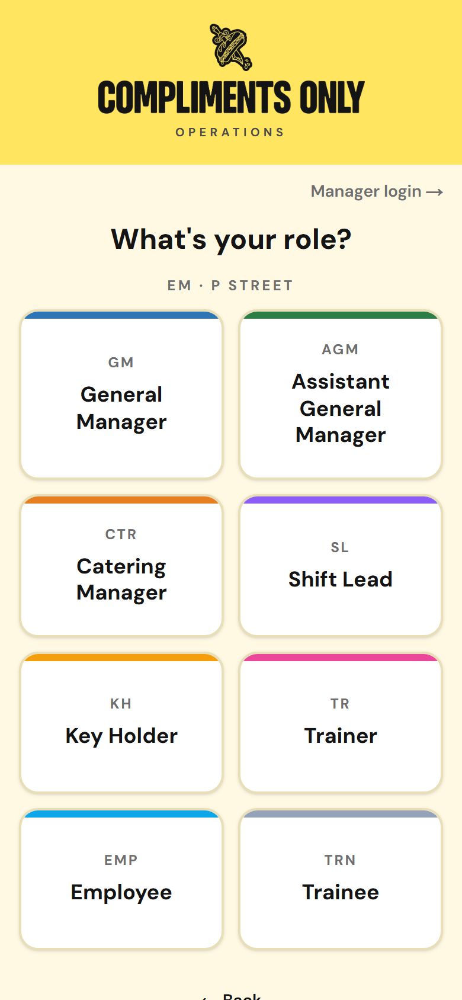

3. Under **Who are you?**, tap your name.

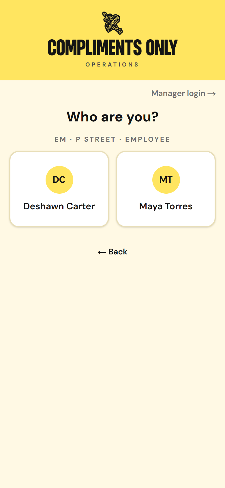

4. Type your 4-digit PIN. There is no Enter key. The app logs you in on the fourth number.

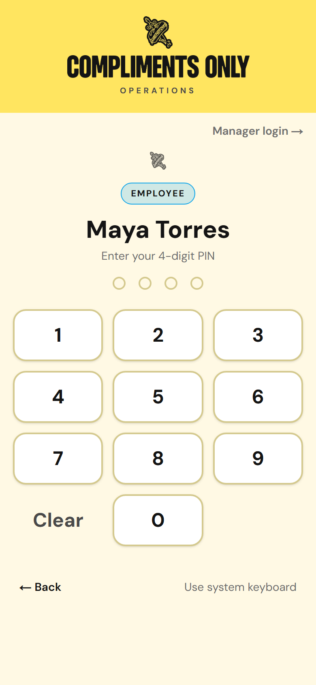

**Worth knowing**

- **Back** takes you one page back. **Clear** wipes the numbers you typed.
- Only people at that shop with that role show up. If your name is not there, tap **Back** and check your shop and role. Still missing? Ask a manager.
- A wrong PIN says "Wrong PIN. Try again." Too many wrong tries lock you out for a while. A red box says **Account locked** and counts down. Ask a manager for help.
- A red box that says **Too many tries** means too many log-ins came from the shop in a short time. It is not your PIN. Wait for the count to run out, then try again.
- **Manager login →** at the top is for managers who use an email and password. You use the tiles.
- The app logs you out after 10 minutes with no taps.

### Your dashboard

This is your home page. You land here after you log in.

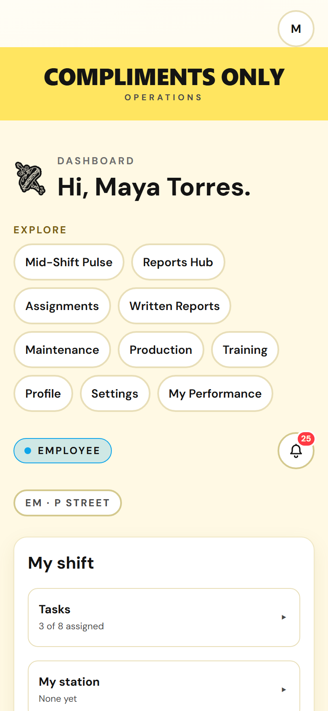

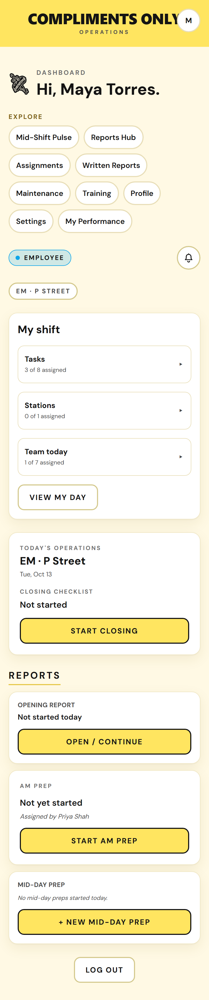

From top to bottom, you see:

- **Explore**: buttons to other pages, like **Mid-Shift Pulse**, **Assignments**, **Maintenance**, **Production**, **Training** and **My Performance**.
- Your role and your shop.
- **My shift**: the board. It shows your tasks and your station.
- **Today's operations**: the closing checklist, with **Start closing** or **Continue closing**.
- **Reports**: a tile for each job assigned to you today, like **Opening Report** or **AM Prep**. Your **My station:** card shows here too. If you have no task and no station today, this part is not there.
- **Log out**, at the very bottom.

**Worth knowing**

- The bell at the top shows your messages.
- **Training** in **Explore** opens this guide.

### En español

CO-OPS es la app que usamos para manejar la tienda. La usas para revisar la tienda en la mañana, hacer las tareas de cierre de tu estación y ver qué está pasando. Casi todo lo que tocas se guarda con tu nombre y la hora.

**Palabras de la app**

| Palabra | Qué significa |
|---|---|
| Tienda | Una de nuestras dos tiendas: P Street o Capitol Hill. Eliges la tuya al entrar. |
| Panel (dashboard) | Tu página de inicio después de entrar. Muestra tu trabajo de hoy. |
| Explorar | La fila de botones del panel que te lleva a otras páginas. |
| Roles | Tu nivel en la app: Aprendiz, Empleado, Encargado de Llaves, Entrenador, Líder de Turno y luego los gerentes. El **encargado de llaves** es el primer nivel que puede cerrar la tienda en la noche. |
| PIN | Tu código de 4 dígitos. Lo escribes para entrar. No se lo des a nadie. |
| Estación | Un puesto de trabajo en la tienda, como Crunchy Boi Station o Expo Station. Cada una tiene sus propias tareas de cierre. |
| Puesto | Un lugar que hay que cubrir en una estación. Algunas estaciones tienen dos, como Expeditor y Register & Delivery en Expo Station. |
| El tablero (Mi turno) | La lista de quién tiene cada tarea y cada estación hoy. Está en tu panel. |
| Tarea | Un trabajo que la app sigue, como la apertura, la Lista de Prep AM o la preparación de mediodía. Un gerente o un encargado de llaves se la asigna a una persona. |
| Par | Cuánto de cada producto debe tener la línea listo. |
| Verificación de apertura | La primera parte de la mañana: revisas que el cierre de anoche coincida con lo que de verdad hay. |
| Conteo de cierre | El conteo que dejó el que cerró anoche (en la Lista de Prep AM). El que abre lo ve en la mañana. |
| Prep de apertura | La segunda parte de la mañana: preparas comida hasta llegar al par. |
| Prep | Dejar la comida lista para la línea: cortar, cocinar, llenar botellas. |
| Preparación de mediodía | Prep después de la hora pico del almuerzo, para que la línea vuelva al par. |
| Lista de Prep AM | Un conteo que haces al cerrar. Cuentas lo que queda para que el equipo de la mañana sepa qué hay. |
| Lista de cierre | La lista de tareas de cierre, estación por estación. Corre todo el día, no solo en la noche. |
| Salida (walk-out) | Las últimas revisiones antes de cerrar con llave: luces, aparatos, horno, puertas. |
| Reporte PM | El reporte de la noche. Un encargado de llaves califica a cada persona del turno. |
| Depósito de caja | El conteo de efectivo de la noche. Lo hace un encargado de llaves. |
| Pulso de medio turno | Una página en vivo que muestra qué pasa en la tienda ahora mismo. |
| Entrega | Un pedido que llega en camión. Un encargado de llaves lo recibe. |
| Conteo | Un conteo completo de lo que hay en los estantes. Lo hace un encargado de llaves. |
| Recorrido de pedido | Un recorrido por la tienda para armar el próximo pedido a un proveedor. Lo hace un encargado de llaves. |
| Producción | El registro de comida que hiciste con materia prima fuera de las hojas de prep. Lo pueden registrar los empleados y más arriba. |
| 86 | Lenguaje de cocina para "se acabó". Cuando algo se acabe, avísale a tu encargado de llaves. |
| Nota de entrega de turno | Una nota que un gerente deja para el siguiente turno. Ves las que son para el equipo. |
| Guardado | La app ya guardó tu trabajo. Muchas páginas guardan mientras trabajas y dicen "Guardado". |

**Entrar a la app**

Lo haces al empezar cada turno. Las páginas de entrada siempre están en inglés, así que aquí van los nombres en inglés tal como salen en pantalla.

1. En **Where are you?**, toca tu tienda.

2. En **What's your role?**, toca tu rol. Casi todo el equipo toca **Employee** o **Trainee**.

3. En **Who are you?**, toca tu nombre.

4. Escribe tu PIN de 4 dígitos. No hay tecla de Enter. La app te deja entrar al cuarto número.

**Bueno saber**

- **Back** te regresa una página. **Clear** borra los números que escribiste.
- Solo salen las personas de esa tienda con ese rol. Si tu nombre no aparece, toca **Back** y revisa tu tienda y tu rol. ¿Sigue sin salir? Pregúntale a un gerente.
- Un PIN equivocado dice "Wrong PIN. Try again." Si te equivocas muchas veces, la cuenta se bloquea un rato. Un cuadro rojo dice **Account locked** y cuenta el tiempo hacia atrás. Pídele ayuda a un gerente.
- Un cuadro rojo que dice **Too many tries** quiere decir que hubo demasiadas entradas desde la tienda en poco tiempo. No es tu PIN. Espera a que termine la cuenta y vuelve a intentar.
- **Manager login →** arriba es para gerentes que usan correo y contraseña. Tú usas los mosaicos.
- La app cierra tu sesión después de 10 minutos sin tocar nada.

**Tu panel**

Es tu página de inicio. Llegas aquí después de entrar. De arriba hacia abajo ves:

- **Explorar**: botones a otras páginas, como **Pulso de medio turno**, **Asignaciones**, **Mantenimiento**, **Producción**, **Capacitación** y **Mi Desempeño**.
- Tu rol y tu tienda.
- **Mi turno**: el tablero. Muestra tus tareas y tu estación.
- **Operaciones de hoy**: la lista de cierre, con **Empezar cierre** o **Continuar cierre**.
- **Reportes**: un mosaico por cada trabajo que te asignaron hoy, como **Reporte de apertura** o **Lista de Prep AM**. Tu tarjeta **Mi estación:** también sale aquí. Si hoy no tienes ninguna tarea ni estación, esta parte no aparece.
- **Cerrar sesión**, hasta abajo.

**Bueno saber**

- La campana de arriba muestra tus mensajes.
- **Capacitación** en **Explorar** abre esta guía.

## Morning

The morning job is the **Opening Report**. It has two parts. First you check last night's closing (opening verification). Then you make food up to par (opening prep).

You only do it if a manager or key holder assigns it to you. If you don't see the **Opening Report** tile under **Reports**, it is not yours today. Ask your key holder if you think it should be. The shop opens at 10:30 AM, and the opening is late after that.

### Open the Opening Report

1. On the dashboard, find **Reports**. On the **Opening Report** tile, tap **Open / continue**. You can also tap **Opening prep** on the board. It is the same job.

2. The page opens on the **Phase 1 · Verify** tab. The other tab says **Phase 2 (locked)**. It opens after you send Phase 1.

**Worth knowing**

- If the page says it is waiting on last night's closing, you can't start yet. Last night's closing is not done. Tell a key holder.

### Opening verification (Phase 1)

You walk each station. You check that last night's closing matches what you see.

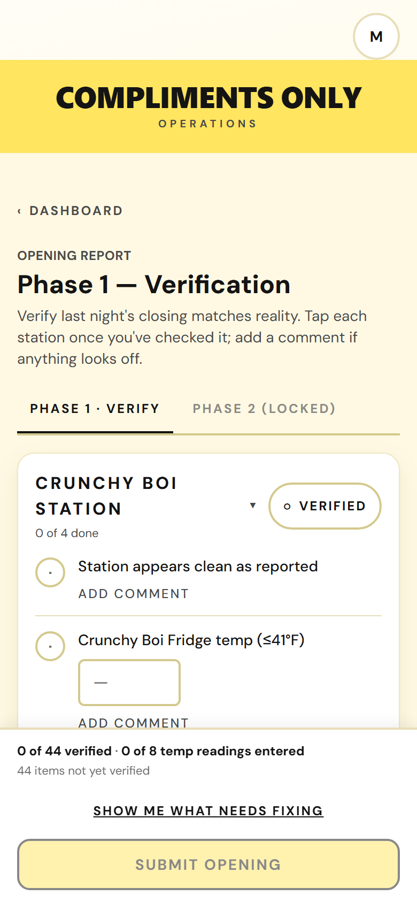

1. Look over a station. If it looks right, tap **Verified** on its card. The lines on the card get a check.

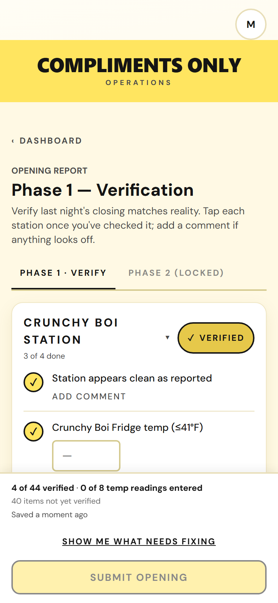

2. Read the fridge thermometer. Type the number in the temp box on that card. The card is done when the temp is in. Only the first card starts open. Tap a card's name to open it and find its temp box.

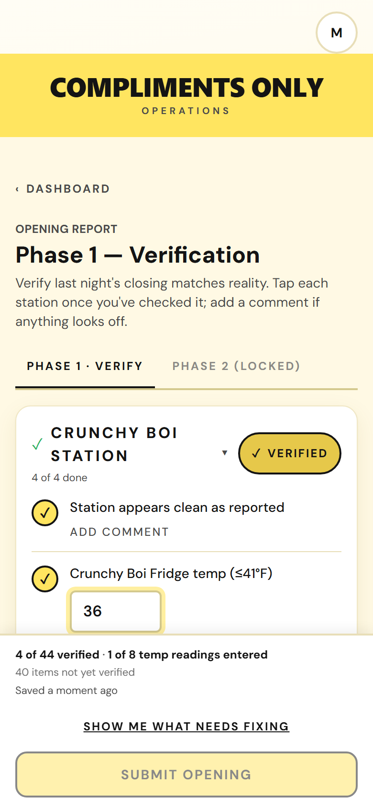

3. If something is wrong, tap **Add comment** on that line. Write what you found. Tell your key holder too.

4. Now the prep sections: Veg, Cooks, Sides, Sauces and Slicing. Open one. Some items have no count from last night. Type what you see in the **Opener recount** box for each one. Then tap **Verify section**.

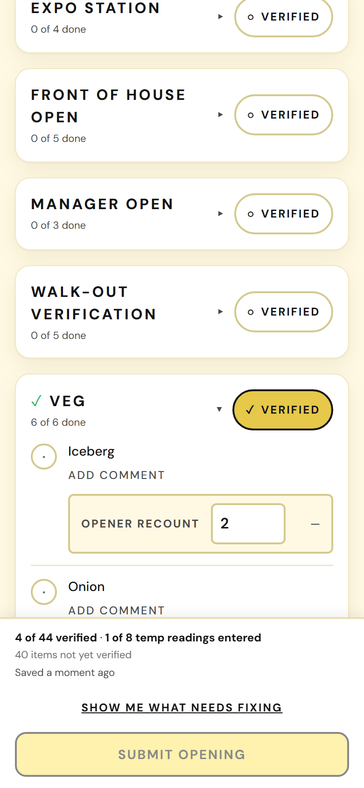

5. A pink box may show under the cards: "No prior closing data detected". It shows once you type a recount for an item with no count from last night. Pick the reason that fits: **Location was closed (planned)** or **Closing was missed / I don't know**.

6. Make sure every station is checked, every temp is in, and every prep section is verified. If the pink box showed, pick a reason. Then tap **Submit Opening**.

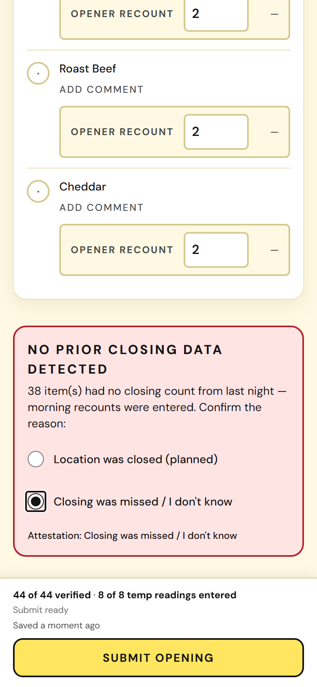

**Worth knowing**

- The page saves as you go. The bottom bar says "Saved a moment ago". If someone else opens the report, they see your work.
- The bottom bar counts what is left. Tap **Show me what needs fixing** to find it.
- The "verified" count on the bottom bar (like "44 of 44 verified") counts the lines on the station cards. The prep sections are not in it. Each one needs its own **Verify section** tap.
- **Verify section** stays grey until each item with no count from last night has a recount. On the other items, the recount box is a choice. Use it only to fix a wrong count.
- A recount box is red while it still needs a number. It goes back to normal once you fill it.
- Some days no item has a count from last night. Then every prep item needs a recount. That is a lot of boxes, so work one section at a time.
- **Submit Opening** stays grey until every station is checked, every temp is in, and every prep section is verified (**Verify section**). If the pink box shows, a reason must be picked too.
- A fridge should read 41°F or less. If it reads higher, tell your key holder right away.

### Opening prep (Phase 2)

After you send Phase 1, the **Phase 2 — Prep Entry** tab opens.

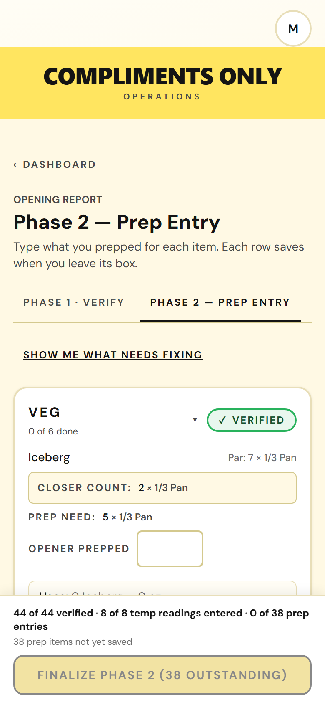

Each row shows three things:

- **Par**: how much the line should have.
- **Closer count**: what the closer counted last night (or your own recount from Phase 1).
- **Prep need**: how much you need to make.

1. Make the food for a row.

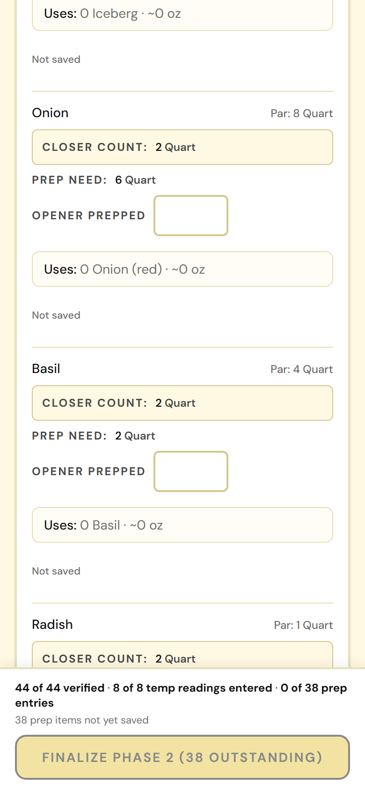

2. Type how much you made in **Opener prepped**. Then tap outside the box, or go on to the next box. The row saves when you leave its box.

3. Made more or less than **Prep need**? Then the row does not save yet. It says "Add a reason to save". Tap the button under the row. It says how far off you are. Pick a reason. Fill in **Notes** if it asks. Tap **Save**.

4. Check the row. It should say "Saved by" with your name and the time.

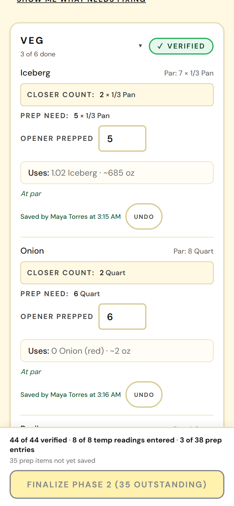

5. Typed the wrong number? Tap **Undo** on that row. If a box asks why, pick a reason and tap **Undo entry**. Then type the right amount.

6. When every row is saved, tap **Finalize Phase 2**. Until then, the button shows how many rows are left. After you tap it, it says **Phase 2 finalized**.

**Worth knowing**

- "5 × 1/3 Pan" means five 1/3 pans. Type 5, not 5.33.
- Type plain numbers, like 5 or 5.5. A fraction like "5 1/3" does not save. The box says "Numbers only, like 5.5 — not saved".
- A row with no par says "No par set — type what you made". Type what you made, even 0. It needs no reason.
- Some rows show a **Uses:** line. It lists the stock that food uses. You don't need to do anything with it.
- After you tap **Finalize Phase 2**, the button says **Phase 2 finalized**. The opening is done.
- The closer count comes from last night's AM prep. If you typed an **Opener recount** in Phase 1, your recount shows here instead.
- A row with no "Saved by" line is not saved. Look for "Add a reason to save" or "Not saved".
- If you made less than you need, your managers get an alert. Be clear in the note.
- **Undo** right after you save asks nothing. After about a minute, it asks why.

### En español

El trabajo de la mañana es el **Reporte de apertura**. Tiene dos partes. Primero revisas el cierre de anoche (verificación de apertura). Luego preparas comida hasta llegar al par (prep de apertura).

Solo lo haces si un gerente o un encargado de llaves te lo asigna. Si no ves el mosaico **Reporte de apertura** en **Reportes**, hoy no te toca. Pregúntale a tu encargado de llaves si crees que sí te toca. La tienda abre a las 10:30 AM, y la apertura va tarde después de esa hora.

**Abrir el Reporte de apertura**

1. En el panel, busca **Reportes**. En el mosaico **Reporte de apertura**, toca **Abrir / continuar**. También puedes tocar **Preparación de apertura** en el tablero. Es el mismo trabajo.

2. La página abre en la pestaña **Fase 1 · Verificar**. La otra pestaña dice **Fase 2 (bloqueada)**. Se abre cuando envías la Fase 1.

- Si la página dice que está esperando el cierre de anoche, todavía no puedes empezar. El cierre de anoche no está terminado. Avísale a un encargado de llaves.

**Verificación de apertura (Fase 1)**

Recorres cada estación. Revisas que el cierre de anoche coincida con lo que ves.

1. Revisa una estación. Si se ve bien, toca **Verificar** en su tarjeta. Las líneas de la tarjeta quedan marcadas.

2. Lee el termómetro del refrigerador. Escribe el número en la casilla de temperatura de esa tarjeta. La tarjeta queda lista cuando pones la temperatura. Solo la primera tarjeta empieza abierta. Toca el nombre de una tarjeta para abrirla y ver su casilla de temperatura.

3. Si algo está mal, toca **Añadir comentario** en esa línea. Escribe lo que encontraste. Avísale también a tu encargado de llaves.

4. Ahora las secciones de prep: Verduras (Veg), Cocidos (Cooks), Acompañantes (Sides), Salsas (Sauces) y Rebanado (Slicing). Abre una. Algunos productos no tienen conteo de anoche. Escribe lo que ves en la casilla **Recuento del opener** de cada uno. Luego toca **Verificar sección**.

5. Puede salir un cuadro rosa debajo de las tarjetas: "No se detectaron datos de cierre previo". Sale cuando escribes un recuento de un producto que no tenía conteo de anoche. Elige el motivo correcto: **Ubicación cerrada (planificado)** o **Cierre omitido / No sé**.

6. Asegúrate de que todas las estaciones estén revisadas, todas las temperaturas puestas y todas las secciones de prep verificadas. Si salió el cuadro rosa, elige un motivo. Luego toca **Enviar Apertura**.

**Bueno saber**

- La página guarda mientras trabajas. La barra de abajo dice "Guardado hace un momento". Si otra persona abre el reporte, ve tu trabajo.
- La barra de abajo cuenta lo que falta. Toca **Muéstrame qué hay que corregir** para encontrarlo.
- El conteo de "verificadas" en la barra de abajo (como "44 de 44 verificadas") cuenta las líneas de las tarjetas de las estaciones. Las secciones de prep no entran. Cada una necesita su propio toque en **Verificar sección**.
- **Verificar sección** sigue gris hasta que cada producto sin conteo de anoche tenga su recuento. En los demás productos, la casilla de recuento es opcional. Úsala solo para corregir un conteo mal hecho.
- Una casilla de recuento está en rojo mientras le falta un número. Vuelve a la normalidad cuando la llenas.
- Algunos días ningún producto tiene conteo de anoche. Entonces cada producto de prep necesita un recuento. Son muchas casillas, así que trabaja una sección a la vez.
- **Enviar Apertura** sigue gris hasta que todas las estaciones estén revisadas, todas las temperaturas puestas y todas las secciones de prep verificadas (**Verificar sección**). Si sale el cuadro rosa, también tienes que elegir un motivo.
- Un refrigerador debe marcar 41°F o menos. Si marca más, avísale de inmediato a tu encargado de llaves.

**Prep de apertura (Fase 2)**

Después de enviar la Fase 1, se abre la pestaña **Fase 2 — Entrada de Prep**. Cada fila muestra tres cosas:

- **Par**: cuánto debe tener la línea.
- **Conteo de cierre**: lo que contó anoche el que cerró (o tu propio recuento de la Fase 1).
- **Por preparar**: cuánto tienes que preparar.

1. Prepara la comida de una fila.

2. Escribe cuánto preparaste en **Preparado hoy**. Luego toca fuera de la casilla, o pasa a la siguiente. La fila se guarda al salir de su casilla.

3. ¿Preparaste más o menos de lo que dice **Por preparar**? Entonces la fila todavía no se guarda. Dice "Agrega una razón para guardar". Toca el botón debajo de la fila. Dice cuánto te pasaste o te faltó. Elige una razón. Llena **Notas** si te lo pide. Toca **Guardar**.

4. Revisa la fila. Debe decir "Guardado por" con tu nombre y la hora.

5. ¿Pusiste mal el número? Toca **Deshacer** en esa fila. Si sale un cuadro que pregunta por qué, elige una razón y toca **Deshacer entrada**. Luego escribe el número correcto.

6. Cuando todas las filas estén guardadas, toca **Finalizar Fase 2**. Mientras tanto, el botón muestra cuántas filas faltan. Después de tocarlo, dice **Fase 2 finalizada**.

**Bueno saber**

- "5 × 1/3 Pan" quiere decir cinco bandejas de 1/3. Escribe 5, no 5.33.
- Escribe números simples, como 5 o 5.5. Una fracción como "5 1/3" no se guarda. La casilla dice "Solo números, como 5.5 — no se guardó".
- Una fila sin par dice "Sin par — escribe lo que preparaste". Escribe lo que preparaste, aunque sea 0. No necesita razón.
- Algunas filas muestran una línea **Usa:**. Dice qué producto usa esa comida. No tienes que hacer nada con ella.
- Después de tocar **Finalizar Fase 2**, el botón dice **Fase 2 finalizada**. La apertura está lista.
- El conteo de cierre sale de la Lista de Prep AM de anoche. Si escribiste un **Recuento del opener** en la Fase 1, aquí sale tu recuento.
- Una fila sin la línea "Guardado por" no está guardada. Busca "Agrega una razón para guardar" o "Sin guardar".
- Si preparaste menos de lo necesario, tus gerentes reciben una alerta. Explícalo claro en la nota.
- Si tocas **Deshacer** justo después de guardar, no te pregunta nada. Después de un minuto más o menos, te pregunta por qué.

## All day

These jobs run all day. You use your board. You do your station's closing jobs. You check the Pulse, the fridges and the equipment. Some days you also do mid-day prep.

### Your board

The board shows who has which task and station today. Find it on the dashboard under **My shift**.

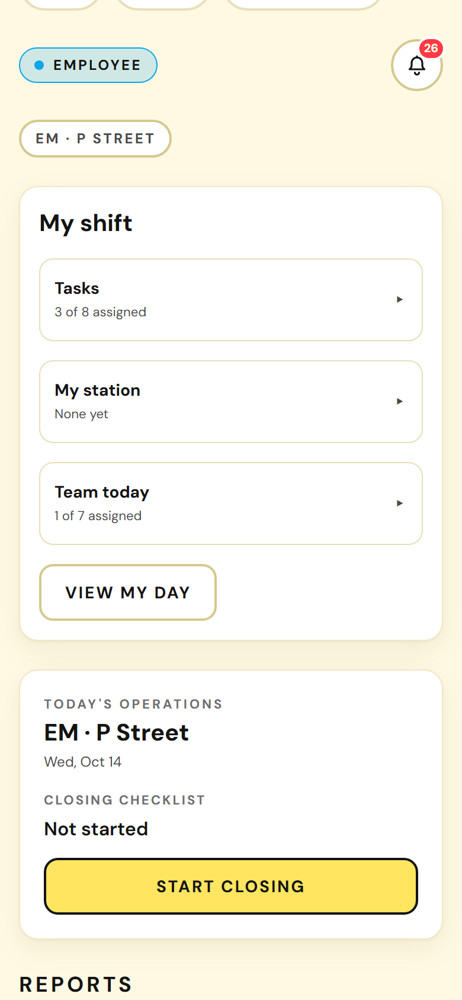

It has three rows: **Tasks**, **My station** and **Team today**. Tap a row to open it. The **My station** row says "Yours:" and your station, or "None yet". For the full board, tap **View my day**, or tap **Assignments** in **Explore**.

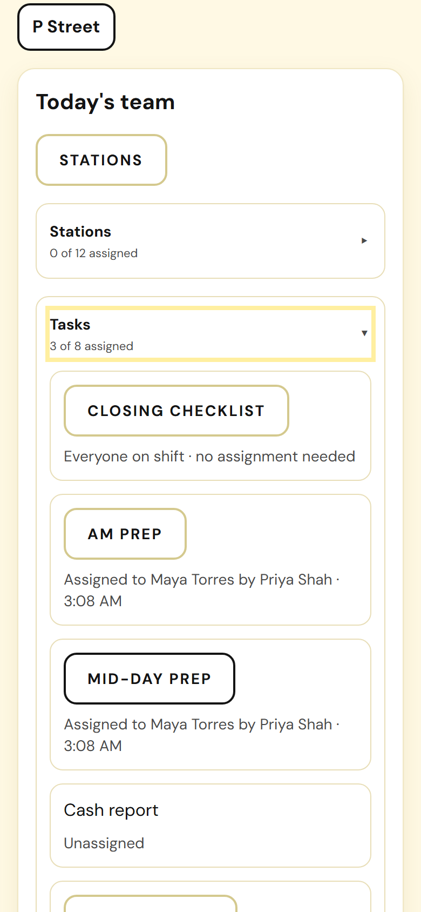

- The first task is **Closing checklist**. It says "Everyone on shift · no assignment needed". That means it is for everyone.
- Your own tasks are links. Tap one to open it.
- A task with nobody on it says "Unassigned". You can't open it. A key holder or a manager hands it out.
- If a task is someone else's, you see "Assigned to someone else." Ask a key holder to change it before you do it.

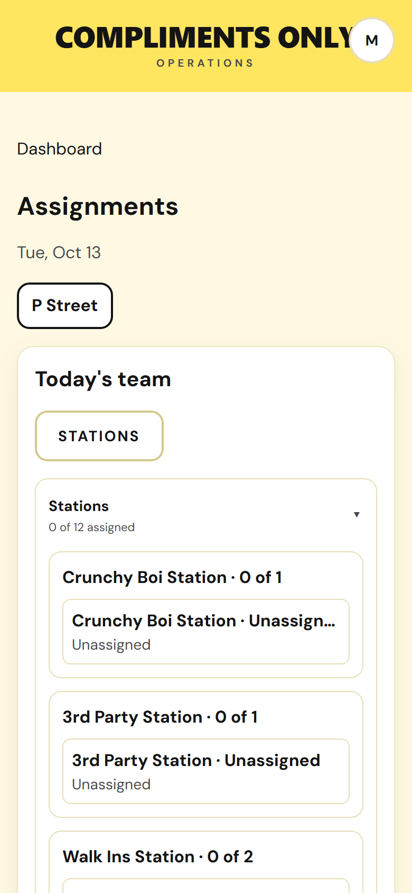

The **Stations** list shows each station and its positions, and who has them.

### Claim a station

You pick your own station from the board on the dashboard. If a key holder or manager already gave you a station, you can't change it yourself.

1. On the dashboard, under **My shift**, tap the **My station** row to open it.

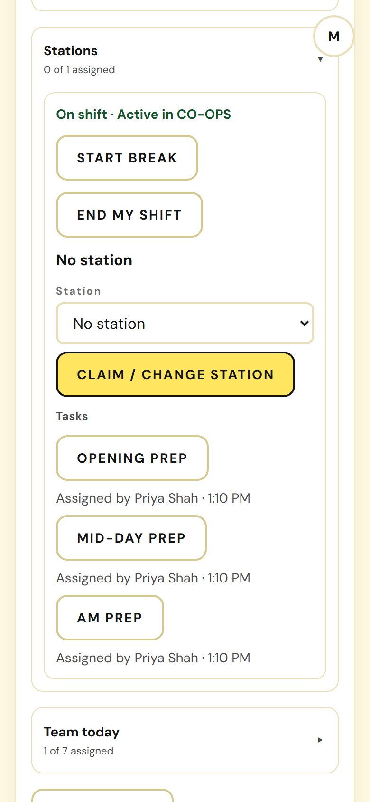

2. Pick your spot in the **Station** list. Some choices say **fill first**. That means nobody is at that station yet. Take those before the others.

3. Tap **Claim / change station**.

4. A **Confirm change** box opens. A reason is not needed. Leave **Reason for change** on "No reason (optional)". Tap **Confirm change**.

5. The **My station** row now says "Yours:" and your station. A **My station:** card with your station's name shows up under **Reports**. Tap it to go to your part of the closing checklist.

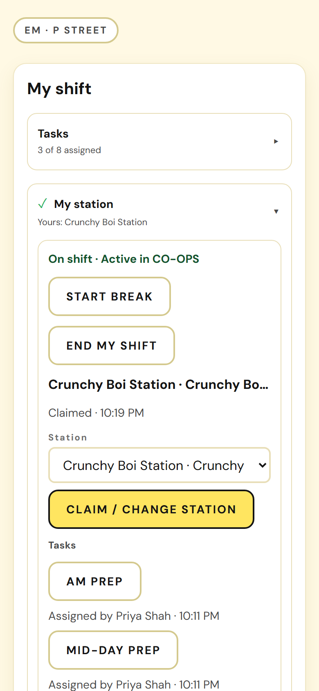

**Worth knowing**

- You can't take a spot someone already has. Ask a key holder.
- Does your station say "Assigned by" and a name? Then a key holder or manager gave it to you. The **Claim / change station** button does not show. Ask a key holder to change it.
- Going on break? Open the **My station** row and tap **Start break**. When you come back, tap **Back from break**.

### Your station's closing jobs

The closing checklist runs all day. Each station closes on its own when its jobs are done. So tick your lines as you finish each job, not all at the end.

1. On the dashboard, under **Today's operations**, tap **Start closing** or **Continue closing**.

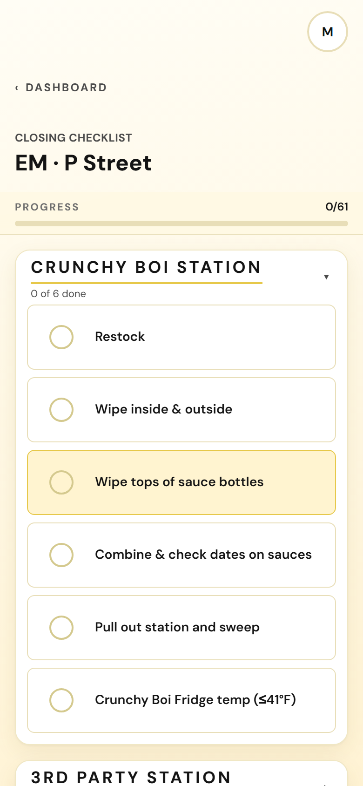

2. Find your station's section. Tap its name to open or close it.

3. Do a job, then tap its line. The line gets a check, with "you" and the time.

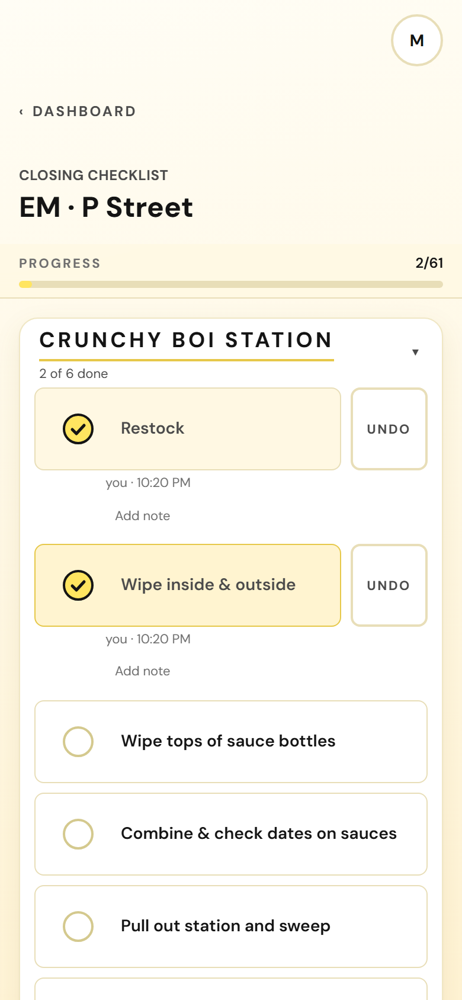

4. A fridge temp line works a little differently. Tapping it opens a small box. Type the temp in **Temp (°F)**, then tap **Save**. A few lines ask for a number the same way, in a box called **Count**.

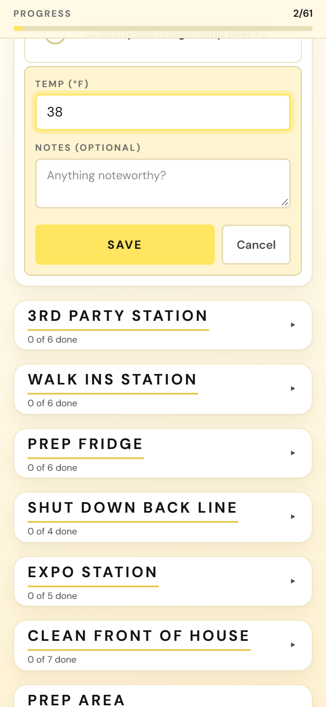

5. Want to add a note? Tap **Add note** on a checked line. Type in the box ("Anything noteworthy?"). Tap **Save note**.

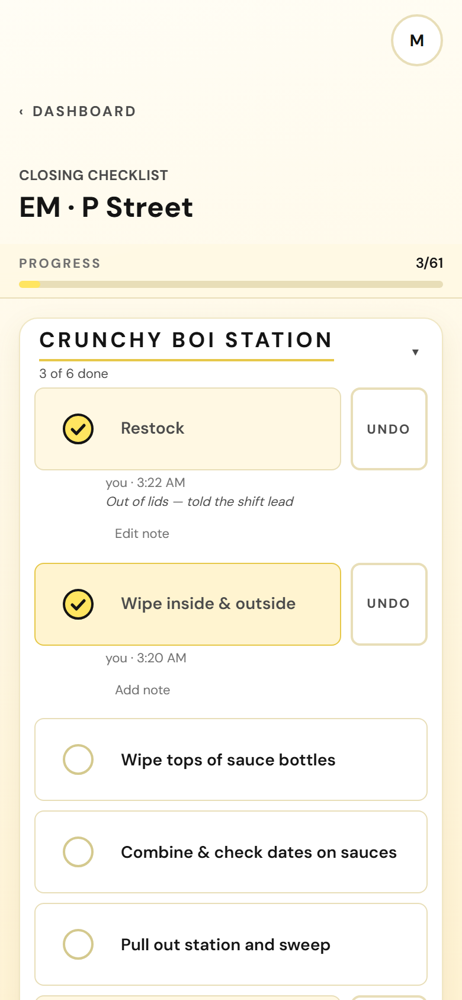

6. Checked the wrong line? Tap **Undo** on it.

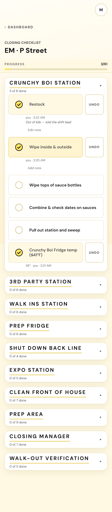

**Worth knowing**

- **Add note** shows up only after you check a line. After you save a note, the link says **Edit note**.
- A temp or count line has no **Add note**. Type your note in the **Notes (optional)** box when you type the number.
- Each section shows how many of its lines are done. **Progress** at the top counts the whole list.
- When all of a station's lines are done, the station closes. Your **My station** row says "Closed ·" and the time. The **My station:** card under **Reports** goes away. That is normal. If a line is undone, the station opens again.
- If a section says "N awaiting higher role", some of its lines are for a higher role. Those lines show a badge like "Level 4+ only" or "Shift Lead+ only". Leave them.
- Some lines are reports, like AM Prep or Mid-day Prep. They are not check boxes. They say "Pending — tap to open". Tap one to open that report's own page. The line checks itself when the report is sent, with "Submitted by", a name and the time.
- A report line that says "Assigned shift task required" is not yours. Leave it.
- A trainee can open the list once someone has started it for the day.
- There is no send button at the bottom for you. A key holder sends the closing at night.

### Mid-Shift Pulse

The Pulse shows what is going on in the shop right now. Tap **Mid-Shift Pulse** in **Explore**.

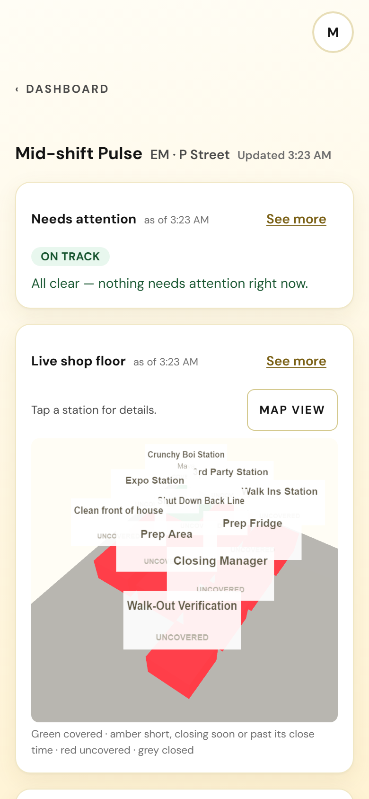

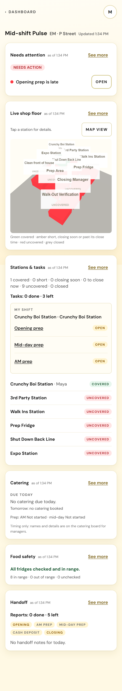

You see these parts:

- **Needs attention**: things that are late or need action. When nothing does, it says "All clear — nothing needs attention right now."
- **Live shop floor**: a map of the stations. Tap a station for details. One button switches the look. It says **Map view** while you see the 3D floor, and **3D view** while you see the flat map.
- **Stations & tasks**: your tasks, and which stations are covered.
- **Catering**: when catering orders are due.
- **Food safety**: if the fridges are checked and in range.
- **Handoff**: notes from managers for the crew.

Tap **See more** on a part to open its full page.

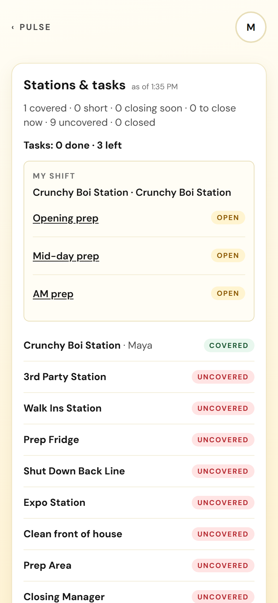

**Worth knowing**

- The page updates itself every 60 seconds.
- As crew, you see your own tasks and station. You don't see sales or other people's details.

### Fridge temps and broken equipment

Use this when a fridge runs warm or something breaks. Tap **Maintenance** in **Explore**. Trainees can't open it; tell a key holder instead.

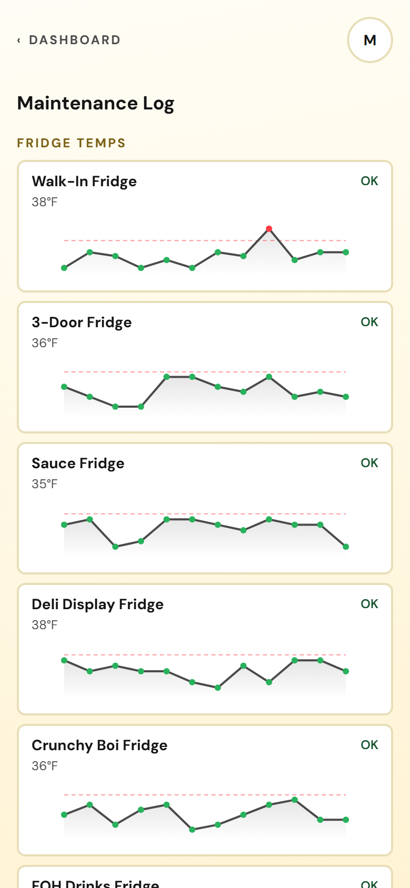

**Fridge temps** shows the last reading for each fridge. These come from the temp lines on the opening and the closing checklist. You don't type temps here. A fridge that ran too warm today says **Out of range**. **No reading today** means nobody has checked it yet today.

To log a problem:

1. Under **Log a maintenance note**, pick the item in the **Equipment** list. Not on the list? Pick **Other…** and type its name in the **Equipment name** box.

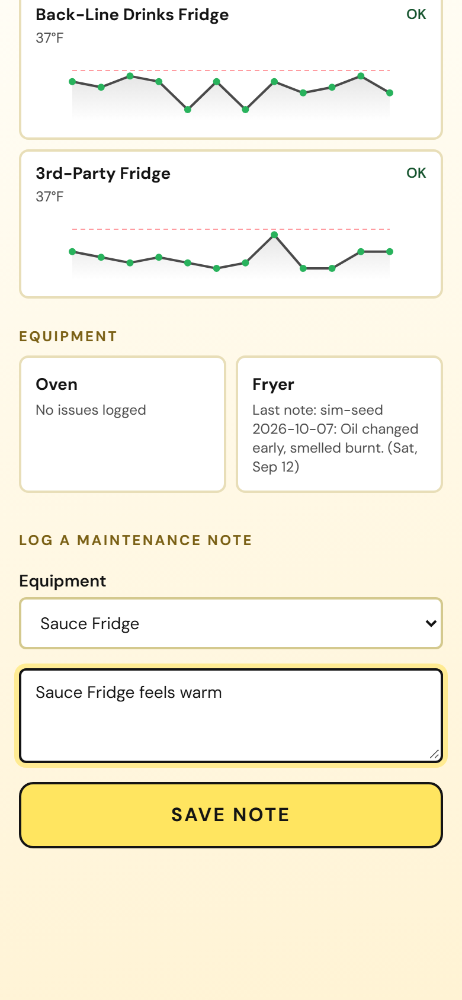

2. Type what is wrong in the note box ("What's going on?").

3. Tap **Save note**. The box clears, and your note shows on the page.

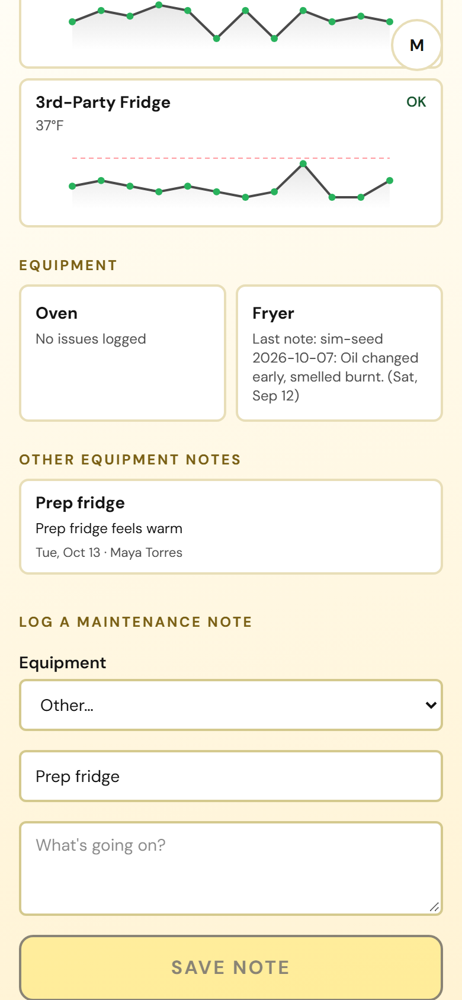

**Worth knowing**

- There is no "saved" message. The empty box means it worked.
- A note is a record, not an alarm. If it can't wait, tell a manager right away too.

### Mid-day prep

After the lunch rush, mid-day prep gets the line back to par. You only do it if it is assigned to you. It is due from 2:00 PM and late after 3:30 PM. A shop can do two a day at most.

1. Under **Reports**, on the **Mid-day Prep** tile, tap **+ New mid-day prep**.

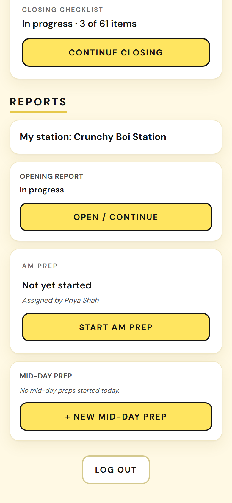

2. The page says **Phase 1 — count to par**. Type what is on the line in each **On hand** box. The app shows how much you need.

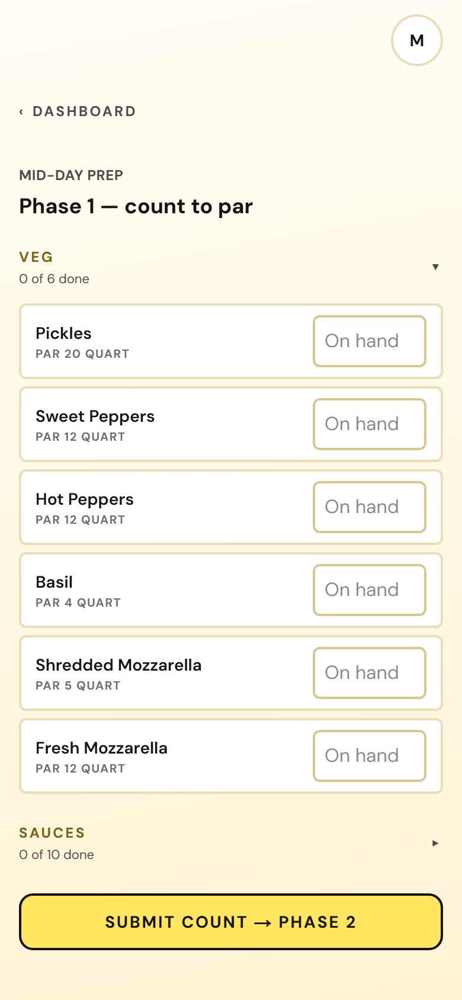

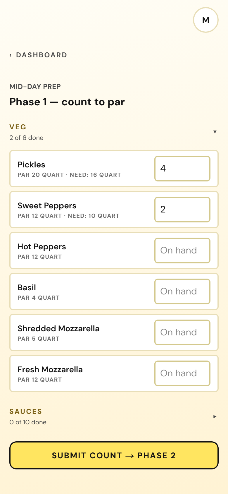

3. Tap **Submit count → Phase 2**.

4. The page now says **Phase 2 — prep**. Each row shows **Need:**, how much to make. Make the food. Type how much you made in the **Prepped** box.

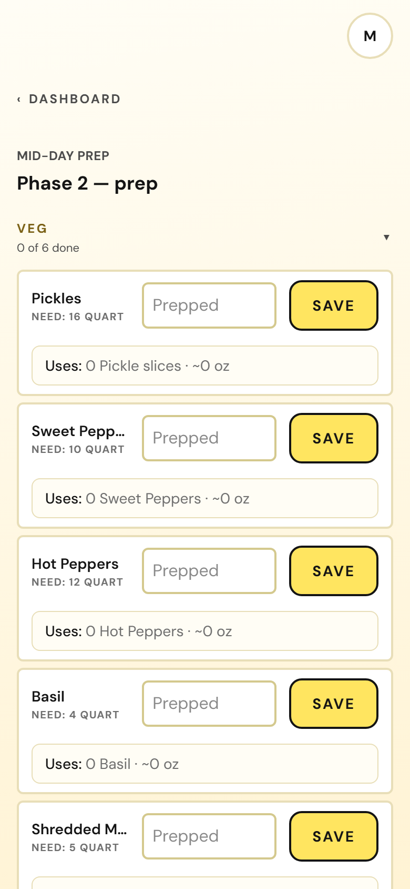

5. Made more or less than **Need:**? An **Add over/under reason** button shows under the row. Tap it and fill it in first. If you skip it, **Save** says "Add an over/under reason first".

6. Tap **Save** on that row. The row says "Saved ✓".

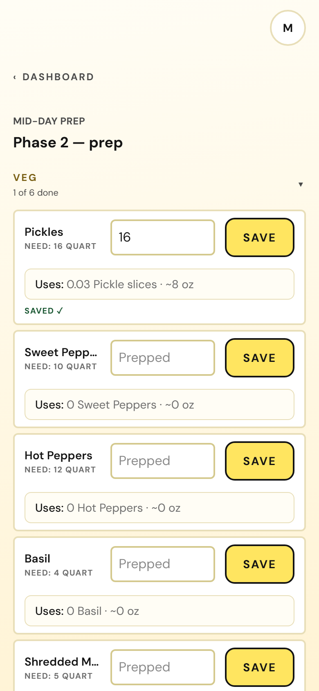

7. When every row you made is saved, tap **Finalize prep**. This checks the Mid-day Prep line on the closing checklist for you.

8. The title changes to **Finalized — prep made**. A green line says "Finalized at" the time, with your name. Each row shows **Need:** and **Made:**. Your work is saved.

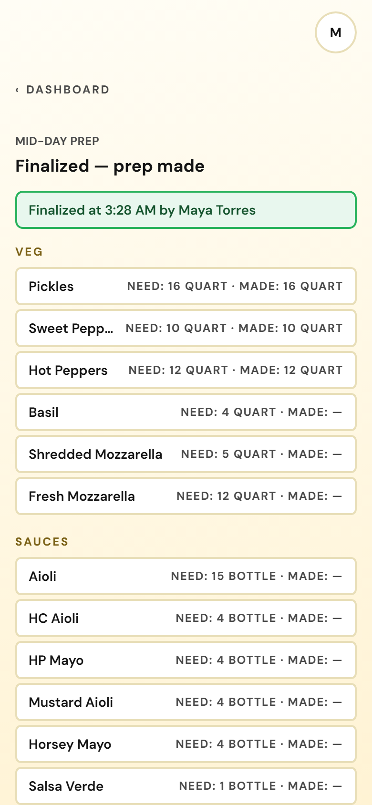

**Worth knowing**

- Here, each row needs its own **Save** tap. That is not like the opening, where a row saves when you leave its box.
- A row you don't save is not counted. **Finalize prep** does not stop you, so check every row first.
- A row with no par shows **Par** instead of **Need:**. Type what you made and tap **Save**. It needs no reason.
- "5 × 1/3 Pan" means five 1/3 pans. Type 5.
- Some rows show a **Uses:** line. It lists the stock that food uses. You don't need to do anything with it.
- If a note says "Some items couldn't load", do the rest of the rows. Tell a manager the items it names.
- The **Mid-day Prep** tile on the dashboard also shows "Finalized at" the time, with your name.

### Production

Use this when you make food from raw stock outside the opening and mid-day prep sheets. Employees and up can log it. Tap **Production** in **Explore**.

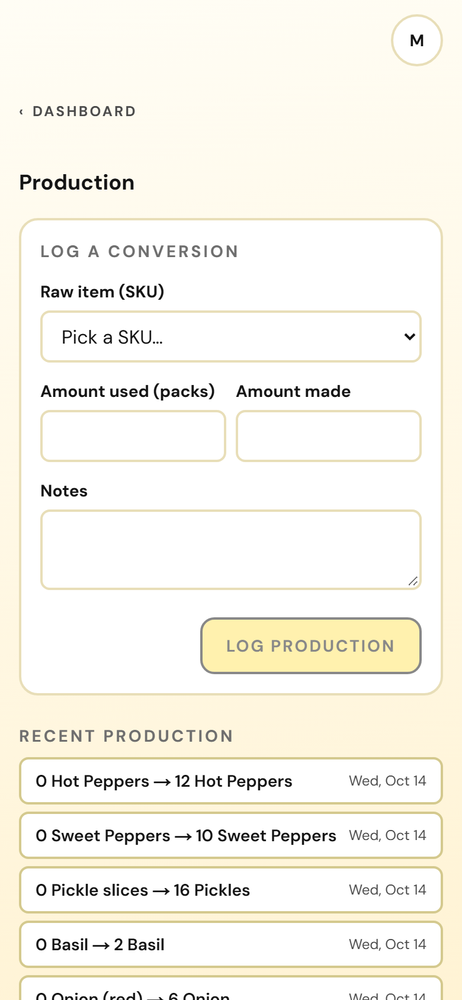

1. Under **Log a conversion**, pick the **Raw item (SKU)** you used. Each choice shows how many packs are **in stock**.

2. Pick what it **Makes**. This list shows up only after you pick a raw item. It starts on "Pick what you made…".

3. Type the **Amount used (packs)** and the **Amount made**. The app may fill in **Amount made** with what it expects (**Predicted output**). Change it to what you really made. **Notes** is optional.

4. Tap **Log production**. Your line shows at the top of **Recent production**.

**Worth knowing**

- The app takes the packs you used off the shop's stock count. That keeps the shop's numbers right for counts and orders.
- The opening and mid-day prep sheets log their own food. You see it in **Recent production** too. Don't log it again here.
- **Log production** stays grey until the raw item, what it makes and both amounts are filled in. If **Makes** has nothing to pick, ask a manager.
- No message pops up. Your new line in **Recent production** means it worked.

### En español

Estos trabajos corren todo el día. Usas tu tablero. Haces las tareas de cierre de tu estación. Revisas el Pulso, los refrigeradores y los equipos. Algunos días también haces la preparación de mediodía.

**Tu tablero**

El tablero muestra quién tiene cada tarea y cada estación hoy. Lo encuentras en el panel, en **Mi turno**.

Tiene tres filas: **Tareas**, **Mi estación** y **Equipo de hoy**. Toca una fila para abrirla. La fila **Mi estación** dice "Tuya:" y tu estación, o "Aún ninguna". Para ver el tablero completo, toca **Ver mi día**, o toca **Asignaciones** en **Explorar**.

- La primera tarea es **Lista de cierre**. Dice "Todos en el turno · no requiere asignación". Quiere decir que es para todos.
- Tus propias tareas son enlaces. Toca una para abrirla.
- Una tarea sin nadie dice "Sin asignar". No la puedes abrir. Un encargado de llaves o un gerente la reparte.
- Si una tarea es de otra persona, ves "Asignada a otra persona." Pídele a un encargado de llaves que la cambie antes de hacerla.

La lista de **Estaciones** muestra cada estación con sus puestos, y quién los tiene.

**Elegir tu estación**

Eliges tu estación desde el tablero del panel. Si un encargado de llaves o un gerente ya te dio una estación, no la puedes cambiar tú.

1. En el panel, en **Mi turno**, toca la fila **Mi estación** para abrirla.

2. Elige tu lugar en la lista de estaciones. Algunas opciones dicen **cubrir primero**. Quiere decir que nadie está en esa estación todavía. Toma esas antes que las demás.

3. Toca **Elegir / cambiar estación**.

4. Se abre un cuadro **Confirma el cambio**. No hace falta un motivo. Deja **Motivo del cambio** en "Sin motivo (opcional)". Toca **Confirma el cambio**.

5. La fila **Mi estación** ya dice "Tuya:" y tu estación. En **Reportes** aparece una tarjeta **Mi estación:** con el nombre de tu estación. Tócala para ir a tu parte de la lista de cierre.

**Bueno saber**

- No puedes tomar un lugar que ya tiene otra persona. Pregúntale a un encargado de llaves.
- ¿Tu estación dice "Asignado por" y un nombre? Entonces te la dio un encargado de llaves o un gerente. No sale el botón **Elegir / cambiar estación**. Pídele a un encargado de llaves que la cambie.
- ¿Te vas a tu descanso? Abre la fila **Mi estación** y toca **Iniciar descanso**. Cuando regreses, toca **Volver del descanso**.

**Las tareas de cierre de tu estación**

La lista de cierre corre todo el día. Cada estación se cierra sola cuando sus tareas están hechas. Así que marca tus líneas cuando termines cada trabajo, no todo al final.

1. En el panel, en **Operaciones de hoy**, toca **Empezar cierre** o **Continuar cierre**.

2. Busca la sección de tu estación. Toca su nombre para abrirla o cerrarla.

3. Haz un trabajo y luego toca su línea. La línea queda marcada, con "tú" y la hora.

4. La línea de temperatura de un refrigerador es un poco distinta. Al tocarla se abre un cuadro chico. Escribe la temperatura en **Temp (°F)** y toca **Guardar**. Algunas líneas piden un número de la misma forma, en una casilla llamada **Cantidad**.

5. ¿Quieres agregar una nota? Toca **Agregar nota** en una línea marcada. Escribe en la casilla ("¿Algo importante?"). Toca **Guardar nota**.

6. ¿Marcaste la línea equivocada? Toca **Deshacer** en ella.

**Bueno saber**

- **Agregar nota** aparece solo después de marcar una línea. Después de guardar una nota, el enlace dice **Editar nota**.
- Una línea de temperatura o de cantidad no tiene **Agregar nota**. Escribe tu nota en la casilla **Notas (opcional)** cuando escribes el número.
- Cada sección muestra cuántas de sus líneas están hechas. **Progreso** arriba cuenta toda la lista.
- Cuando todas las líneas de una estación están hechas, la estación se cierra. Tu fila **Mi estación** dice "Cerrada ·" y la hora. La tarjeta **Mi estación:** de **Reportes** desaparece. Es normal. Si se deshace una línea, la estación se abre otra vez.
- Si una sección dice "N esperando rol superior", algunas de sus líneas son para un rol más alto. Esas líneas muestran una etiqueta como "Solo nivel 4+" o "Solo Shift Lead+". Déjalas.
- Algunas líneas son reportes, como la Lista de Prep AM o la preparación de mediodía. No son casillas. Dicen "Pendiente — toca para abrir". Toca una para abrir la página de ese reporte. La línea se marca sola cuando se envía el reporte, con "Enviado por", un nombre y la hora.
- Una línea de reporte que dice "Necesitas tener asignada esta tarea" no es tuya. Déjala.
- Un aprendiz puede abrir la lista cuando alguien ya la empezó ese día.
- Abajo no hay botón para enviar. Un encargado de llaves envía el cierre en la noche.

**Pulso de medio turno**

El Pulso muestra qué pasa en la tienda ahora mismo. Toca **Pulso de medio turno** en **Explorar**. Ves estas partes:

- **Requiere atención**: cosas que van tarde o que hay que atender. Si no hay nada, dice "Todo en orden: nada requiere atención ahora."
- **Piso en vivo**: un mapa de las estaciones. Toca una estación para ver detalles. Un botón cambia la vista. Dice **Vista de mapa** mientras ves el piso en 3D, y **Vista 3D** mientras ves el mapa plano.
- **Estaciones y tareas**: tus tareas y qué estaciones están cubiertas.
- **Catering**: cuándo tocan los pedidos de catering.
- **Seguridad alimentaria**: si los refrigeradores están revisados y en rango.
- **Entrega de turno**: notas de los gerentes para el equipo.

Toca **Ver más** en una parte para abrir su página completa.

- La página se actualiza sola cada 60 segundos.
- Como parte del equipo, ves tus propias tareas y tu estación. No ves ventas ni los detalles de otras personas.

**Temperaturas de refrigeradores y equipo descompuesto**

Úsalo cuando un refrigerador está caliente o algo se descompone. Toca **Mantenimiento** en **Explorar**. Los aprendices no pueden abrirlo; avísale a un encargado de llaves.

**Temperaturas de refrigeradores** muestra la última lectura de cada refrigerador. Salen de las líneas de temperatura de la apertura y de la lista de cierre. Aquí no escribes temperaturas. Un refrigerador que hoy estuvo muy caliente dice **Fuera de rango**. **Sin lectura hoy** quiere decir que nadie lo ha revisado hoy.

Para registrar un problema:

1. En **Registrar nota de mantenimiento**, elige el aparato en la lista **Equipo**. ¿No está en la lista? Elige **Otro…** y escribe su nombre en la casilla **Nombre del equipo**.

2. Escribe qué está mal en la casilla de la nota ("¿Qué está pasando?").

3. Toca **Guardar nota**. La casilla se vacía y tu nota aparece en la página.

- No sale ningún mensaje de "guardado". Si la casilla queda vacía, funcionó.
- Una nota es un registro, no una alarma. Si no puede esperar, avísale también a un gerente de inmediato.

**Preparación de mediodía**

Después de la hora pico del almuerzo, la preparación de mediodía regresa la línea al par. Solo la haces si te la asignan. Se hace a partir de las 2:00 PM y va tarde después de las 3:30 PM. Una tienda puede hacer dos al día como máximo.

1. En **Reportes**, en el mosaico **Preparación de mediodía**, toca **+ Nueva preparación de mediodía**.

2. La página dice **Fase 1 — conteo al par**. Escribe lo que hay en la línea en cada casilla **En mano**. La app muestra cuánto falta.

3. Toca **Enviar conteo → Fase 2**.

4. Ahora la página dice **Fase 2 — preparación**. Cada fila muestra **Falta:**, cuánto hay que preparar. Prepara la comida. Escribe cuánto preparaste en la casilla **Preparado**.

5. ¿Preparaste más o menos de lo que dice **Falta:**? Debajo de la fila sale el botón **Agregar razón sobre/bajo par**. Tócalo y llénalo primero. Si te lo saltas, **Guardar** dice "Agrega primero una razón de sobre/bajo par".

6. Toca **Guardar** en esa fila. La fila dice "Guardado ✓".

7. Cuando todas las filas que preparaste estén guardadas, toca **Finalizar preparación**. Esto marca por ti la línea de preparación de mediodía en la lista de cierre.

8. El título cambia a **Finalizada — preparación hecha**. Una línea verde dice "Finalizado a las" con la hora y tu nombre. Cada fila muestra **Falta:** y **Hecho:**. Tu trabajo quedó guardado.

**Bueno saber**

- Aquí cada fila necesita su propio toque en **Guardar**. No es como la apertura, donde la fila se guarda al salir de su casilla.
- Una fila que no guardas no cuenta. **Finalizar preparación** no te detiene, así que revisa cada fila antes.
- Una fila sin par muestra **Par** en vez de **Falta:**. Escribe lo que preparaste y toca **Guardar**. No necesita razón.
- "5 × 1/3 Pan" quiere decir cinco bandejas de 1/3. Escribe 5.
- Algunas filas muestran una línea **Usa:**. Dice qué producto usa esa comida. No tienes que hacer nada con ella.
- Si sale una nota que dice "Algunos artículos no se pudieron cargar", haz las demás filas. Avísale a un gerente qué artículos nombra.
- El mosaico **Preparación de mediodía** del panel también dice "Finalizado a las" con la hora y tu nombre.

**Producción**

Úsalo cuando preparas comida con materia prima fuera de las hojas de prep de la apertura y de mediodía. Lo pueden registrar los empleados y más arriba. Toca **Producción** en **Explorar**.

1. En **Registrar una conversión**, elige la **Materia prima (SKU)** que usaste. Cada opción dice cuántos paquetes hay **en existencia**.

2. Elige lo que **Hace**. Esta lista sale solo después de elegir la materia prima. Empieza en "Elige lo que hiciste…".

3. Escribe la **Cantidad usada (paquetes)** y la **Cantidad hecha**. La app puede llenar **Cantidad hecha** con lo que espera (**Salida estimada**). Cámbiala por lo que de verdad hiciste. **Notas** es opcional.

4. Toca **Registrar producción**. Tu línea sale arriba en **Producción reciente**.

**Bueno saber**

- La app resta los paquetes que usaste del inventario de la tienda. Así los números de la tienda quedan bien para los conteos y los pedidos.
- Las hojas de prep de la apertura y de mediodía registran su propia comida. También la ves en **Producción reciente**. No la registres otra vez aquí.
- **Registrar producción** sigue gris hasta que llenas la materia prima, lo que hace y las dos cantidades. Si **Hace** no tiene nada para elegir, pregúntale a un gerente.
- No sale ningún mensaje. Tu línea nueva en **Producción reciente** quiere decir que funcionó.

## Night

At night, you finish your station's closing jobs. Some nights you also do AM prep. A key holder does the last steps. When you leave, you end your shift.

### Finish your station

Check off the last lines in your station's section. When they are all done, your station closes on the board. If you could not finish a job, tell your key holder.

### AM prep (the closing count)

AM prep is a count you do at closing. You count what is left so the morning crew knows what is there. The opener sees your numbers as the **Closer count**. You only do it if it is assigned to you.

1. Start the closing checklist first. On the dashboard, under **Today's operations**, tap **Start closing**. If it already says **Continue closing**, it is started. If you skip this step, AM prep won't send.

2. Under **Reports**, on the **AM Prep** tile, tap **Start AM Prep**.

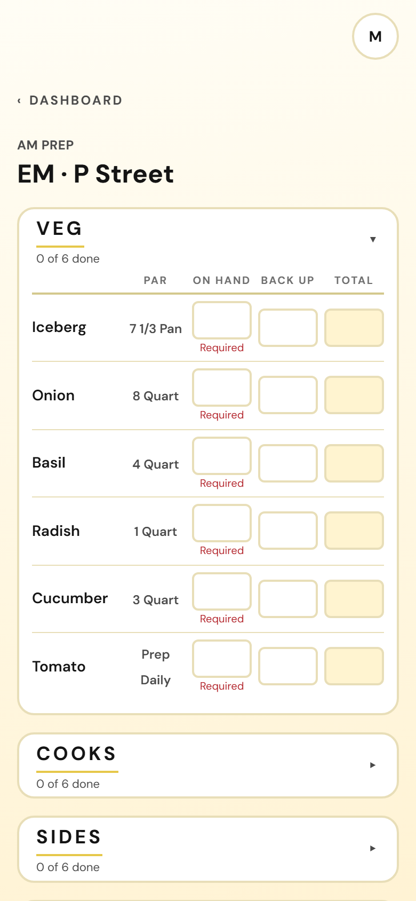

3. Open each section: Veg, Cooks, Sides, Sauces, Slicing and Misc. In the first box of each row, type how much is left. Its name depends on the section: **ON HAND** (Veg, Cooks), **PORT** (portioned, in Sides) or **LINE** (Sauces, Slicing).

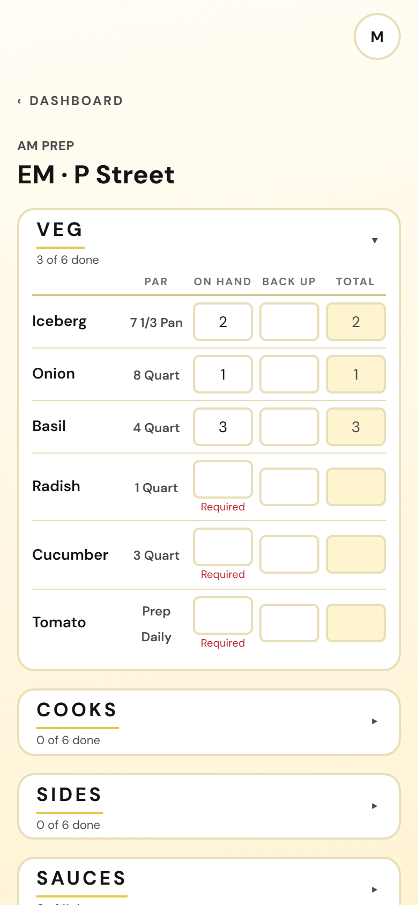

4. Is there more in a bulk container? Type it in **BACK UP**. **TOTAL** fills itself.

5. In **Misc**, answer each question with **YES** or **NO**.

6. Tap **Submit AM Prep**. A green line says "AM Prep submitted at" the time, with your name.

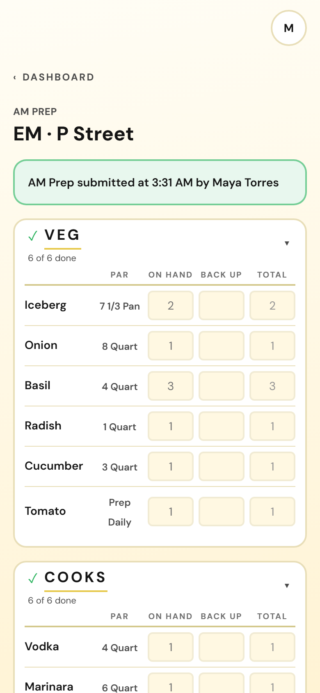

**Worth knowing**

- Every row needs an answer. An empty box says **Required** in red. **BACK UP** can stay empty.
- Until every row is filled, the button says **Fix issues before submitting**. Tap **Show me what needs fixing** to find the empty rows.
- The sheet saves as you go. The bottom of the page says "Saved". If you leave and come back, it says "Picked up where you left off".
- **Discard changes** at the bottom puts the boxes back the way they were when you opened the page.
- If it says "Closing not yet started", start the closing checklist from the dashboard. Then go back to the dashboard and tap **Continue AM Prep**. Tap **Submit AM Prep** again. Your numbers are still there.
- There is no second check. **Submit AM Prep** sends it right away.
- Sending AM prep checks the AM Prep line on the closing checklist for you.
- From 6 PM, the closing checklist shows a yellow note until AM prep is sent: "Tonight’s AM prep count isn’t in yet." Sending AM prep clears it.
- If a note says "Some items couldn't load", count the rest and send. Tell a manager the items it names.

### What the key holder does

A key holder finishes the night. Here is what they do:

- The PM report: they grade each person on the shift. Your grades show up on your **My Performance** page.
- The cash deposit: they count the drawer and sign with their PIN.
- All the walk-out lines (lights, devices, oven, doors) must be done.
- Last, they tap **Review & submit** and confirm the closing with their PIN.

### End my shift

Do this when you leave for the day.

Closers: finish your station's lines and AM prep first. **End my shift** takes your tasks and report tiles away.

1. On the dashboard, under **My shift**, tap the **My station** row to open it.

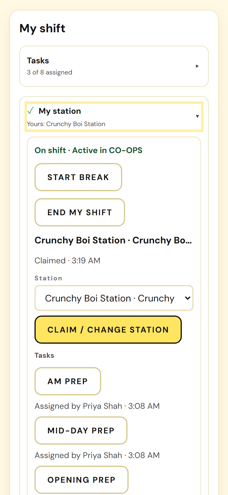

2. Tap **End my shift**.

3. A **Confirm change** box asks: "End your shift? Your station is released and your open tasks are unassigned." A reason is not needed. Leave **Reason for change** on "No reason (optional)". Tap **Confirm change**.

4. The board says "Ended shift" and the time. Your station, your tasks and the **Reports** tiles go away. **Start break** and **End my shift** go away too. The **Station** list and **Claim / change station** stay. You use them if you come back.

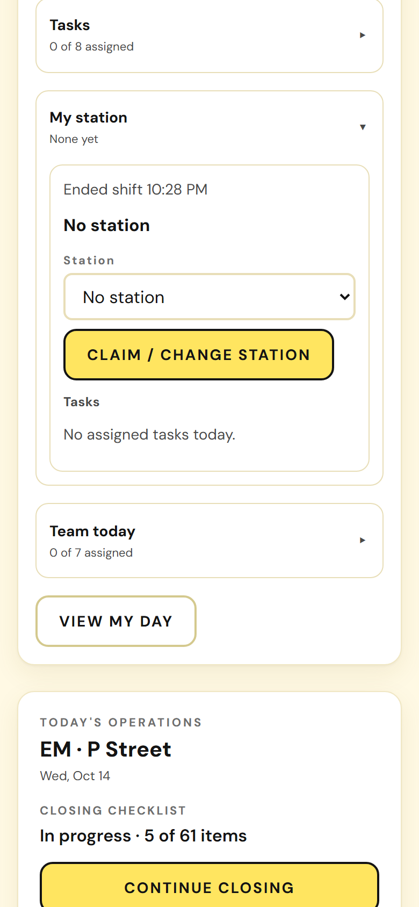

**Worth knowing**

- **End my shift** does not clock you out of Toast.
- Coming back to work? Claim a station again from the **My station** row.

### En español

En la noche terminas las tareas de cierre de tu estación. Algunas noches también haces la Lista de Prep AM. Un encargado de llaves hace los últimos pasos. Cuando te vas, terminas tu turno.

**Terminar tu estación**

Marca las últimas líneas de la sección de tu estación. Cuando todas están hechas, tu estación se cierra en el tablero. Si no pudiste terminar algo, avísale a tu encargado de llaves.

**Lista de Prep AM (el conteo de cierre)**

La Lista de Prep AM es un conteo que haces al cerrar. Cuentas lo que queda para que el equipo de la mañana sepa qué hay. El que abre ve tus números como **Conteo de cierre**. Solo la haces si te la asignan. En el tablero esta tarea se llama **Preparación de la mañana**. Es la misma Lista de Prep AM.

1. Primero empieza la lista de cierre. En el panel, en **Operaciones de hoy**, toca **Empezar cierre**. Si ya dice **Continuar cierre**, ya está empezada. Si te saltas este paso, la Lista de Prep AM no se envía.

2. En **Reportes**, en el mosaico **Lista de Prep AM**, toca **Iniciar Lista de Prep AM**.

3. Abre cada sección: Verduras, Cocidos, Acompañantes, Salsas, Rebanado y Misceláneo. En la primera casilla de cada fila, escribe cuánto queda. Su nombre depende de la sección: **EN MANO** (Verduras, Cocidos), **PORC** (porcionado, en Acompañantes) o **LÍNEA** (Salsas, Rebanado).

4. ¿Hay más en un recipiente a granel? Escríbelo en **RESPALDO**. **TOTAL** se llena solo.

5. En **Misceláneo**, contesta cada pregunta con **SÍ** o **NO**.

6. Toca **Enviar Lista de Prep AM**. Una línea verde dice "Lista de Prep AM enviada a las" con la hora y tu nombre.

**Bueno saber**

- Cada fila necesita una respuesta. Una casilla vacía dice **Obligatorio** en rojo. **RESPALDO** puede quedar vacía.
- Mientras falten filas, el botón dice **Corrige los errores antes de enviar**. Toca **Muéstrame qué hay que corregir** para encontrar las filas vacías.
- La hoja guarda mientras trabajas. Abajo de la página dice "Guardado". Si sales y regresas, dice "Retomaste donde lo dejaste".
- **Descartar cambios**, abajo, deja las casillas como estaban cuando abriste la página.
- Si dice "El cierre no ha comenzado", empieza la lista de cierre desde el panel. Luego regresa al panel y toca **Continuar Lista de Prep AM**. Toca **Enviar Lista de Prep AM** otra vez. Tus números siguen ahí.
- No hay una segunda confirmación. **Enviar Lista de Prep AM** la envía de inmediato.
- Al enviar la Lista de Prep AM, se marca sola su línea en la lista de cierre.
- Desde las 6 PM, la lista de cierre muestra una nota amarilla hasta que se envía la Lista de Prep AM: "El conteo de preparación AM de esta noche aún no está." Al enviarla, la nota se quita.
- Si sale una nota que dice "Algunos artículos no se pudieron cargar", cuenta los demás y envía. Avísale a un gerente qué artículos nombra.

**Lo que hace el encargado de llaves**

Un encargado de llaves termina la noche. Esto es lo que hace:

- El reporte PM: califica a cada persona del turno. Tus calificaciones salen en tu página **Mi Desempeño**.
- El depósito de caja: cuenta la caja y firma con su PIN.
- Las líneas de salida (luces, aparatos, horno, puertas) tienen que estar todas hechas.
- Al final, toca **Revisar y enviar** y confirma el cierre con su PIN.

**Terminar mi turno**

Hazlo cuando te vas al final del día.

Si cierras: termina primero las líneas de tu estación y la Lista de Prep AM. **Terminar mi turno** te quita tus tareas y tus mosaicos de reportes.

1. En el panel, en **Mi turno**, toca la fila **Mi estación** para abrirla.

2. Toca **Terminar mi turno**.

3. Un cuadro **Confirma el cambio** pregunta: "¿Terminar tu turno? Se libera tu estación y se quitan tus tareas abiertas." No hace falta un motivo. Deja **Motivo del cambio** en "Sin motivo (opcional)". Toca **Confirma el cambio**.

4. El tablero dice "Terminó su turno a las" y la hora. Tu estación, tus tareas y los mosaicos de **Reportes** desaparecen. **Iniciar descanso** y **Terminar mi turno** también desaparecen. La lista **Estación** y **Elegir / cambiar estación** se quedan. Las usas si vuelves.

- **Terminar mi turno** no registra tu salida en Toast.
- ¿Vuelves a trabajar? Elige otra vez una estación desde la fila **Mi estación**.

## Your stuff

These pages are about you: your team, your language, your notes, your grades, and logging out.

### Profile

Tap **Profile** in **Explore**. The page is called **Team Profiles**. It lists your teammates at your shop. Tap a name to open that person's page.

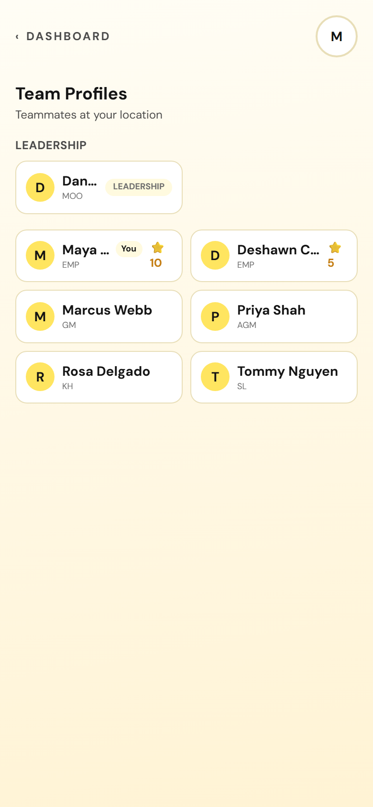

### Language

1. Tap **Settings** in **Explore**.

2. Under **Language**, tap **English** or **Español**.

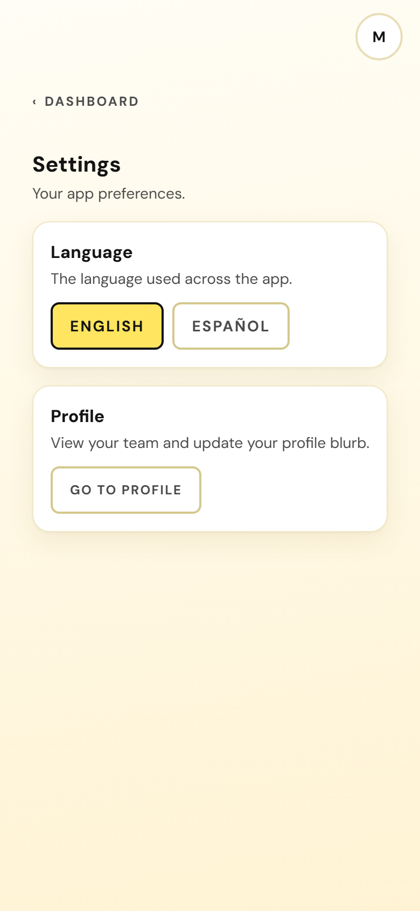

You can also tap the round button with your first letter at the top right. It shows **Language** there too.

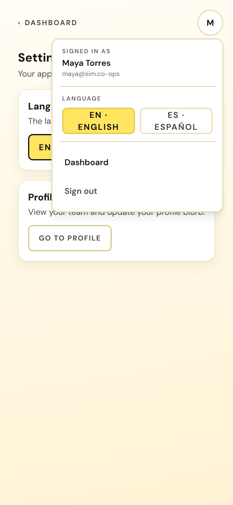

**Worth knowing**

- The login pages stay in English.
- The round button also has **Dashboard**. Use it if the way back is hard to find.

### Written reports

Use a written report for anything that has no other place in the app: a spill, waste, a problem with a delivery.

1. Tap **Written Reports** in **Explore**.

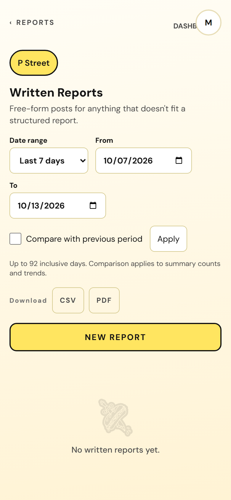

2. Tap **New report**.

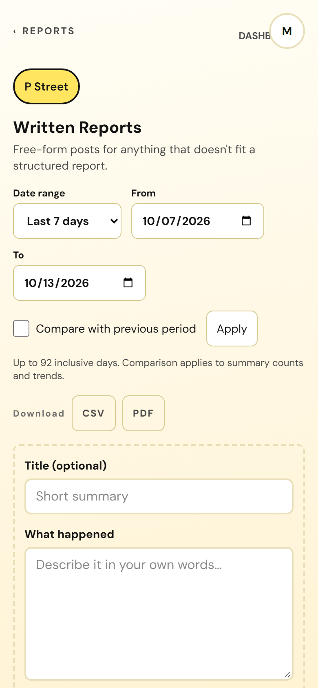

3. Type what happened in **What happened**. The title is optional.

4. Pick a **Category** if one fits.

5. Tap **Post report**. It stays grey until **What happened** has text.

**Worth knowing**

- Trainees can read written reports but can't post them.

### My Performance

Tap **My Performance** in **Explore**. It shows only your own work.

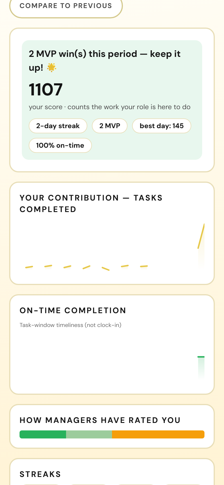

- Your score counts the work your role is here to do.
- **How managers have rated you** and **Feedback from shifts** come from the PM report: **Arrived ready**, **Attitude**, **Production** and **Team player**, plus MVP.
- The bell shows "New shift feedback" when a new PM report grades you.
- A manager's private notes never show here.
- Pick dates at the top to see a different time.

### Log out

Tap **Log out** at the very bottom of the dashboard. You can also tap **Sign out** in the round button at the top right. You land back on **Where are you?**

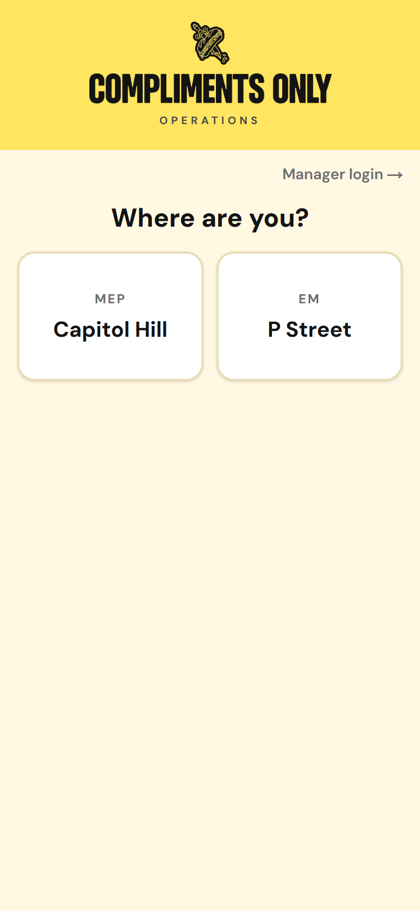

**Worth knowing**

- Log out every time you leave the phone or tablet. Anything tapped while you are logged in counts as yours.
- If you forget, the app logs you out after 10 minutes with no taps.

### En español

Estas páginas son sobre ti: tu equipo, tu idioma, tus notas, tus calificaciones y cómo cerrar sesión.

**Perfil**

Toca **Perfil** en **Explorar**. La página se llama **Perfiles del Equipo**. Muestra a tus compañeros de tu tienda. Toca un nombre para abrir la página de esa persona.

**Idioma**

1. Toca **Configuración** en **Explorar**.

2. En **Idioma**, toca **English** o **Español**.

También puedes tocar el botón redondo con tu inicial, arriba a la derecha. Ahí también sale **Idioma**.

- Las páginas de entrada siguen en inglés.
- El botón redondo también tiene **Panel**. Úsalo si no encuentras cómo regresar.

**Reportes escritos**

Usa un reporte escrito para lo que no tiene otro lugar en la app: algo que se derramó, desperdicio, un problema con una entrega.

1. Toca **Reportes escritos** en **Explorar**.

2. Toca **Nuevo reporte**.

3. Escribe lo que pasó en **Qué pasó**. El título es opcional.

4. Elige una **Categoría** si alguna te sirve.

5. Toca **Publicar reporte**. Sigue gris hasta que **Qué pasó** tenga texto.

- Los aprendices pueden leer los reportes escritos, pero no publicarlos.

**Mi Desempeño**

Toca **Mi Desempeño** en **Explorar**. Solo muestra tu propio trabajo.

- Tu puntaje cuenta el trabajo que tu puesto debe hacer.
- **Cómo te han calificado los gerentes** y **Comentarios de turnos** salen del reporte PM: **Llegó listo**, **Actitud**, **Producción** y **Trabajo en equipo**, más el MVP.
- La campana muestra "Nuevo comentario de turno" cuando un reporte PM nuevo te califica.
- Las notas privadas de un gerente nunca salen aquí.
- Elige fechas arriba para ver otro periodo.

**Cerrar sesión**

Toca **Cerrar sesión** hasta abajo del panel. También puedes tocar **Cerrar sesión** en el botón redondo de arriba a la derecha. Regresas a la página **Where are you?**

- Cierra sesión cada vez que dejes el teléfono o la tablet. Todo lo que se toque mientras tu sesión está abierta cuenta como tuyo.
- Si se te olvida, la app cierra tu sesión después de 10 minutos sin tocar nada.
